# Atlas Part 9: Foundations

## Status

**Derived view, not canon. Generated; don't edit by hand.** Edit [`foundations.json`](foundations.json), then run `python3 atlas/tools/atlas_part.py` from the repository root. That rebuilds this page, the [image](foundations.png) of this part, and the [combined board](../board/README.md) (interactive: https://claude.ai/artifact/XG2oKvVRes6f7su2dyMaWs). Every thing links to the wiki page it comes from; the wiki wins any disagreement. Part of the [Atlas](../README.md); plan in [PLAN.md](../PLAN.md).

What the world is and the rules everything else follows: the World Overview (the world, the political order, the story's three scales, the core themes), all twenty World Rules, how every supernatural claim is judged, and the character design rule.

This part gets its own first column, Foundations: start here. Its rules connect to the things they name (the regions, the Council, the Villain, Wurdren, the institutions, magic); rules that govern whole parts without naming a thing (language, food, architecture, names) have no connections.

**Counts:** 3 overviews, 3 story scales, 20 world rules, 5 supernatural claims, 1 writing guide; 30 connections (27 stated in the wiki, 3 inferred).

## Gaps this part exposes

Things the wiki doesn't settle yet. Listed for the author to decide; nothing here was filled in.

- World Overview and World Rules, the two pages everything else hangs on, carry no status label.
- The setting is "currently called" Two Sons (for its twin suns); the final name isn't settled on the page.
- Rules 2, 6, 13–19 govern whole areas (geography, technology, culture, language, food, architecture, names, violence) without naming a specific thing, so they have no connections on the board.
- Trade and Dependencies and Current Events each give an example chain of knock-on effects (10 steps and 13 steps); they are similar but not the same chain.

## World rules

| From | Connection | To | Basis | Supporting text |
| --- | --- | --- | --- | --- |
| 1. Regions are ecosystems, not gimmicks | warns against reducing | Ironcrest | stated | “reduce Ironcrest to mines, Greenvale to farms, Northwind to fish, Deepwood to trees, Highridge to caravans, or Sunplains to vineyards” [source](../../wiki/World-Rules.md#1-regions-are-ecosystems-not-gimmicks) |
| 1. Regions are ecosystems, not gimmicks | warns against reducing | Greenvale | stated | “reduce Ironcrest to mines, Greenvale to farms, Northwind to fish, Deepwood to trees, Highridge to caravans, or Sunplains to vineyards” [source](../../wiki/World-Rules.md#1-regions-are-ecosystems-not-gimmicks) |
| 1. Regions are ecosystems, not gimmicks | warns against reducing | Northwind | stated | “reduce Ironcrest to mines, Greenvale to farms, Northwind to fish, Deepwood to trees, Highridge to caravans, or Sunplains to vineyards” [source](../../wiki/World-Rules.md#1-regions-are-ecosystems-not-gimmicks) |
| 1. Regions are ecosystems, not gimmicks | warns against reducing | Deepwood | stated | “reduce Ironcrest to mines, Greenvale to farms, Northwind to fish, Deepwood to trees, Highridge to caravans, or Sunplains to vineyards” [source](../../wiki/World-Rules.md#1-regions-are-ecosystems-not-gimmicks) |
| 1. Regions are ecosystems, not gimmicks | warns against reducing | Highridge Plateau | stated | “reduce Ironcrest to mines, Greenvale to farms, Northwind to fish, Deepwood to trees, Highridge to caravans, or Sunplains to vineyards” [source](../../wiki/World-Rules.md#1-regions-are-ecosystems-not-gimmicks) |
| 1. Regions are ecosystems, not gimmicks | warns against reducing | Sunplains | stated | “reduce Ironcrest to mines, Greenvale to farms, Northwind to fish, Deepwood to trees, Highridge to caravans, or Sunplains to vineyards” [source](../../wiki/World-Rules.md#1-regions-are-ecosystems-not-gimmicks) |
| 3. Borders are gradients | likely shapes | Border-town culture | inferred | “Border areas should show mixed food, building methods, accents, family ties, religious practice, law, tools, and loyalties.” [source](../../wiki/World-Rules.md#3-borders-are-gradients) |
| 4. History is messy | governs | Before the Convergence | stated | “Pre-Convergence history must contain temporary victories, reversals, disputed claims” [source](../../wiki/World-Rules.md#4-history-is-messy) |
| 4. History is messy | likely governs | Contested memory | inferred | “contradictory memories” [source](../../wiki/World-Rules.md#4-history-is-messy) |
| 5. Low fantasy means material limits matter | limits | Magic and relics | stated | “Magic cannot erase logistics.” [source](../../wiki/World-Rules.md#5-low-fantasy-means-material-limits-matter) |
| 7. Magic is scarce, uncertain, limited, or costly | is answered by | Magic and relics | stated | “Settled for Two Sons as real but deniable” [source](../../wiki/World-Rules.md#7-magic-is-scarce-uncertain-limited-or-costly) |
| 8. Institutions have constituencies | applies to | How governments behave | stated | “No kingdom, guild, religion, council family, or criminal organization acts as one mind.” [source](../../wiki/World-Rules.md#8-institutions-have-constituencies) |
| 8. Institutions have constituencies | applies to | Guilds | stated | “No kingdom, guild, religion, council family, or criminal organization acts as one mind.” [source](../../wiki/World-Rules.md#8-institutions-have-constituencies) |
| 8. Institutions have constituencies | applies to | The nine faiths | stated | “No kingdom, guild, religion, council family, or criminal organization acts as one mind.” [source](../../wiki/World-Rules.md#8-institutions-have-constituencies) |
| 8. Institutions have constituencies | applies to | The Council houses | stated | “No kingdom, guild, religion, council family, or criminal organization acts as one mind.” [source](../../wiki/World-Rules.md#8-institutions-have-constituencies) |
| 8. Institutions have constituencies | applies to | The underworld | stated | “No kingdom, guild, religion, council family, or criminal organization acts as one mind.” [source](../../wiki/World-Rules.md#8-institutions-have-constituencies) |
| 9. The Council controls dependencies, not minds | constrains | The Economic Council | stated | “The Council cannot simply order the world to obey.” [source](../../wiki/World-Rules.md#9-the-council-controls-dependencies-not-minds) |
| 10. The Villain's schemes must survive ordinary scrutiny | constrains | The Villain | stated | “His plans work because people have independent reasons to take each step.” [source](../../wiki/World-Rules.md#10-the-villains-schemes-must-survive-ordinary-scrutiny) |
| 11. Wurdren does not win by becoming the biggest power | constrains | Wurdren | stated | “His narrative function is strongest when his influence comes from relationships, credibility, persistence, compassion, local knowledge, and consequences of previous choices.” [source](../../wiki/World-Rules.md#11-wurdren-does-not-win-by-becoming-the-biggest-power) |
| 12. Every major event should have second- and third-order effects | likely governs | Current events | inferred | “Every major event should have second- and third-order effects” [source](../../wiki/World-Rules.md#12-every-major-event-should-have-second--and-third-order-effects) |
| 20. The world exists when the protagonists are absent | constrains | Wurdren | stated | “A town may solve its own problem before Wurdren arrives.” [source](../../wiki/World-Rules.md#20-the-world-exists-when-the-protagonists-are-absent) |

## The story's three scales

| From | Connection | To | Basis | Supporting text |
| --- | --- | --- | --- | --- |
| The Council: system | is the story scale of | The Economic Council | stated | “The Council believes unmanaged competition will eventually return the world to pre-Convergence violence.” [source](../../wiki/World-Overview.md#the-council--system) |
| The Villain: strategy | is the story scale of | The Villain | stated | “The Villain sees the Council's order as a cage.” [source](../../wiki/World-Overview.md#the-villain--strategy) |
| Wurdren: people | is the story scale of | Wurdren | stated | “Wurdren is an aging adventurer whose life is not defined by command of armies or secret institutions.” [source](../../wiki/World-Overview.md#wurdren--people) |
| The political order | describes | The Economic Council | stated | “Above and through this visible order operates the **Economic Council**” [source](../../wiki/World-Overview.md#the-political-order) |

## Supernatural claims

| From | Connection | To | Basis | Supporting text |
| --- | --- | --- | --- | --- |
| Moral relics and artifacts | is judged under | Magic and relics | stated | “**Real but deniable**, as above.” [source](../../wiki/Magic.md#everything-else-that-has-been-claimed) |
| "Illusions" | is judged under | Magic and relics | stated | “**Legend and stagecraft.**” [source](../../wiki/Magic.md#everything-else-that-has-been-claimed) |
| Special creatures | is judged under | Magic and relics | stated | “**Animals, misidentified.**” [source](../../wiki/Magic.md#everything-else-that-has-been-claimed) |
| Spirits, ancestors, aurora omens | is judged under | Magic and relics | stated | “Treated as faith and custom, never as proof” [source](../../wiki/Magic.md#everything-else-that-has-been-claimed) |
| Mystical armies, forest mages, living-root peoples | is judged under | Magic and relics | stated | “They conflict with the low-fantasy frame and aren't carried forward.” [source](../../wiki/Magic.md#everything-else-that-has-been-claimed) |

## Diagram

Stated connections only; positions are automatic. The [interactive board](../board/README.md) is easier to read.

```mermaid
flowchart LR
  wf_scale_council["The Council: system"]
  pw_council["The Economic Council"]
  wf_scale_villain["The Villain: strategy"]
  pp_villain["The Villain"]
  wf_scale_wurdren["Wurdren: people"]
  pp_wurdren["Wurdren"]
  wf_order["The political order"]
  wf_rule_1["1. Regions are ecosystems, not gimmicks"]
  ironcrest(["Ironcrest"])
  greenvale(["Greenvale"])
  northwind(["Northwind"])
  deepwood(["Deepwood"])
  highridge(["Highridge Plateau"])
  sunplains(["Sunplains"])
  wf_rule_4["4. History is messy"]
  hi_before["Before the Convergence"]
  wf_rule_5["5. Low fantasy means material limits matter"]
  pw_magic["Magic and relics"]
  wf_rule_7["7. Magic is scarce, uncertain, limited, or costly"]
  wf_rule_8["8. Institutions have constituencies"]
  pw_politics["How governments behave"]
  pw_guilds["Guilds"]
  pw_faiths["The nine faiths"]
  pp_families["The Council houses"]
  pw_underworld["The underworld"]
  wf_rule_9["9. The Council controls dependencies, not minds"]
  wf_rule_10["10. The Villain's schemes must survive ordinary scrutiny"]
  wf_rule_11["11. Wurdren does not win by becoming the biggest power"]
  wf_rule_20["20. The world exists when the protagonists are absent"]
  wf_claim_relics["Moral relics and artifacts"]
  wf_claim_illusions["'Illusions'"]
  wf_claim_creatures["Special creatures"]
  wf_claim_spirits["Spirits, ancestors, aurora omens"]
  wf_claim_removed["Mystical armies, forest mages, living-root peoples"]
  wf_scale_council --> pw_council
  wf_scale_villain --> pp_villain
  wf_scale_wurdren --> pp_wurdren
  wf_order --> pw_council
  wf_rule_1 --> ironcrest
  wf_rule_1 --> greenvale
  wf_rule_1 --> northwind
  wf_rule_1 --> deepwood
  wf_rule_1 --> highridge
  wf_rule_1 --> sunplains
  wf_rule_4 --> hi_before
  wf_rule_5 --> pw_magic
  wf_rule_7 --> pw_magic
  wf_rule_8 --> pw_politics
  wf_rule_8 --> pw_guilds
  wf_rule_8 --> pw_faiths
  wf_rule_8 --> pp_families
  wf_rule_8 --> pw_underworld
  wf_rule_9 --> pw_council
  wf_rule_10 --> pp_villain
  wf_rule_11 --> pp_wurdren
  wf_rule_20 --> pp_wurdren
  wf_claim_relics --> pw_magic
  wf_claim_illusions --> pw_magic
  wf_claim_creatures --> pw_magic
  wf_claim_spirits --> pw_magic
  wf_claim_removed --> pw_magic
```

## Every thing in this part

Grouped by board column.

### Foundations

| Thing | Kind | Status | Summary |
| --- | --- | --- | --- |
| [The world](../../wiki/World-Overview.md#the-world) | Overview | No status label | The setting is currently called Two Sons, named for its twin suns. It should feel materially recognizable: people farm, fish, mine, build, trade, travel, worship, fight, negotiate, borrow money, inherit property, join guilds, smuggle goods, raise families and remember old wars. Fantasy exists, but it doesn't replace those realities. |
| [The political order](../../wiki/World-Overview.md#the-political-order) | Overview | No status label | The present world exists in the shadow of The Convergence, which turned centuries of shifting frontiers, raids, petty kingdoms, warbands, toll states, clan confederacies and temporary conquests into recognized borders and rules for trade and dispute. It didn't create perfect peace: it made conflict more expensive, more political and more indirect. |
| [The Council: system](../../wiki/World-Overview.md#the-council--system) | Story scale | No status label | It believes unmanaged competition will eventually return the world to pre-Convergence violence, so it adjusts credit, food movement, route access, construction, resource supply and information to keep any one kingdom, guild or coalition from becoming dangerously dominant. |
| [The Villain: strategy](../../wiki/World-Overview.md#the-villain--strategy) | Story scale | No status label | He sees the Council's order as a cage. His people or cause have been denied something he regards as necessary and just (safety, territory, autonomy, dignity or political recognition), and he concludes the Council will never voluntarily allow the change he seeks. So he attacks the relationships holding the world together. He does not simply invade. He creates conditions in which kingdoms, guilds, religious groups and ordinary people make choices that advance his plan for reasons that make sense to them. |
| [Wurdren: people](../../wiki/World-Overview.md#wurdren--people) | Story scale | No status label | An aging adventurer whose life isn't defined by command of armies or secret institutions. He encounters consequences (a town that lost its grain, a caravan that didn't arrive, workers caught between a guild and an owner, refugees from a border incident, a religious dispute turned violent), solves immediate human problems, and repeatedly changes the larger game without understanding it at first. |
| [Core themes](../../wiki/World-Overview.md#core-themes) | Overview | No status label | Interconnection and unintended consequences; stability versus freedom; ends versus means; systems, strategies and lived experience; history inherited unevenly; identity without monoculture; blending at borders; the power and danger of institutions that genuinely solve problems; and ordinary decency as politically consequential. |
| [1. Regions are ecosystems, not gimmicks](../../wiki/World-Rules.md#1-regions-are-ecosystems-not-gimmicks) | World rule | No status label | Give regions environmental and historical emphases, and remember ordinary economic diversity exists everywhere. A region's famous specialty is what outsiders notice first, not all that exists there. |
| [2. Geography must cause culture without dictating it](../../wiki/World-Rules.md#2-geography-must-cause-culture-without-dictating-it) | World rule | No status label | Climate, soils, rivers, coasts, elevation, forests, mineral deposits and routes create pressures; human history decides how people respond. |
| [3. Borders are gradients](../../wiki/World-Rules.md#3-borders-are-gradients) | World rule | No status label | Political borders became clearer after The Convergence, but culture doesn't stop at a line on a map. |
| [4. History is messy](../../wiki/World-Rules.md#4-history-is-messy) | World rule | No status label | Pre-Convergence history must contain temporary victories, reversals, disputed claims, marriages, defections, raids, trade agreements, migrations, local exceptions and contradictory memories. |
| [5. Low fantasy means material limits matter](../../wiki/World-Rules.md#5-low-fantasy-means-material-limits-matter) | World rule | No status label | Travel takes time. Food spoils. Roads wash out. Animals tire. Messages arrive late. Iron rusts. Winter closes routes. Armies need food. |
| [6. Technology is craft-scale and pre-industrial](../../wiki/World-Rules.md#6-technology-is-craft-scale-and-pre-industrial) | World rule | No status label | Hand tools, animal, water and wind power, pulleys, screws, mills, kilns, presses, furnaces, boats, carts, roads, irrigation, fortification, and paper and record systems where appropriate. |
| [7. Magic is scarce, uncertain, limited, or costly](../../wiki/World-Rules.md#7-magic-is-scarce-uncertain-limited-or-costly) | World rule | No status label | Magic should feel like one more difficult property of the world, not a universal convenience. Settled as real but deniable. |
| [8. Institutions have constituencies](../../wiki/World-Rules.md#8-institutions-have-constituencies) | World rule | No status label | No kingdom, guild, religion, council family or criminal organization acts as one mind. |
| [9. The Council controls dependencies, not minds](../../wiki/World-Rules.md#9-the-council-controls-dependencies-not-minds) | World rule | No status label | The Council can't simply order the world to obey. Its plans can fail. |
| [10. The Villain's schemes must survive ordinary scrutiny](../../wiki/World-Rules.md#10-the-villains-schemes-must-survive-ordinary-scrutiny) | World rule | No status label | His plans work because people have independent reasons to take each step. Avoid schemes that require everyone else to become stupid. |
| [11. Wurdren does not win by becoming the biggest power](../../wiki/World-Rules.md#11-wurdren-does-not-win-by-becoming-the-biggest-power) | World rule | No status label | His narrative function is strongest when his influence comes from relationships, credibility, persistence, compassion, local knowledge and the consequences of previous choices. |
| [12. Every major event should have second- and third-order effects](../../wiki/World-Rules.md#12-every-major-event-should-have-second--and-third-order-effects) | World rule | No status label | Ask what happens immediately, who pays, who unexpectedly benefits, what becomes scarce, what route changes and what rumor spreads. |
| [13. Culture is learned, contested, and changing](../../wiki/World-Rules.md#13-culture-is-learned-contested-and-changing) | World rule | No status label | Younger border populations, migrants, merchants, soldiers, pilgrims, mixed families and urban populations should often combine practices older generations consider incompatible. |
| [14. Draw globally, copy nowhere whole](../../wiki/World-Rules.md#14-draw-globally-copy-nowhere-whole) | World rule | No status label | Real cultures are inspiration pools, not templates. |
| [15. Language affects habits of attention, not intelligence](../../wiki/World-Rules.md#15-language-affects-habits-of-attention-not-intelligence) | World rule | No status label | Regional languages may make certain distinctions habitual: inclusive/exclusive "we", social status, evidence source, completed or ongoing action, animate/inanimate categories, certainty, direction or kin. |
| [16. Food must follow ecology, trade, class, season, and preservation](../../wiki/World-Rules.md#16-food-must-follow-ecology-trade-class-season-and-preservation) | World rule | No status label | There's no single "Ironcrest cuisine" eaten identically by miners, nobles, farmers, children and merchants. |
| [17. Architecture is accumulated history](../../wiki/World-Rules.md#17-architecture-is-accumulated-history) | World rule | No status label | A city should contain old walls, reused foundations, additions, rebuilt burned districts, foreign quarters, guild construction, poor improvisation, elite fashion and border influence. |
| [18. Names need etymological logic](../../wiki/World-Rules.md#18-names-need-etymological-logic) | World rule | No status label | Settlement names may come from geography, founders, old peoples, industries, sacred events, rulers, directions, markets, forts, bridges, rivers or older languages. |
| [19. Violence changes societies](../../wiki/World-Rules.md#19-violence-changes-societies) | World rule | No status label | Wars produce widows, missing heirs, debts, veterans, ruins, refugees, border minorities, abandoned roads, trauma, legends, land claims, taxes and political institutions. |
| [20. The world exists when the protagonists are absent](../../wiki/World-Rules.md#20-the-world-exists-when-the-protagonists-are-absent) | World rule | No status label | Guild elections continue. Religious debates continue. Crime changes. Children grow up. Crops fail. Roads are repaired. Families marry across borders. |
| [Moral relics and artifacts](../../wiki/Magic.md#everything-else-that-has-been-claimed) | Supernatural claim | Working canon | Real but deniable. A handful of old community relics with small, moral effects (a lantern that dims at lies, ink that smudges on a dishonest contract); every effect has a plausible ordinary explanation within reach and the story never confirms it. |
| ["Illusions"](../../wiki/Magic.md#everything-else-that-has-been-claimed) | Supernatural claim | Working canon | Legend and stagecraft. Veils, dream-knives, refracted lights, sects that saw through lies: stories told about vanished sects and old relics. In the present, illusions are rumor, performance or fraud. |
| [Special creatures](../../wiki/Magic.md#everything-else-that-has-been-claimed) | Supernatural claim | Working canon | Animals, misidentified. Sea monsters, drakes, forest beasts: real animals, rare or strange ones included, seen badly and retold well. Underpass "monsters" are ecological disruption. |
| [Spirits, ancestors, aurora omens](../../wiki/Magic.md#everything-else-that-has-been-claimed) | Supernatural claim | Working canon | Belief. Treated as faith and custom, never as proof. |
| [Mystical armies, forest mages, living-root peoples](../../wiki/Magic.md#everything-else-that-has-been-claimed) | Supernatural claim | Working canon | Removed. From earlier notes. They conflict with the low-fantasy frame and aren't carried forward. |
| [Character design rule](../../wiki/Story/Character-Roster.md#character-design-rule) | Writing guide | No status label | A useful recurring pattern for memorable characters, and a reminder that the world needs ordinary people too. Don't make every memorable character an assassin, mastermind or secret noble. |

**The world**

- *Principle:* Fantasy exists, but it doesn't replace material realities: farming, fishing, mining, building, trade, travel, worship, war, negotiation, debt, inheritance, guilds, smuggling, families and memories of old wars. ([source](../../wiki/World-Overview.md#the-world))
- *Scope:* Three broad landmasses (the Western, Northern and Eastern Continents); a central mountain system, The Spine; The Underpass beneath parts of it; Port, the major neutral commercial city; and six major cultural-political regions: Ironcrest, Northwind, Greenvale, Highridge Plateau, Deepwood and Sunplains. ([source](../../wiki/World-Overview.md#the-world))
- *Rule:* The regions' descriptions are emphases, not total definitions. Greenvale has smiths. Ironcrest has farms. Northwind has inland villages. Sunplains has poor laborers and dry pastoral country beyond wealthy orchard belts. Deepwood has market towns and politics. Highridge has families who never see a caravan. ([source](../../wiki/World-Overview.md#the-world))

**The political order**

- *Principle:* The Convergence did not create perfect peace. It made conflict more expensive, more political and more indirect. ([source](../../wiki/World-Overview.md#the-political-order))
- *Scope:* Kings, city councils, clan leaders, local assemblies, noble houses, guilds, temples, financiers, merchant families, criminal syndicates and village authorities all still possess real power. ([source](../../wiki/World-Overview.md#the-political-order))
- *Council:* Above and through this visible order operates the Economic Council: wealthy trans-regional families whose power comes from controlling systems the kingdoms depend on, rather than from owning one kingdom apiece. Their current working domains are food, materials, routes, infrastructure, finance, and knowledge/information. ([source](../../wiki/World-Overview.md#the-political-order))

**The Council: system**

- *How it acts:* It believes unmanaged competition will eventually return the world to pre-Convergence violence, so it adjusts credit, food movement, route access, construction, resource supply and information to keep any one kingdom, guild or coalition from becoming dangerously dominant. ([source](../../wiki/World-Overview.md#the-council--system))
- *At its heart:* Central contradiction: it preserves peace by denying other people the ability to choose freely. ([source](../../wiki/World-Overview.md#the-council--system))

**The Villain: strategy**

- *How it acts:* He sees the Council's order as a cage. His people or cause have been denied something he regards as necessary and just (safety, territory, autonomy, dignity or political recognition), and he concludes the Council will never voluntarily allow the change he seeks. So he attacks the relationships holding the world together. He does not simply invade. He creates conditions in which kingdoms, guilds, religious groups and ordinary people make choices that advance his plan for reasons that make sense to them. ([source](../../wiki/World-Overview.md#the-villain--strategy))
- *At its heart:* Central contradiction: he seeks liberation by manipulating people as ruthlessly as the system he hates. ([source](../../wiki/World-Overview.md#the-villain--strategy))

**Wurdren: people**

- *How it acts:* An aging adventurer whose life isn't defined by command of armies or secret institutions. He encounters consequences (a town that lost its grain, a caravan that didn't arrive, workers caught between a guild and an owner, refugees from a border incident, a religious dispute turned violent), solves immediate human problems, and repeatedly changes the larger game without understanding it at first. ([source](../../wiki/World-Overview.md#wurdren--people))
- *At its heart:* Central idea: the great powers treat suffering as an abstraction; Wurdren keeps making it specific. ([source](../../wiki/World-Overview.md#wurdren--people))

**Core themes**

- *Principle:* *Not in the wiki yet.*
- *Scope:* *Not in the wiki yet.*
- *Themes:* Interconnection and unintended consequences. Stability versus freedom. Ends versus means. The difference between systems, strategies and lived human experience. History as something people inherit unevenly. Regional identity without monoculture. Cultural blending at borders, ports, roads, markets, religious networks and among younger generations. The power and danger of institutions that genuinely solve problems. Ordinary decency as something politically consequential even when it isn't politically motivated. ([source](../../wiki/World-Overview.md#core-themes))

**1. Regions are ecosystems, not gimmicks**

- *Detail:* Don't reduce Ironcrest to mines, Greenvale to farms, Northwind to fish, Deepwood to trees, Highridge to caravans, or Sunplains to vineyards. ([source](../../wiki/World-Rules.md#1-regions-are-ecosystems-not-gimmicks))

**2. Geography must cause culture without dictating it**

- *Detail:* Two communities facing similar conditions may develop different solutions because of law, religion, language, past disasters or political organization. ([source](../../wiki/World-Rules.md#2-geography-must-cause-culture-without-dictating-it))

**3. Borders are gradients**

- *Detail:* Border areas should show mixed food, building methods, accents, family ties, religious practice, law, tools and loyalties. ([source](../../wiki/World-Rules.md#3-borders-are-gradients))

**4. History is messy**

- *Detail:* Avoid "Region A defeated Region B and owned this land until the Convergence." Prefer: three valleys changed hands repeatedly; one town paid taxes to two rulers; one lineage still claims a field it hasn't controlled for 140 years. ([source](../../wiki/World-Rules.md#4-history-is-messy))

**5. Low fantasy means material limits matter**

- *Detail:* Disease and injury matter. Building something large requires labor, money, timber, stone, tools and political permission. Magic cannot erase logistics. ([source](../../wiki/World-Rules.md#5-low-fantasy-means-material-limits-matter))

**6. Technology is craft-scale and pre-industrial**

- *Detail:* Avoid steam-age machinery, modern manufacturing logic, magical equivalents of electricity, or implausibly cheap precision. ([source](../../wiki/World-Rules.md#6-technology-is-craft-scale-and-pre-industrial))

**7. Magic is scarce, uncertain, limited, or costly**

- *Detail:* When magic appears, define who can use it, how reliable it is, what it costs, why it hasn't transformed every industry, and how ordinary people understand or misunderstand it. Answered on Magic and Relics. ([source](../../wiki/World-Rules.md#7-magic-is-scarce-uncertain-limited-or-costly))

**8. Institutions have constituencies**

- *Detail:* Every institution should contain beneficiaries, critics, careerists, true believers, reformers, people trapped by necessity, and regional branches with different priorities. ([source](../../wiki/World-Rules.md#8-institutions-have-constituencies))

**9. The Council controls dependencies, not minds**

- *Detail:* It works through credit, contracts, monopolies, shortages, storage, shipping, construction, insurance-like arrangements, information, patronage, guild politics and elite relationships. ([source](../../wiki/World-Rules.md#9-the-council-controls-dependencies-not-minds))

**10. The Villain's schemes must survive ordinary scrutiny**

- *Detail:* A manipulated king still thinks he is defending a border. A guild still thinks it is protecting members. A religious leader still thinks the issue matters spiritually. A smuggler still wants profit. ([source](../../wiki/World-Rules.md#10-the-villains-schemes-must-survive-ordinary-scrutiny))

**11. Wurdren does not win by becoming the biggest power**

- *Detail:* If he becomes another master strategist moving nations like pieces, the story loses its most important contrast. ([source](../../wiki/World-Rules.md#11-wurdren-does-not-win-by-becoming-the-biggest-power))

**12. Every major event should have second- and third-order effects**

- *Detail:* Then: which guild reacts, which faith interprets it, which criminal group exploits it, what the Council does, how the Villain can use that response, and what Wurdren encounters on the ground. ([source](../../wiki/World-Rules.md#12-every-major-event-should-have-second--and-third-order-effects))

**13. Culture is learned, contested, and changing**

- *Detail:* "Traditional culture" itself should contain multiple traditions. ([source](../../wiki/World-Rules.md#13-culture-is-learned-contested-and-changing))

**14. Draw globally, copy nowhere whole**

- *Detail:* Borrow solutions to similar human problems (high-altitude housing, irrigation, clan law, fishing preservation, courtyard living, mobile pastoralism, market institutions, oral history), then recombine them according to this world's own history. ([source](../../wiki/World-Rules.md#14-draw-globally-copy-nowhere-whole))

**15. Language affects habits of attention, not intelligence**

- *Detail:* Don't claim grammar makes a people inherently rational, emotional, peaceful, collectivist or superior. ([source](../../wiki/World-Rules.md#15-language-affects-habits-of-attention-not-intelligence))

**16. Food must follow ecology, trade, class, season, and preservation**

- *Detail:* Show regional families of food, then class and local variation. ([source](../../wiki/World-Rules.md#16-food-must-follow-ecology-trade-class-season-and-preservation))

**17. Architecture is accumulated history**

- *Detail:* Don't design an entire region in one architectural style. ([source](../../wiki/World-Rules.md#17-architecture-is-accumulated-history))

**18. Names need etymological logic**

- *Detail:* Names should often preserve history no longer visible. ([source](../../wiki/World-Rules.md#18-names-need-etymological-logic))

**19. Violence changes societies**

- *Detail:* Don't use wars only to decorate timelines. ([source](../../wiki/World-Rules.md#19-violence-changes-societies))

**20. The world exists when the protagonists are absent**

- *Detail:* A town may solve its own problem before Wurdren arrives. No faction should feel as though it waits offstage for the plot. ([source](../../wiki/World-Rules.md#20-the-world-exists-when-the-protagonists-are-absent))

**Moral relics and artifacts**

- *Disposition:* Real but deniable ([source](../../wiki/Magic.md#everything-else-that-has-been-claimed))
- *Detail:* A handful of old community relics with small, moral effects (a lantern that dims at lies, ink that smudges on a dishonest contract); every effect has a plausible ordinary explanation within reach and the story never confirms it. ([source](../../wiki/Magic.md#the-decision))

**"Illusions"**

- *Disposition:* Legend and stagecraft ([source](../../wiki/Magic.md#everything-else-that-has-been-claimed))
- *Detail:* Veils, dream-knives, refracted lights, sects that saw through lies: stories told about vanished sects and old relics. In the present, illusions are rumor, performance or fraud. ([source](../../wiki/Magic.md#everything-else-that-has-been-claimed))

**Special creatures**

- *Disposition:* Animals, misidentified ([source](../../wiki/Magic.md#everything-else-that-has-been-claimed))
- *Detail:* Sea monsters, drakes, forest beasts: real animals, rare or strange ones included, seen badly and retold well. Underpass "monsters" are ecological disruption. ([source](../../wiki/Magic.md#everything-else-that-has-been-claimed))

**Spirits, ancestors, aurora omens**

- *Disposition:* Belief ([source](../../wiki/Magic.md#everything-else-that-has-been-claimed))
- *Detail:* Treated as faith and custom, never as proof. ([source](../../wiki/Magic.md#everything-else-that-has-been-claimed))

**Mystical armies, forest mages, living-root peoples**

- *Disposition:* Removed ([source](../../wiki/Magic.md#everything-else-that-has-been-claimed))
- *Detail:* From earlier notes. They conflict with the low-fantasy frame and aren't carried forward. ([source](../../wiki/Magic.md#everything-else-that-has-been-claimed))

**Character design rule**

- *Pattern:* 1. memorable introduction; 2. motivation rooted in history or ideology; 3. exceptional but plausible competence; 4. connection to larger systems; 5. personal code; 6. distinctive method; 7. relationship to a protagonist or faction; 8. plan with consequences; 9. capacity to recur or change. ([source](../../wiki/Story/Character-Roster.md#character-design-rule))
- *The world also needs:* Clerks, cooks, builders, caravan hands, priests, teachers, farmers, sailors, shopkeepers, labor organizers, criminals, children, minor officials, refugees, and people who want nothing to do with the main plot. ([source](../../wiki/Story/Character-Roster.md#character-design-rule))

