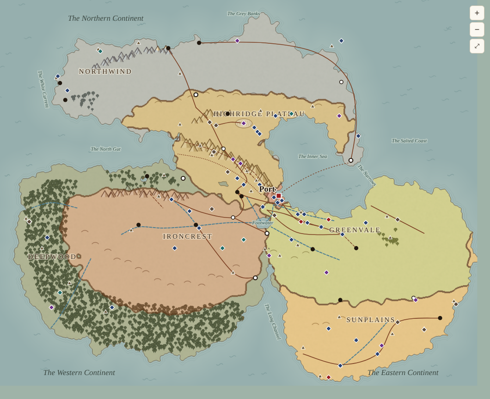

# Lore map

<!-- Generated by atlas/tools/map_draft.py from map-draft.json. Edit the data, not this page. -->

## Status

**First draft (D42): drawn from the lore, not from the legacy image. Every placement is a lean for bt 7274 to move; the wiki owns the facts and the exact map stays open.** Like the rest of the [Atlas](../README.md), this map follows the wiki and never leads it: if a placement here and a wiki page disagree, the wiki wins and the placement moves. The exact map is still [open](../../wiki/Open-Questions.md#map).

- **Interactive map:** [`index.html`](index.html). Pan, zoom, switch layers, search, and click anything for its wiki page.
- **Base image:** [`base-map.png`](base-map.png), drawn by `atlas/tools/lore_map_base.py` from [`geography.json`](geography.json): coasts, mountains, forests and lakes laid out to fit the wiki's relations, not copied from any source image.
- **On the map:** 7 regions, 33 towns, 63 places of interest, 37 named features, 8 rivers, 18 roads and paths, 8 seas and straits; land shares: Northwind 18%, Highridge Plateau 13%, Ironcrest 20%, Deepwood 18%, Greenvale 19%, Sunplains 11%, Port 0%.
- **Rebuild:** `python3 atlas/tools/lore_map_base.py`, then `python3 atlas/tools/map_draft.py lore-map`. Move anything by editing its coordinates in [`map-draft.json`](map-draft.json) (pixels on the 1000 × 760 sheet) and rebuilding.

## How the land was drawn

bt 7274 asked for a map drawn from the lore (2026-11-10, [D42](../../wiki/Sunday-Morning/Notes/Decisions.md#the-authors-decisions)), with Port a coastal city that matters to the whole continent. The land follows from three things the wiki already says.

**The borders force Ironcrest inland.** Highridge, Ironcrest, Deepwood and Greenvale must all border one another ([Geography](../../wiki/Geography-and-Connections.md)), Northwind may border only Highridge, and the Sunplains must touch Greenvale and Deepwood. On any flat map, four regions that all touch leave one of them enclosed by the other three. With Northwind and the Sunplains both needing the sea, the enclosed one has to be Ironcrest. Ironcrest's own page already points that way: its elites import 'coastal foods'.

**So Port is Ironcrest's door to the sea, and everyone's.** Port stands at the head of the Inner Sea, a deep bay with a narrow mouth, at the foot of the Spine, where the Northern Continent's plateau, Ironcrest's uplands and Greenvale's farmland meet. Ironcrest's river runs to the sea through Port; the Spine's roads and the Underpass come down to it; Greenvale's grain ships from it; Northwind's and the Sunplains' ships meet in its harbor. This is the Danzig shape from bt 7274's research: a free port at a river mouth, the only sea door for an inland power, wanted by every neighbor and owned by none. Three kingdoms touch Port's ground, and the bay's two shores belong to two different kingdoms, so no single one holds it.

**North is up, and the names match.** The Northern Continent is in the north, Ironcrest in the west, Greenvale and the Sunplains in the east, so Ironcrest's 'eastern and southeastern edges' face Highridge, Greenvale and Deepwood, as its page says.

| Continent | On the map | Note |
| --- | --- | --- |
| The Northern Continent | the north, joined to the rest only by the Spine | Northwind holds most of it; Highridge's plateau its southern rise toward the Spine. The North Gut and the Inner Sea separate it from the lands to the south. |
| The Western Continent | the south-west, below the North Gut | Deepwood's forest on its coasts and south; Ironcrest's uplands in its north-east interior, with no coast of its own. |
| The Eastern Continent | the south-east, below the Inner Sea | Greenvale across its north and middle, the Sunplains along its south and east. The Long Channel cuts in between it and the Western Continent from the south. |

The three continents meet by land at the Spine and at Footwater, where the Western and Eastern Continents join below it. The legacy notes say the continents are "separated by water channels, connected by the Spine": here the North Gut, the Inner Sea and the Long Channel separate them, and the Spine and the land round Footwater connect them.

## The leans that need bt 7274's eye

Everything else on the map follows from these.

1. **Ironcrest has no coast** ([why](#how-the-land-was-drawn)). It follows from the borders the wiki already states; its page's 'imported coastal foods' fits. Nothing in the wiki gives Ironcrest a harbor. *Lean:* keep. It makes Port matter to Ironcrest the way Danzig mattered to Poland.
2. **Port at the head of the Inner Sea**, on its own ground where Highridge, Ironcrest and Greenvale meet, at the mouth of the Long Water. The bay's two shores are Highridge's and Greenvale's; its mouth, the Narrows, is Northwind's and Greenvale's. *Lean:* keep.
3. **Highridge on the Northern Continent's southern plateau and the Spine.** It is the only land route between Northwind and everyone else, and it comes down to Port. *Lean:* keep.
4. **Deepwood holds the Western Continent's coasts**, wrapping Ironcrest on the west and south, with an arm along the North Gut to the Spine's foot. *Lean:* keep.
5. **The Long Water rises in the Spine, runs through Footwater and turns north through the Kings' Gate to Port.** It still crosses Greenvale's edge and carries Ironcrest's Ember with it. *Lean:* keep.
6. **Northwind borders only Highridge again.** The legacy-image draft gave Northwind Ironcrest's north coast (D40); this map doesn't, because Ironcrest has no coast here. *Lean:* keep; Geography's line follows whichever map bt 7274 keeps.
7. **New water names reused.** The Inner Sea, the Narrows, the North Gut, Footwater and the Long Channel are the Gazetteer's provisional names, moved to the waters that fit them here.

## Relations checked

Every relation the wiki states between regions, checked against the region areas each time the map is built. The build fails if one doesn't hold.

| Regions | The wiki says | On the map | Holds | Source |
| --- | --- | --- | --- | --- |
| Ironcrest – Greenvale | Strongly established (Stonefield Forge) | land border | yes | [Geography](../../wiki/Geography-and-Connections.md#ironcrest--greenvale) |
| Greenvale – Sunplains | Strongly established (Harveston Vale) | land border | yes | [Geography](../../wiki/Geography-and-Connections.md#greenvale--sunplains) |
| Deepwood – Highridge Plateau | Strongly established (Twilighthollow) | land border | yes | [Geography](../../wiki/Geography-and-Connections.md#deepwood--highridge) |
| Deepwood – Ironcrest | Strongly established (Darkroot Gulch) | land border | yes | [Geography](../../wiki/Geography-and-Connections.md#deepwood--ironcrest) |
| Northwind – Highridge Plateau | Strongly established (Icestep Summit) | land border | yes | [Geography](../../wiki/Geography-and-Connections.md#northwind--highridge) |
| Ironcrest – Highridge Plateau | Likely, or a short mountain corridor | land border | yes | [Geography](../../wiki/Geography-and-Connections.md#ironcrest--highridge) |
| Greenvale – Deepwood | Treat as a direct border | land border | yes | [Geography](../../wiki/Geography-and-Connections.md#greenvale--deepwood) |
| Deepwood – Sunplains | Likely | land border | yes | [Geography](../../wiki/Geography-and-Connections.md#deepwood--sunplains) |
| Greenvale – Highridge Plateau | Likely | land border | yes | [Geography](../../wiki/Geography-and-Connections.md#greenvale--highridge) |
| Highridge Plateau – Sunplains | Possible; don't assume | no contact | yes | [Geography](../../wiki/Geography-and-Connections.md#highridge--sunplains) |
| Northwind – Greenvale | Northwind borders none of its suppliers | no contact | yes | [Geography](../../wiki/Geography-and-Connections.md#macro-geography) |
| Northwind – Ironcrest | Northwind borders none of its suppliers (as before D40) | no contact | yes | [Geography](../../wiki/Geography-and-Connections.md#macro-geography) |
| Northwind – Deepwood | Northwind borders none of its suppliers | no contact | yes | [Geography](../../wiki/Geography-and-Connections.md#macro-geography) |
| Port – Greenvale | Port reaches the interior by river or road (the Long Water, the Kings' Road) | land border | yes | [Geography](../../wiki/Geography-and-Connections.md#port) |
| Port – Highridge Plateau | Port stands at the Spine's foot | land border | yes | [Geography](../../wiki/Places/Port.md#why-port-became-central) |

## Regions

| Region | Placed | Wiki |
| --- | --- | --- |
| Northwind | Most of the Northern Continent, its coasts and islands: the cold north, the west and the east cape at the Inner Sea's mouth. It borders only Highridge by land, at Icestep; everything it imports comes through Icestep or by sea through Port. | [Northwind](../../wiki/Regions/Northwind.md) |
| Highridge Plateau | The plateau where the Northern Continent rises toward the Spine, and the Spine itself down to Port: the crossroads every overland route between the north and the south has to cross. | [Highridge Plateau](../../wiki/Regions/Highridge-Plateau.md) |
| Ironcrest | 'Much of the western upland country': the Western Continent's north-east interior, with no coast. Its river, the Ember, reaches the sea only through Footwater, the Long Water and Port. | [Ironcrest](../../wiki/Regions/Ironcrest.md) |
| Deepwood | The Western Continent's forest: its west and south coasts, and an arm along the North Gut to the Spine's foot (Twilighthollow). Ironcrest's uplands meet it at Darkroot Gulch; it meets Greenvale and the Sunplains at the head of the Long Channel. | [Deepwood](../../wiki/Regions/Deepwood.md) |
| Greenvale | 'The largest major agricultural heartland': the Eastern Continent's north and middle, along the Inner Sea's southern shore round to Port. | [Greenvale](../../wiki/Regions/Greenvale.md) |
| Sunplains | The warm south and east of the Eastern Continent, and the Long Channel's eastern shore. | [Sunplains](../../wiki/Regions/Sunplains.md) |
| Port | Port's ground at the head of the Inner Sea, where Highridge, Ironcrest and Greenvale meet. It belongs to no kingdom. | [Port](../../wiki/Places/Port.md) |
| *Northwind, drawn area* | Northwind: the Northern Continent, except where Highridge's plateau rises (lean). | |
| *Deepwood, drawn area* | Deepwood: the Western Continent, except Ironcrest's uplands (lean). | |
| *Sunplains, drawn area* | The Sunplains: the Eastern Continent, except Greenvale (lean). | |
| *Highridge Plateau, drawn area* | The plateau's southern half of the Northern Continent, east of the North Gut, from the scarp below Icestep down to the Inner Sea (lean). | |
| *Highridge Plateau, drawn area* | The Spine: Highridge holds it down to Port (lean). | |
| *Ironcrest, drawn area* | Ironcrest: the Western Continent's north-east interior, walled by the Ironbacks to the north (lean). | |
| *Greenvale, drawn area* | Greenvale: the Eastern Continent's north and middle (lean). | |
| *Port, drawn area* | Port's ground at the head of the Inner Sea (lean). | |

## Seas and straits

| Name | Placed | Wiki |
| --- | --- | --- |
| The Inner Sea | Port's bay: a deep, sheltered sea between the Northern Continent's plateau shore and Greenvale, opening to the ocean only through the Narrows (lean). | [Gazetteer](../../wiki/Places/Gazetteer.md#seas-and-straits) |
| The Narrows | The Inner Sea's mouth, between Northwind's east cape and Greenvale's northern horn: two shores, two kingdoms (lean). | [Gazetteer](../../wiki/Places/Gazetteer.md#seas-and-straits) |
| The North Gut | The long sound between the Northern and Western Continents, west of the Spine (lean). | [Gazetteer](../../wiki/Places/Gazetteer.md#seas-and-straits) |
| Footwater | The lake below the Spine's southern foot where the Western and Eastern Continents join: the Ember runs into it from Ironcrest, the Reed from Greenvale, and the Long Water out of it to Port (lean). | [Gazetteer](../../wiki/Places/Gazetteer.md#seas-and-straits) |
| The Long Channel | The inlet from the southern sea between the Western and Eastern Continents, Deepwood on one shore and the Sunplains on the other (lean). | [Gazetteer](../../wiki/Places/Gazetteer.md#seas-and-straits) |
| The Grey Banks | The great fishing banks, off Northwind's north coast. | [Gazetteer](../../wiki/Places/Gazetteer.md#northwind) |
| The White Current | Runs south along Northwind's west coast. | [Gazetteer](../../wiki/Places/Gazetteer.md#northwind) |
| The Salted Coast | The shore on the sea road between Northwind and the Sunplains, down the east coast past the Narrows (lean); named by the old disputes, and each side means a slightly different stretch. | [Gazetteer](../../wiki/Places/Gazetteer.md#the-great-features) |

## Rivers

| Name | Kind | Placed | Wiki |
| --- | --- | --- | --- |
| The Long Water | river | Rises on the Spine's southern slopes, gathers the Ember and the Reed in Footwater, and cuts north through the Kings' Gate to the sea at Port (lean). | [Places/Gazetteer](../../wiki/Places/Gazetteer.md#the-great-features) |
| The Reed | river | A slow river across Greenvale into Footwater; Reedveil Bend is on a bend of it. | [Places/Gazetteer](../../wiki/Places/Gazetteer.md#greenvale) |
| The Millburn | river | A mill stream joining the Long Water below the Kings' Gate. | [Places/Gazetteer](../../wiki/Places/Gazetteer.md#greenvale) |
| The Ember | river | Ironcrest's working river, past Coalglen into Footwater: Ironcrest's road to the sea (lean). | [Places/Gazetteer](../../wiki/Places/Gazetteer.md#ironcrest) |
| Cinder Brook | river | A tributary of the Ember. | [Places/Gazetteer](../../wiki/Places/Gazetteer.md#ironcrest) |
| The Brownwater | river | A slow, tannin-dark river through the forest to the south-west coast. | [Places/Gazetteer](../../wiki/Places/Gazetteer.md#deepwood) |
| The Braids | river | A braided river of shifting channels to the west coast. | [Places/Gazetteer](../../wiki/Places/Gazetteer.md#deepwood) |
| The Sallow | river | The delta river. | [Places/Gazetteer](../../wiki/Places/Gazetteer.md#sunplains) |

## Roads, paths and shortcuts

| Name | Kind | Placed | Wiki |
| --- | --- | --- | --- |
| The Kings' Road | road | From Greenvale's markets down to Port. | [Places/Gazetteer](../../wiki/Places/Gazetteer.md#the-great-features) |
| The Carriers' Road | road | From Barley Cross up to Lowmeet and the Highridge corridors. | [Places/Gazetteer](../../wiki/Places/Gazetteer.md#the-great-features) |
| The Drove Road | road | Down from the Spine's foot to Greenvale's markets. | [Places/Gazetteer](../../wiki/Places/Gazetteer.md#greenvale) |
| The Milestone Way | road | The old main corridor from Icestep along the plateau and down the Spine to Lowmeet. | [Places/Gazetteer](../../wiki/Places/Gazetteer.md#highridge-plateau) |
| The Salt Road | road | From the Whitepan to the valley markets. | [Places/Gazetteer](../../wiki/Places/Gazetteer.md#highridge-plateau) |
| The Herring Way | road | From the coast across the Barrens to Icestep Summit. | [Places/Gazetteer](../../wiki/Places/Gazetteer.md#northwind) |
| The Long Way | road | The Northwind coast road from the north coast round the east cape to Frostbay Way. | [Places/Gazetteer](../../wiki/Places/Gazetteer.md#the-great-features) |
| The Inner Sea crossing | ferry | From Frostbay Way down the length of the Inner Sea to Port (lean). | [Places/Gazetteer](../../wiki/Places/Gazetteer.md#the-great-features) |
| The Ore Road | road | From the Ironbacks through Emberhaven Cross to the Spine and Highridge. | [Places/Gazetteer](../../wiki/Places/Gazetteer.md#ironcrest) |
| Road to Stonefield | road | From Emberhaven Cross down to Stonefield Forge. | [Places/Gazetteer](../../wiki/Places/Gazetteer.md#between-the-kingdoms) |
| The Charcoal Track | road | Darkroot Gulch through the Charcoal Woods to the Ember forges. | [Places/Gazetteer](../../wiki/Places/Gazetteer.md#ironcrest) |
| Gallows Cut | shortcut | A shortcut over the Ironbacks: half a day saved, a sprained ankle risked. | [Places/Gazetteer](../../wiki/Places/Gazetteer.md#ironcrest) |
| The Hollow Way | shortcut | A sunken lane: a road in summer, a stream in winter. | [Places/Gazetteer](../../wiki/Places/Gazetteer.md#greenvale) |
| The Straight Road | road | Forty miles dead straight, ending in a meadow. | [Places/Places-of-Interest](../../wiki/Places/Places-of-Interest.md#the-straight-road) |
| The Patrons' Road | road | Between the coastal cities; every mile paved by a different patron. | [Places/Gazetteer](../../wiki/Places/Gazetteer.md#sunplains) |
| The Pilgrims' Way | path | From the Hollin Gap up to the Cradle. | [Places/Gazetteer](../../wiki/Places/Gazetteer.md#the-spine-the-overpath-and-the-underpass) |
| The Overpath | overpath | Over the top of the Spine, for those who won't go under. | [Places/The-Spine](../../wiki/Places/The-Spine.md#the-overpath) |
| The Underpass | underpass | Beneath parts of the Spine; branches not mapped. | [Places/The-Underpass](../../wiki/Places/The-Underpass.md) |

## Towns

| Name | Kind | Region (lean) | Placed | Wiki |
| --- | --- | --- | --- | --- |
| Darkroot Gulch | border | Deepwood | Where Ironcrest's uplands meet the forest's arm. | [Places/Border-Towns](../../wiki/Places/Border-Towns.md#darkroot-gulch--deepwood--ironcrest) |
| Larchmere | story | Deepwood | On the shore of Larch Mere, a day's walk and a river from Twilighthollow (lean). | [Sunday-Morning/Stories/The-Blank-Square](../../wiki/Sunday-Morning/Stories/The-Blank-Square.md) |
| Twilighthollow | border | Deepwood | At the Spine's western foot, where the forest thins onto the plateau routes. | [Places/Border-Towns](../../wiki/Places/Border-Towns.md#twilighthollow--deepwood--highridge) |
| Barley Cross | gazetteer | Greenvale | A market town; the Seed House. | [Places/Gazetteer](../../wiki/Places/Gazetteer.md#greenvale) |
| Cellar Hill | gazetteer | Greenvale | A village dug into a hill. | [Places/Gazetteer](../../wiki/Places/Gazetteer.md#greenvale) |
| Four Lane Ends | gazetteer | Greenvale | The Hiring Oak's crossroads. | [Places/Gazetteer](../../wiki/Places/Gazetteer.md#greenvale) |
| Harveston Vale | story | Greenvale | The Vale: the border into the Sunplains. | [Sunday-Morning/Stories/One-Square-Two-Harvests](../../wiki/Sunday-Morning/Stories/One-Square-Two-Harvests.md) |
| Kellerby | story | Greenvale | Farms and orchards on the Wethercrags' summer circuit. | [Sunday-Morning/Stories/Mending-Day](../../wiki/Sunday-Morning/Stories/Mending-Day.md) |
| Lowmeet | gazetteer | Greenvale | Just east of Port, where Highridge's Spine road comes down to Greenvale: its long hall is the Congress Hall (lean). | [Places/Gazetteer](../../wiki/Places/Gazetteer.md#highridge-plateau) |
| Reedveil Bend | story | Greenvale | A cooperative village on a bend of the Reed. | [Sunday-Morning/Stories/The-Eighth-Verse](../../wiki/Sunday-Morning/Stories/The-Eighth-Verse.md) |
| Upper and Nether Brayle | gazetteer | Greenvale | Twin towns either side of a stream on Greenvale's border with the Sunplains (lean). | [Places/Gazetteer](../../wiki/Places/Gazetteer.md#between-the-kingdoms) |
| Deepstep | gazetteer | Highridge Plateau | A dry town named for its Stepwell. | [Places/Gazetteer](../../wiki/Places/Gazetteer.md#highridge-plateau) |
| Icestep Summit | border | Highridge Plateau | The cold pass town where Northwind's moors rise onto the Highridge plateau. | [Places/Border-Towns](../../wiki/Places/Border-Towns.md#icestep-summit--northwind--highridge) |
| Kingshead | gazetteer | Highridge Plateau | Named for the Head in the Square. | [Places/Gazetteer](../../wiki/Places/Gazetteer.md#highridge-plateau) |
| Ninewell Saddle | story | Highridge Plateau | A pass town on a lower saddle at the Spine's southern end (lean). | [Sunday-Morning/Stories/The-Road-in-Use](../../wiki/Sunday-Morning/Stories/The-Road-in-Use.md) |
| Seven Hill | gazetteer | Highridge Plateau | An old pass fortress on the Spine; which pass is open. | [Places/Seven-Hill](../../wiki/Places/Seven-Hill.md) |
| Seven Wells | story | Highridge Plateau | A pass town at the plateau's edge, below Icestep (lean). | [Sunday-Morning/Stories/The-Goat-File](../../wiki/Sunday-Morning/Stories/The-Goat-File.md) |
| Tallybridge | gazetteer | Highridge Plateau | A trading town; the Ledger Vault. | [Places/Gazetteer](../../wiki/Places/Gazetteer.md#highridge-plateau) |
| Underwell | story | Highridge Plateau | An Underpass enclave below Ninewell Saddle. | [Sunday-Morning/Stories/The-Road-in-Use](../../wiki/Sunday-Morning/Stories/The-Road-in-Use.md) |
| Clinker Row | story | Ironcrest | Under the Upper Works, in the Upper Ember valley. | [Sunday-Morning/Stories/The-Same-Paper](../../wiki/Sunday-Morning/Stories/The-Same-Paper.md) |
| Coalglen Meadows | story | Ironcrest | A foundry town on the Ember. | [Sunday-Morning/Stories/Walkout-Pies](../../wiki/Sunday-Morning/Stories/Walkout-Pies.md) |
| Emberhaven Cross | gazetteer | Ironcrest | Where the Ore Road meets the road down to Stonefield. | [Places/Gazetteer](../../wiki/Places/Gazetteer.md#between-the-kingdoms) |
| Stonefield Forge | border | Ironcrest | By Footwater, where Ironcrest's foundry country meets Greenvale's farms (lean). | [Places/Border-Towns](../../wiki/Places/Border-Towns.md#stonefield-forge--ironcrest--greenvale) |
| Frostbay Way | border | Northwind | On the east cape at the Narrows, facing Port down the length of the Inner Sea: Northwind's door to Port (lean). | [Places/Border-Towns](../../wiki/Places/Border-Towns.md#frostbay-way--northwind--port-influence-zone) |
| Kettle Cove | story | Northwind | A small fishing town in a sheltered cove on Northwind's west coast (lean). | [Sunday-Morning/Stories/The-Greenvale-Man](../../wiki/Sunday-Morning/Stories/The-Greenvale-Man.md) |
| Narrow Sound | story | Northwind | Across the headland from Kettle Cove, on Northwind's west coast (lean). | [Sunday-Morning/Stories/The-Greenvale-Man](../../wiki/Sunday-Morning/Stories/The-Greenvale-Man.md) |
| Skerrimouth | story | Northwind | Across the headland from Snowbreaker Quay (lean). | [Sunday-Morning/Stories/The-First-Fish](../../wiki/Sunday-Morning/Stories/The-First-Fish.md) |
| Snowbreaker Quay | story | Northwind | A fishing town on Northwind's north coast that also farms inland (lean). | [Sunday-Morning/Stories/The-First-Fish](../../wiki/Sunday-Morning/Stories/The-First-Fish.md) |
| Winterhaven | gazetteer | Northwind | A winter anchorage on Northwind's east coast (lean). | [Places/Gazetteer](../../wiki/Places/Gazetteer.md#northwind) |
| Port | port | Port | At the head of the Inner Sea, where the Long Water comes through the Kings' Gate to the sea: Ironcrest's only door to the sea, the foot of the Spine's roads, Greenvale's grain harbor, and the meeting place of Northwind's and the Sunplains' ships (lean). It belongs to no kingdom. | [Places/Port](../../wiki/Places/Port.md) |
| Three Spouts | gazetteer | Sunplains | Where three city-states meet. | [Places/Gazetteer](../../wiki/Places/Gazetteer.md#sunplains) |
| Twelve Wheels | gazetteer | Sunplains | A river city on the Sallow. | [Places/Gazetteer](../../wiki/Places/Gazetteer.md#sunplains) |
| Vasselin | story | Sunplains | A city-state of courtyard houses (lean: on the east coast). | [Sunday-Morning/Stories/The-Ladder-Rules](../../wiki/Sunday-Morning/Stories/The-Ladder-Rules.md) |

## Named features

| Name | Kind | Region (lean) | Placed | Wiki |
| --- | --- | --- | --- | --- |
| Mosspeak Rise | hill | Deepwood | Where the forest climbs toward Highridge. | [Places/Gazetteer](../../wiki/Places/Gazetteer.md#deepwood) |
| The Alderfens | wetland | Deepwood | Wet woodland along the slow rivers. | [Places/Gazetteer](../../wiki/Places/Gazetteer.md#deepwood) |
| The Ashwood Edge | forest | Deepwood | The forest's margin toward Greenvale, at the head of the Long Channel. | [Places/Gazetteer](../../wiki/Places/Gazetteer.md#deepwood) |
| The Cedar Reaches | forest | Deepwood | A belt of cedar; the One Tree is beyond it. | [Places/Gazetteer](../../wiki/Places/Gazetteer.md#deepwood) |
| The Deep | forest | Deepwood | The old-growth heart. | [Places/Gazetteer](../../wiki/Places/Gazetteer.md#deepwood) |
| The Hush | forest | Deepwood | The country of the Quiet Villages. | [Places/Gazetteer](../../wiki/Places/Gazetteer.md#deepwood) |
| Hartwood | woods | Greenvale | An old oak and hazel wood. | [Places/Gazetteer](../../wiki/Places/Gazetteer.md#greenvale) |
| Ship Hill | hill | Greenvale | Toward the Highridge edge. | [Places/Gazetteer](../../wiki/Places/Gazetteer.md#greenvale) |
| The Chalk Downs | downs | Greenvale | Sheep downs between the Redlands' country and the Deepwood edge (lean). | [Places/Gazetteer](../../wiki/Places/Gazetteer.md#greenvale) |
| The Kings' Gate | gorge | Greenvale | The Long Water's gorge through the last hills of the Spine, between Footwater and Port. | [Places/Gazetteer](../../wiki/Places/Gazetteer.md#the-great-features) |
| The Redlands | plain | Greenvale | The red-soil wheat plain of Greenvale's east (lean). | [Places/Gazetteer](../../wiki/Places/Gazetteer.md#greenvale) |
| The Wetlands of Saltings | wetland | Greenvale | The marsh along the Inner Sea's shore east of Port. | [Places/Gazetteer](../../wiki/Places/Gazetteer.md#greenvale) |
| Twelve Stones Ford | ford | Greenvale | A paved ford over the Reed. | [Places/Gazetteer](../../wiki/Places/Gazetteer.md#greenvale) |
| Ascarra | spring | Highridge Plateau | A spring with an Old Spine name. | [Places/Gazetteer](../../wiki/Places/Gazetteer.md#highridge-plateau) |
| Eagle's Summit | peak | Highridge Plateau | A high resting place on the Overpath. | [Places/Gazetteer](../../wiki/Places/Gazetteer.md#the-spine-the-overpath-and-the-underpass) |
| Orrimath | pass | Highridge Plateau | A high pass with an Old Spine name. | [Places/Gazetteer](../../wiki/Places/Gazetteer.md#the-spine-the-overpath-and-the-underpass) |
| Shimmerfall Ravine | ravine | Highridge Plateau | A ravine of waterfalls. | [Places/Gazetteer](../../wiki/Places/Gazetteer.md#the-spine-the-overpath-and-the-underpass) |
| The Drip | tunnel | Highridge Plateau | A wet stretch of the Underpass, where it rains underground all year. | [Places/Gazetteer](../../wiki/Places/Gazetteer.md#the-spine-the-overpath-and-the-underpass) |
| The High Flat | plateau | Highridge Plateau | The exposed upper plateau. | [Places/Gazetteer](../../wiki/Places/Gazetteer.md#highridge-plateau) |
| The Hollin Gap | pass | Highridge Plateau | A lower, greener pass. | [Places/Gazetteer](../../wiki/Places/Gazetteer.md#the-spine-the-overpath-and-the-underpass) |
| The Sheltered Valleys | valleys | Highridge Plateau | Cut into the plateau's edge, where most of the towns and the water are. | [Places/Gazetteer](../../wiki/Places/Gazetteer.md#highridge-plateau) |
| The Whitepan | salt flat | Highridge Plateau | The salt flat. | [Places/Gazetteer](../../wiki/Places/Gazetteer.md#highridge-plateau) |
| The Charcoal Woods | woods | Ironcrest | Coppiced for the forges' charcoal. | [Places/Gazetteer](../../wiki/Places/Gazetteer.md#ironcrest) |
| The Ironbacks | ridge | Ironcrest | The long ridge of ore hills along Ironcrest's northern edge. | [Places/Gazetteer](../../wiki/Places/Gazetteer.md#ironcrest) |
| The Upper Ember | valley | Ironcrest | The valley above Coalglen, near the Ember's source. | [Places/Gazetteer](../../wiki/Places/Gazetteer.md#ironcrest) |
| Cape Wending | cape | Northwind | The west cape, where the White Current turns out to sea (lean). | [Places/Gazetteer](../../wiki/Places/Gazetteer.md#northwind) |
| Icefang Fjord | fjord | Northwind | A fjord in Northwind's north coast with a mouth of rocks like teeth (lean). | [Places/Gazetteer](../../wiki/Places/Gazetteer.md#northwind) |
| Sealfjord | fjord | Northwind | A broad fjord on the northwest coast. | [Places/Gazetteer](../../wiki/Places/Gazetteer.md#northwind) |
| The Barrens | moor | Northwind | High cold moor behind the north coast. | [Places/Gazetteer](../../wiki/Places/Gazetteer.md#northwind) |
| The Long Skerries | islands | Northwind | A string of islets off Northwind's north-east coast (lean). | [Places/Gazetteer](../../wiki/Places/Gazetteer.md#northwind) |
| Golden Dunes Shore | coast | Sunplains | A long sandy coast. | [Places/Gazetteer](../../wiki/Places/Gazetteer.md#sunplains) |
| Helios Orchard | estate | Sunplains | An old orchard estate toward Harveston Vale. | [Places/Gazetteer](../../wiki/Places/Gazetteer.md#sunplains) |
| The Arch Valley | valley | Sunplains | The valley of the Long Arches. | [Places/Gazetteer](../../wiki/Places/Gazetteer.md#sunplains) |
| The Dry Edge | plain | Sunplains | Where the irrigated land gives out. | [Places/Gazetteer](../../wiki/Places/Gazetteer.md#sunplains) |
| The Orchard Belt | orchards | Sunplains | The irrigated orchard country; the Long Arches feed its far side. | [Places/Gazetteer](../../wiki/Places/Gazetteer.md#sunplains) |
| The Sapphire Isles | islands | Sunplains | Small offshore islands. | [Places/Gazetteer](../../wiki/Places/Gazetteer.md#sunplains) |
| The Thousand Channels | delta | Sunplains | The Sallow's delta. | [Places/Gazetteer](../../wiki/Places/Gazetteer.md#sunplains) |

## Places of interest

| Name | Kind | Region (lean) | Placed | Wiki |
| --- | --- | --- | --- | --- |
| The Black Pool | natural wonder | Deepwood | A backwater of the Brownwater. | [Places/Places-of-Interest](../../wiki/Places/Places-of-Interest.md#the-black-pool) |
| The Canopy Road | landmark | Deepwood | Across the Alderfens. | [Places/Places-of-Interest](../../wiki/Places/Places-of-Interest.md#the-canopy-road) |
| The One Tree | holy site | Deepwood | Beyond the Cedar Reaches. | [Places/Places-of-Interest](../../wiki/Places/Places-of-Interest.md#the-one-tree) |
| The Quiet Villages | ruin | Deepwood | In the Hush. | [Places/Places-of-Interest](../../wiki/Places/Places-of-Interest.md#the-quiet-villages) |
| The Telling Tree | landmark | Deepwood | In a Deepwood village (lean). | [Places/Places-of-Interest](../../wiki/Places/Places-of-Interest.md#the-telling-tree) |
| Cellar Hill | landmark | Greenvale | A village of root cellars. | [Places/Places-of-Interest](../../wiki/Places/Places-of-Interest.md#cellar-hill) |
| The Congress Hall | landmark | Greenvale | In Lowmeet. | [Places/Places-of-Interest](../../wiki/Places/Places-of-Interest.md#the-congress-hall) |
| The Count Stones | holy site | Greenvale | On the far side of the Chalk Downs, at the western woods' edge. | [Places/Places-of-Interest](../../wiki/Places/Places-of-Interest.md#the-count-stones) |
| The Dawn Hill | holy site | Greenvale | Above the road from Harveston Vale up to Lowmeet, which runs from the Sunplains to Highridge through Greenvale (lean). | [Places/Places-of-Interest](../../wiki/Places/Places-of-Interest.md#the-dawn-hill) |
| The Drowned Bell | mystery | Greenvale | Under the Millburn's millpond. | [Places/Places-of-Interest](../../wiki/Places/Places-of-Interest.md#the-drowned-bell) |
| The Fiddlers' Hollow | meeting place | Greenvale | The Ridge-Roamers' winter meadow (lean: a sheltered valley below the Spine's foot). | [Places/Places-of-Interest](../../wiki/Places/Places-of-Interest.md#the-fiddlers-hollow) |
| The Floating Fields | landmark | Greenvale | In the Wetlands of Saltings. | [Places/Places-of-Interest](../../wiki/Places/Places-of-Interest.md#the-floating-fields) |
| The Grand Orchard | landmark | Greenvale | In Greenvale (lean: below the Redlands). | [Places/Places-of-Interest](../../wiki/Places/Places-of-Interest.md#the-grand-orchard) |
| The Hiring Oak | landmark | Greenvale | At Four Lane Ends. | [Places/Places-of-Interest](../../wiki/Places/Places-of-Interest.md#the-hiring-oak) |
| The Letter Tree | landmark | Greenvale | On the Carriers' Road. | [Places/Places-of-Interest](../../wiki/Places/Places-of-Interest.md#the-letter-tree) |
| The Reconciliation Bridge | holy site | Greenvale | Between Upper and Nether Brayle. | [Places/Places-of-Interest](../../wiki/Places/Places-of-Interest.md#the-reconciliation-bridge) |
| The Seed House | landmark | Greenvale | In Barley Cross. | [Places/Places-of-Interest](../../wiki/Places/Places-of-Interest.md#the-seed-house) |
| The Ship on the Hill | mystery | Greenvale | On Ship Hill. | [Places/Places-of-Interest](../../wiki/Places/Places-of-Interest.md#the-ship-on-the-hill) |
| The Sitting Kings | monument | Greenvale | In the walls of the Kings' Gate. | [Places/Places-of-Interest](../../wiki/Places/Places-of-Interest.md#the-sitting-kings) |
| The Straight Road | ruin | Greenvale | Forty miles of fitted stone across Greenvale's east. | [Places/Places-of-Interest](../../wiki/Places/Places-of-Interest.md#the-straight-road) |
| The Carvers' Gallery | carving | Highridge Plateau | On the Long Bore of the Underpass. | [Places/Places-of-Interest](../../wiki/Places/Places-of-Interest.md#the-carvers-gallery) |
| The Debate Steps | landmark | Highridge Plateau | In a Highridge city (lean: Tallybridge). | [Places/Places-of-Interest](../../wiki/Places/Places-of-Interest.md#the-debate-steps) |
| The Golden Caravanserai | landmark | Highridge Plateau | On the caravan corridor. | [Places/Places-of-Interest](../../wiki/Places/Places-of-Interest.md#the-golden-caravanserai) |
| The Head in the Square | monument | Highridge Plateau | In Kingshead. | [Places/Places-of-Interest](../../wiki/Places/Places-of-Interest.md#the-head-in-the-square) |
| The Lantern Fair Cavern | landmark | Highridge Plateau | The Lantern Hall, in the Underpass. | [Places/Places-of-Interest](../../wiki/Places/Places-of-Interest.md#the-lantern-fair-cavern) |
| The Ledger Vault | landmark | Highridge Plateau | In Tallybridge. | [Places/Places-of-Interest](../../wiki/Places/Places-of-Interest.md#the-ledger-vault) |
| The Milestones | ruin | Highridge Plateau | Along the Milestone Way. | [Places/Places-of-Interest](../../wiki/Places/Places-of-Interest.md#the-milestones) |
| The Mother's Cradle | holy site | Highridge Plateau | In the central peaks. | [Places/Places-of-Interest](../../wiki/Places/Places-of-Interest.md#the-mothers-cradle) |
| The Pass Springs | landmark | Highridge Plateau | Below the Hollin Gap. | [Places/Places-of-Interest](../../wiki/Places/Places-of-Interest.md#the-pass-springs) |
| The Rockfall Stones | memorial | Highridge Plateau | In the Underpass. | [Places/Places-of-Interest](../../wiki/Places/Places-of-Interest.md#the-rockfall-stones) |
| The Rocking Stone | holy site | Highridge Plateau | On a Highridge hillside. | [Places/Places-of-Interest](../../wiki/Places/Places-of-Interest.md#the-rocking-stone) |
| The Salt Mirror | holy site | Highridge Plateau | On the Whitepan. | [Places/Places-of-Interest](../../wiki/Places/Places-of-Interest.md#the-salt-mirror) |
| The Speaking Cliff | carving | Highridge Plateau | Above the road through Orrimath. | [Places/Places-of-Interest](../../wiki/Places/Places-of-Interest.md#the-speaking-cliff) |
| The Stepwell | landmark | Highridge Plateau | In Deepstep. | [Places/Places-of-Interest](../../wiki/Places/Places-of-Interest.md#the-stepwell) |
| The Storm Bell | holy site | Highridge Plateau | On the Bellsaddle of the Overpath. | [Places/Places-of-Interest](../../wiki/Places/Places-of-Interest.md#the-storm-bell) |
| The Whistling Notch | natural wonder | Highridge Plateau | A cleft on the plateau's edge above the Inner Sea (lean). | [Places/Places-of-Interest](../../wiki/Places/Places-of-Interest.md#the-whistling-notch) |
| The Black Field | memorial | Ironcrest | On a valley floor (lean). | [Places/Places-of-Interest](../../wiki/Places/Places-of-Interest.md#the-black-field) |
| The Blue Pit | natural wonder | Ironcrest | An old pit in the uplands (lean). | [Places/Places-of-Interest](../../wiki/Places/Places-of-Interest.md#the-blue-pit) |
| The Burning Hill | natural wonder | Ironcrest | Smoulder Knowe. | [Places/Places-of-Interest](../../wiki/Places/Places-of-Interest.md#the-burning-hill) |
| The First Wheel | landmark | Ironcrest | In the gorge of Cinder Brook. | [Places/Places-of-Interest](../../wiki/Places/Places-of-Interest.md#the-first-wheel) |
| The Star Iron | relic | Ironcrest | In a village square (lean). | [Places/Places-of-Interest](../../wiki/Places/Places-of-Interest.md#the-star-iron) |
| The Thousand Steps | landmark | Ironcrest | On the Ironbacks. | [Places/Places-of-Interest](../../wiki/Places/Places-of-Interest.md#the-thousand-steps) |
| The Wall of Names | memorial | Ironcrest | In Coalglen Meadows (lean). | [Places/Places-of-Interest](../../wiki/Places/Places-of-Interest.md#the-wall-of-names) |
| The Burned Strand | memorial | Northwind | On the Salted Coast, the east cape's outer shore (lean). | [Places/Places-of-Interest](../../wiki/Places/Places-of-Interest.md#the-burned-strand) |
| The Ice Halls | natural wonder | Northwind | In the cliffs of Sealfjord. | [Places/Places-of-Interest](../../wiki/Places/Places-of-Interest.md#the-ice-halls) |
| The Moot Isle | meeting place | Northwind | The Holm, at the end of the Long Skerries off the Northwind coast. | [Places/Places-of-Interest](../../wiki/Places/Places-of-Interest.md#the-moot-isle) |
| The Rescue Houses | landmark | Northwind | Along the cliffs of Northwind's west coast (lean). | [Places/Places-of-Interest](../../wiki/Places/Places-of-Interest.md#the-rescue-houses) |
| The Seafarer's Beacon | landmark | Northwind | On Cape Wending. | [Places/Places-of-Interest](../../wiki/Places/Places-of-Interest.md#the-seafarers-beacon) |
| The Tide Road | holy site | Northwind | The causeway to an islet off Northwind's north coast (lean). | [Places/Places-of-Interest](../../wiki/Places/Places-of-Interest.md#the-tide-road) |
| Stationers' Row | landmark | Port | In Port. | [Places/Places-of-Interest](../../wiki/Places/Places-of-Interest.md#stationers-row) |
| The Floating Market | landmark | Port | On Port's Inner Pool. | [Places/Places-of-Interest](../../wiki/Places/Places-of-Interest.md#the-floating-market) |
| The Old Light | ruin | Port | On Lamp Point, the north side of the Throat, Port's harbor mouth. | [Places/Places-of-Interest](../../wiki/Places/Places-of-Interest.md#the-old-light) |
| The Seizure Warehouse | memorial | Port | In Port's Old Bond. | [Places/Places-of-Interest](../../wiki/Places/Places-of-Interest.md#the-seizure-warehouse) |
| The Stair of Flags | landmark | Port | In Port's Enclave Quarter. | [Places/Places-of-Interest](../../wiki/Places/Places-of-Interest.md#the-stair-of-flags) |
| The Argument House | holy site | Sunplains | In a Sunplains city. | [Places/Places-of-Interest](../../wiki/Places/Places-of-Interest.md#the-argument-house) |
| The Boundary Fountain | landmark | Sunplains | At Three Spouts. | [Places/Places-of-Interest](../../wiki/Places/Places-of-Interest.md#the-boundary-fountain) |
| The Dig at Harrow Isle | mystery | Sunplains | On Harrow Isle, the plainest of the Sapphire Isles, off the south coast. | [Places/Places-of-Interest](../../wiki/Places/Places-of-Interest.md#the-dig-at-harrow-isle) |
| The Groaning Wheels | landmark | Sunplains | In Twelve Wheels. | [Places/Places-of-Interest](../../wiki/Places/Places-of-Interest.md#the-groaning-wheels) |
| The Lantern Stair | landmark | Sunplains | In a Sunplains hill city. | [Places/Places-of-Interest](../../wiki/Places/Places-of-Interest.md#the-lantern-stair) |
| The Long Arches | ruin | Sunplains | In the Arch Valley. | [Places/Places-of-Interest](../../wiki/Places/Places-of-Interest.md#the-long-arches) |
| The Patrons' Wall | monument | Sunplains | In a Sunplains city square. | [Places/Places-of-Interest](../../wiki/Places/Places-of-Interest.md#the-patrons-wall) |
| The Reed Towns | landmark | Sunplains | In the Thousand Channels. | [Places/Places-of-Interest](../../wiki/Places/Places-of-Interest.md#the-reed-towns) |
| The Stepped Tombs | monument | Sunplains | On the Dry Edge. | [Places/Places-of-Interest](../../wiki/Places/Places-of-Interest.md#the-stepped-tombs) |

## Not placed

| Name | Why | Wiki |
| --- | --- | --- |
| The Treaty Stones and the Treaty Line | The Treaty Line (the Convergence boundary) isn't placed; the borders stay open. | [Places/Places-of-Interest](../../wiki/Places/Places-of-Interest.md#the-treaty-stones) |
| The Roamers' Round | A circuit, not a place: through Kellerby and along the Straight Road in summer, back to the Fiddlers' Hollow for winter. | [Places/Gazetteer](../../wiki/Places/Gazetteer.md#between-the-kingdoms) |
| Seven Hill's pass | Which pass Seven Hill guards is open on its own page. | [Places/Gazetteer](../../wiki/Places/Gazetteer.md#the-spine-the-overpath-and-the-underpass) |
| Port's districts (the Throat, Lamp Point, the Inner Pool, the Old Bond, the Enclave Quarter, the Lean, Three Pots Street) | Too small for this map's scale; the places of interest in them are placed at Port. | [Places/Gazetteer](../../wiki/Places/Gazetteer.md#port) |
