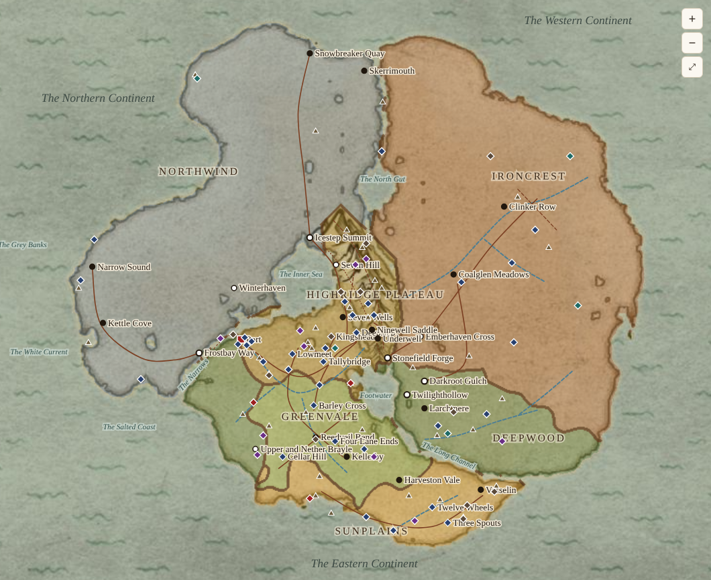

# Map draft

<!-- Generated by atlas/tools/map_draft.py from map-draft.json. Edit the data, not this page. -->

## Status

**Draft placements on the legacy continent map. Every placement is a lean for bt 7274 to move; the wiki owns the facts and the exact map stays open.** Like the rest of the [Atlas](../README.md), this map follows the wiki and never leads it: if a placement here and a wiki page disagree, the wiki wins and the placement moves. The exact map is still [open](../../wiki/Open-Questions.md#map).

- **Interactive map:** [`index.html`](index.html) (on GitHub Pages: https://bigcatmellow.github.io/10Kings/atlas/map/ once Pages is on). Pan, zoom, switch layers, search, and click anything for its wiki page.
- **Base image:** [`base-map.png`](base-map.png), a copy of `legacy-notes/2026-09-22/consolidated-package/Map_-_The_Continent.png`, which the [Source Register](../../wiki/Reference/Source-Register.md) calls a provisional historical concept.
- **On the map:** 6 regions, 33 towns, 63 places of interest, 37 named features, 8 rivers, 18 roads and paths, 8 seas and straits.
- **Rebuild:** `python3 atlas/tools/map_draft.py`. Move anything by editing its coordinates in [`map-draft.json`](map-draft.json) (pixels on the 980 × 728 image) and rebuilding.

## How the land was read

bt 7274 chose to read the continents **by shape** (2026-11-09), from the legacy notes: the Northern Continent is "clover-like", the Western "rounded", the Eastern "tapering". The names are old names, not compass directions on this image.

| Continent | On the image | Note |
| --- | --- | --- |
| The Northern Continent | the clover-shaped land, upper left | By shape: the clover-like land jutting into icy seas (legacy notes). Home to Northwind. |
| The Western Continent | the round land, right | By shape: the rounded land (legacy notes). Home to Ironcrest; Deepwood's main forest in its corner by the Spine (lean). The name is an old name, not a compass direction on this image (bt 7274, 2026-11-09). |
| The Eastern Continent | the tapering land along the bottom | By shape: the tapering land (legacy notes). Highridge by the mountains, Greenvale in the middle, the Sunplains along the south and the tip, and Deepwood's western woods (lean). |

The three continents meet by land only at the Spine, the mountains drawn at the centre, which fits the legacy notes ("separated by water channels, connected by the Spine") and [Geography](../../wiki/Geography-and-Connections.md#macro-geography), where the continents must meet by land.

## The leans that need bt 7274's eye

One at a time, each with a lean. Everything else on the map follows from these.

1. **Port's site.** Placed on the south shore of the Narrows, the strait between the Northern and Eastern Continents, at the Long Water's mouth, with Frostbay Way across the water. This is where the legacy notes' "strategic strait between continents" fits best, and it puts Port between Northwind and the grain river. *Lean:* keep it here.
2. **Highridge astride the Spine.** The plateau is placed on the mountains where the three continents meet, plus the Eastern Continent's edge beside them, so that it touches Northwind (Icestep Summit), Ironcrest's foot, Deepwood (Twilighthollow) and Greenvale. *Lean:* keep it.
3. **Deepwood in two woods.** The main forest is the Western Continent's corner by the Spine's foot (meeting Ironcrest at Darkroot Gulch and Highridge at Twilighthollow); a smaller western wood sits on the Eastern Continent, so Deepwood also borders Greenvale, as [Geography](../../wiki/Geography-and-Connections.md) expects. The legacy notes call it "ancient forested enclaves". *Lean:* keep two woods.
4. **New water names.** The image's straits and lakes had no names, so five are proposed in the [Gazetteer](../../wiki/Places/Gazetteer.md#seas-and-straits): the Inner Sea, the Narrows, the North Gut, Footwater and the Long Channel. *Lean:* keep them as provisional.

## Regions

| Region | Placed | Wiki |
| --- | --- | --- |
| Northwind | Much of the Northern Continent (Northwind page). | [Northwind](../../wiki/Regions/Northwind.md) |
| Ironcrest | The Western Continent, 'western upland country'. It reaches the Spine's foot, where it meets Greenvale at Stonefield Forge. | [Ironcrest](../../wiki/Regions/Ironcrest.md) |
| Deepwood | Lean: the main forest in the Western Continent's corner by the Spine (borders Ironcrest at Darkroot Gulch and Highridge at Twilighthollow), and a western enclave on the Eastern Continent (borders Greenvale). The legacy notes call Deepwood 'ancient forested enclaves'. | [Deepwood](../../wiki/Regions/Deepwood.md) |
| Highridge Plateau | Lean: the plateau astride the Spine, where the three continents meet by land, and the Eastern Continent's edge beside it ('elevated, mountain-adjacent'). It meets Northwind at Icestep Summit. | [Highridge Plateau](../../wiki/Regions/Highridge-Plateau.md) |
| Greenvale | The Eastern Continent's middle ('north/central' in the legacy notes). | [Greenvale](../../wiki/Regions/Greenvale.md) |
| Sunplains | The southern extension: the south coast and the tapering tip. | [Sunplains](../../wiki/Regions/Sunplains.md) |
| *The Spine* | The Spine is drawn as mountains where the three continents meet; the plateau is placed astride it (lean). | [The Spine](../../wiki/Places/The-Spine.md) |

## Seas and straits

| Name | Placed | Wiki |
| --- | --- | --- |
| The Inner Sea | Between the Northern Continent, the Spine and the Eastern Continent. | [Gazetteer](../../wiki/Places/Gazetteer.md#seas-and-straits) |
| The Narrows | The strait between the Northern and Eastern Continents; Port stands on it. | [Gazetteer](../../wiki/Places/Gazetteer.md#seas-and-straits) |
| The North Gut | The water between the Northern and Western Continents, north of the Spine. | [Gazetteer](../../wiki/Places/Gazetteer.md#seas-and-straits) |
| Footwater | The lake at the Spine's foot, between the Western and Eastern Continents. | [Gazetteer](../../wiki/Places/Gazetteer.md#seas-and-straits) |
| The Long Channel | The channel between the Western Continent and the Eastern Continent's tip. | [Gazetteer](../../wiki/Places/Gazetteer.md#seas-and-straits) |
| The Grey Banks | The great fishing banks, offshore. | [Gazetteer](../../wiki/Places/Gazetteer.md#northwind) |
| The White Current | Runs south along the Northwind coast. | [Gazetteer](../../wiki/Places/Gazetteer.md#northwind) |
| The Salted Coast | Named by the old disputes; each side means a slightly different stretch. | [Gazetteer](../../wiki/Places/Gazetteer.md#the-great-features) |

## Rivers

| Name | Kind | Placed | Wiki |
| --- | --- | --- | --- |
| The Long Water | river | Rises at the Spine's foot, crosses Highridge's edge and Greenvale, and reaches the sea at Port (lean). | [Places/Gazetteer](../../wiki/Places/Gazetteer.md#the-great-features) |
| The Reed | river | A slow tributary; Reedveil Bend is on a bend of it. | [Places/Gazetteer](../../wiki/Places/Gazetteer.md#greenvale) |
| The Millburn | river | A mill stream; the Drowned Bell is under its millpond. | [Places/Gazetteer](../../wiki/Places/Gazetteer.md#greenvale) |
| The Ember | river | Ironcrest's working river, past Coalglen to the coast by the Spine. | [Places/Gazetteer](../../wiki/Places/Gazetteer.md#ironcrest) |
| Cinder Brook | river | A tributary of the Ember. | [Places/Gazetteer](../../wiki/Places/Gazetteer.md#ironcrest) |
| The Brownwater | river | A slow, tannin-dark river. | [Places/Gazetteer](../../wiki/Places/Gazetteer.md#deepwood) |
| The Braids | river | A braided river of shifting channels. | [Places/Gazetteer](../../wiki/Places/Gazetteer.md#deepwood) |
| The Sallow | river | The delta river. | [Places/Gazetteer](../../wiki/Places/Gazetteer.md#sunplains) |

## Roads, paths and shortcuts

| Name | Kind | Placed | Wiki |
| --- | --- | --- | --- |
| The Kings' Road | road | Follows the Long Water down through the Kings' Gate to Port. | [Places/Gazetteer](../../wiki/Places/Gazetteer.md#the-great-features) |
| The Carriers' Road | road | From Barley Cross up to the Highridge corridors. | [Places/Gazetteer](../../wiki/Places/Gazetteer.md#the-great-features) |
| The Drove Road | road | For driving Highridge stock down to Greenvale's markets. | [Places/Gazetteer](../../wiki/Places/Gazetteer.md#greenvale) |
| The Milestone Way | road | The old main corridor along the plateau, from Icestep down the Spine. | [Places/Gazetteer](../../wiki/Places/Gazetteer.md#highridge-plateau) |
| The Salt Road | road | From the Whitepan to the valley markets. | [Places/Gazetteer](../../wiki/Places/Gazetteer.md#highridge-plateau) |
| The Herring Way | road | From the coast across the Barrens to Icestep Summit. | [Places/Gazetteer](../../wiki/Places/Gazetteer.md#northwind) |
| The Long Way | road | The Northwind coast road to Frostbay Way. | [Places/Gazetteer](../../wiki/Places/Gazetteer.md#the-great-features) |
| Ferry across the Narrows | ferry | The Long Way's last stretch to Port is by boat (lean). | [Places/Gazetteer](../../wiki/Places/Gazetteer.md#the-great-features) |
| The Ore Road | road | From the Ironbacks through Emberhaven Cross to Highridge, across the Spine's flank. | [Places/Gazetteer](../../wiki/Places/Gazetteer.md#ironcrest) |
| Road to Stonefield | road | From Emberhaven Cross down to Stonefield Forge. | [Places/Gazetteer](../../wiki/Places/Gazetteer.md#between-the-kingdoms) |
| The Charcoal Track | road | Darkroot Gulch through the Charcoal Woods to the Ember forges. | [Places/Gazetteer](../../wiki/Places/Gazetteer.md#ironcrest) |
| Gallows Cut | shortcut | A shortcut over the Ironbacks: half a day saved, a sprained ankle risked. | [Places/Gazetteer](../../wiki/Places/Gazetteer.md#ironcrest) |
| The Hollow Way | shortcut | A sunken lane: a road in summer, a stream in winter. | [Places/Gazetteer](../../wiki/Places/Gazetteer.md#greenvale) |
| The Straight Road | road | Forty miles dead straight, ending in a meadow. | [Places/Places-of-Interest](../../wiki/Places/Places-of-Interest.md#the-straight-road) |
| The Patrons' Road | road | Between the coastal cities; every mile paved by a different patron. | [Places/Gazetteer](../../wiki/Places/Gazetteer.md#sunplains) |
| The Pilgrims' Way | path | From the Hollin Gap up to the Cradle. | [Places/Gazetteer](../../wiki/Places/Gazetteer.md#the-spine-the-overpath-and-the-underpass) |
| The Overpath | overpath | Over the top of the Spine, for those who won't go under. | [Places/The-Spine](../../wiki/Places/The-Spine.md#the-overpath) |
| The Underpass | underpass | Beneath parts of the Spine; branches not mapped. | [Places/The-Underpass](../../wiki/Places/The-Underpass.md) |

## Towns

| Name | Kind | Region (lean) | Placed | Wiki |
| --- | --- | --- | --- | --- |
| Larchmere | story | Deepwood | On the shore of Larch Mere, a forest lake, a day's walk and a river from Twilighthollow. | [Sunday-Morning/Stories/The-Blank-Square](../../wiki/Sunday-Morning/Stories/The-Blank-Square.md) |
| Twilighthollow | border | Deepwood | Where the forest uplands meet the plateau routes, at the Spine's foot. | [Places/Border-Towns](../../wiki/Places/Border-Towns.md#twilighthollow--deepwood--highridge) |
| Barley Cross | gazetteer | Greenvale | A market town; the Seed House. | [Places/Gazetteer](../../wiki/Places/Gazetteer.md#greenvale) |
| Cellar Hill | gazetteer | Greenvale | A village dug into a hill. | [Places/Gazetteer](../../wiki/Places/Gazetteer.md#greenvale) |
| Four Lane Ends | gazetteer | Greenvale | The Hiring Oak's crossroads. | [Places/Gazetteer](../../wiki/Places/Gazetteer.md#greenvale) |
| Harveston Vale | story | Greenvale | The Vale: the border into the Sunplains. | [Sunday-Morning/Stories/One-Square-Two-Harvests](../../wiki/Sunday-Morning/Stories/One-Square-Two-Harvests.md) |
| Kellerby | story | Greenvale | Farms and orchards on the Wethercrags' summer circuit. | [Sunday-Morning/Stories/Mending-Day](../../wiki/Sunday-Morning/Stories/Mending-Day.md) |
| Reedveil Bend | story | Greenvale | A cooperative village on a bend of the Reed. | [Sunday-Morning/Stories/The-Eighth-Verse](../../wiki/Sunday-Morning/Stories/The-Eighth-Verse.md) |
| Upper and Nether Brayle | gazetteer | Greenvale | Twin towns joined by the Reconciliation Bridge (lean: on Greenvale's border with the western woods). | [Places/Gazetteer](../../wiki/Places/Gazetteer.md#between-the-kingdoms) |
| Deepstep | gazetteer | Highridge Plateau | A dry town named for its Stepwell. | [Places/Gazetteer](../../wiki/Places/Gazetteer.md#highridge-plateau) |
| Icestep Summit | border | Highridge Plateau | The cold pass town where Northwind meets Highridge, at the Spine's northern end. | [Places/Border-Towns](../../wiki/Places/Border-Towns.md#icestep-summit--northwind--highridge) |
| Kingshead | gazetteer | Highridge Plateau | Named for the Head in the Square. | [Places/Gazetteer](../../wiki/Places/Gazetteer.md#highridge-plateau) |
| Lowmeet | gazetteer | Highridge Plateau | Its long hall is the Congress Hall. | [Places/Gazetteer](../../wiki/Places/Gazetteer.md#highridge-plateau) |
| Ninewell Saddle | story | Highridge Plateau | A pass town on a lower saddle, on the Highridge side. | [Sunday-Morning/Stories/The-Road-in-Use](../../wiki/Sunday-Morning/Stories/The-Road-in-Use.md) |
| Seven Hill | gazetteer | Highridge Plateau | An old pass fortress on the Highridge side; which pass is open. | [Places/Seven-Hill](../../wiki/Places/Seven-Hill.md) |
| Seven Wells | story | Highridge Plateau | A pass town at the plateau's edge. | [Sunday-Morning/Stories/The-Goat-File](../../wiki/Sunday-Morning/Stories/The-Goat-File.md) |
| Tallybridge | gazetteer | Highridge Plateau | A trading town; the Ledger Vault. | [Places/Gazetteer](../../wiki/Places/Gazetteer.md#highridge-plateau) |
| Underwell | story | Highridge Plateau | An Underpass enclave below Ninewell Saddle. | [Sunday-Morning/Stories/The-Road-in-Use](../../wiki/Sunday-Morning/Stories/The-Road-in-Use.md) |
| Clinker Row | story | Ironcrest | Under the Upper Works, in the Upper Ember valley. | [Sunday-Morning/Stories/The-Same-Paper](../../wiki/Sunday-Morning/Stories/The-Same-Paper.md) |
| Coalglen Meadows | story | Ironcrest | A foundry town on the Ember. | [Sunday-Morning/Stories/Walkout-Pies](../../wiki/Sunday-Morning/Stories/Walkout-Pies.md) |
| Darkroot Gulch | border | Ironcrest | Where Ironcrest's uplands meet the forest. | [Places/Border-Towns](../../wiki/Places/Border-Towns.md#darkroot-gulch--deepwood--ironcrest) |
| Emberhaven Cross | gazetteer | Ironcrest | Where the Ore Road meets the road down to Stonefield. | [Places/Gazetteer](../../wiki/Places/Gazetteer.md#between-the-kingdoms) |
| Stonefield Forge | border | Ironcrest | At the Spine's foot, where the Western and Eastern lands meet (lean). | [Places/Border-Towns](../../wiki/Places/Border-Towns.md#stonefield-forge--ironcrest--greenvale) |
| Frostbay Way | border | Northwind | The coastal corridor town toward Port, across the Narrows. | [Places/Border-Towns](../../wiki/Places/Border-Towns.md#frostbay-way--northwind--port-influence-zone) |
| Kettle Cove | story | Northwind | A small fishing town in a sheltered cove. | [Sunday-Morning/Stories/The-Greenvale-Man](../../wiki/Sunday-Morning/Stories/The-Greenvale-Man.md) |
| Narrow Sound | story | Northwind | Across the headland from Kettle Cove (lean: west coast). | [Sunday-Morning/Stories/The-Greenvale-Man](../../wiki/Sunday-Morning/Stories/The-Greenvale-Man.md) |
| Skerrimouth | story | Northwind | Across the headland from Snowbreaker Quay, at the mouth of the skerries. | [Sunday-Morning/Stories/The-First-Fish](../../wiki/Sunday-Morning/Stories/The-First-Fish.md) |
| Snowbreaker Quay | story | Northwind | A fishing town that also farms inland (lean: north coast). | [Sunday-Morning/Stories/The-First-Fish](../../wiki/Sunday-Morning/Stories/The-First-Fish.md) |
| Winterhaven | gazetteer | Northwind | A winter anchorage, sheltered on the Inner Sea (lean). | [Places/Gazetteer](../../wiki/Places/Gazetteer.md#northwind) |
| Port | port | Port | On the Narrows, at the Long Water's mouth (lean). It belongs to no kingdom. | [Places/Port](../../wiki/Places/Port.md) |
| Three Spouts | gazetteer | Sunplains | Where three city-states meet. | [Places/Gazetteer](../../wiki/Places/Gazetteer.md#sunplains) |
| Twelve Wheels | gazetteer | Sunplains | A river city on the Sallow. | [Places/Gazetteer](../../wiki/Places/Gazetteer.md#sunplains) |
| Vasselin | story | Sunplains | A city-state of courtyard houses (lean: near the tip). | [Sunday-Morning/Stories/The-Ladder-Rules](../../wiki/Sunday-Morning/Stories/The-Ladder-Rules.md) |

## Named features

| Name | Kind | Region (lean) | Placed | Wiki |
| --- | --- | --- | --- | --- |
| Mosspeak Rise | hill | Deepwood | Where the forest climbs toward Highridge. | [Places/Gazetteer](../../wiki/Places/Gazetteer.md#deepwood) |
| The Alderfens | wetland | Deepwood | Wet woodland along the slow rivers. | [Places/Gazetteer](../../wiki/Places/Gazetteer.md#deepwood) |
| The Ashwood Edge | forest | Deepwood | The western woods' margin toward Greenvale. | [Places/Gazetteer](../../wiki/Places/Gazetteer.md#deepwood) |
| The Cedar Reaches | forest | Deepwood | A belt of cedar; the One Tree is beyond it. | [Places/Gazetteer](../../wiki/Places/Gazetteer.md#deepwood) |
| The Deep | forest | Deepwood | The old-growth heart. | [Places/Gazetteer](../../wiki/Places/Gazetteer.md#deepwood) |
| The Hush | forest | Deepwood | The country of the Quiet Villages. | [Places/Gazetteer](../../wiki/Places/Gazetteer.md#deepwood) |
| Hartwood | woods | Greenvale | An old oak and hazel wood. | [Places/Gazetteer](../../wiki/Places/Gazetteer.md#greenvale) |
| Ship Hill | hill | Greenvale | Toward the Highridge edge. | [Places/Gazetteer](../../wiki/Places/Gazetteer.md#greenvale) |
| The Chalk Downs | downs | Greenvale | Sheep downs between the Redlands and the western woods. | [Places/Gazetteer](../../wiki/Places/Gazetteer.md#greenvale) |
| The Kings' Gate | gorge | Greenvale | The Long Water's gorge through the last hills before the coast. | [Places/Gazetteer](../../wiki/Places/Gazetteer.md#the-great-features) |
| The Redlands | plain | Greenvale | The red-soil wheat plain. | [Places/Gazetteer](../../wiki/Places/Gazetteer.md#greenvale) |
| The Wetlands of Saltings | wetland | Greenvale | The marsh near the Long Water's mouth. | [Places/Gazetteer](../../wiki/Places/Gazetteer.md#greenvale) |
| Twelve Stones Ford | ford | Greenvale | A paved ford over the Reed. | [Places/Gazetteer](../../wiki/Places/Gazetteer.md#greenvale) |
| Ascarra | spring | Highridge Plateau | A spring with an Old Spine name. | [Places/Gazetteer](../../wiki/Places/Gazetteer.md#highridge-plateau) |
| Eagle's Summit | peak | Highridge Plateau | A high resting place on the Overpath. | [Places/Gazetteer](../../wiki/Places/Gazetteer.md#the-spine-the-overpath-and-the-underpass) |
| Orrimath | pass | Highridge Plateau | A high pass with an Old Spine name. | [Places/Gazetteer](../../wiki/Places/Gazetteer.md#the-spine-the-overpath-and-the-underpass) |
| Shimmerfall Ravine | ravine | Highridge Plateau | A ravine of waterfalls. | [Places/Gazetteer](../../wiki/Places/Gazetteer.md#the-spine-the-overpath-and-the-underpass) |
| The Drip | tunnel | Highridge Plateau | A wet stretch of the Underpass, where it rains underground all year. | [Places/Gazetteer](../../wiki/Places/Gazetteer.md#the-spine-the-overpath-and-the-underpass) |
| The High Flat | plateau | Highridge Plateau | The exposed upper plateau, on the Spine (lean). | [Places/Gazetteer](../../wiki/Places/Gazetteer.md#highridge-plateau) |
| The Hollin Gap | pass | Highridge Plateau | A lower, greener pass. | [Places/Gazetteer](../../wiki/Places/Gazetteer.md#the-spine-the-overpath-and-the-underpass) |
| The Sheltered Valleys | valleys | Highridge Plateau | Cut into the plateau's edge, where most of the towns and the water are. | [Places/Gazetteer](../../wiki/Places/Gazetteer.md#highridge-plateau) |
| The Whitepan | salt flat | Highridge Plateau | The salt flat. | [Places/Gazetteer](../../wiki/Places/Gazetteer.md#highridge-plateau) |
| The Charcoal Woods | woods | Ironcrest | Coppiced for the forges' charcoal. | [Places/Gazetteer](../../wiki/Places/Gazetteer.md#ironcrest) |
| The Ironbacks | ridge | Ironcrest | A long ridge of ore hills above the Ember. | [Places/Gazetteer](../../wiki/Places/Gazetteer.md#ironcrest) |
| The Upper Ember | valley | Ironcrest | The valley above Coalglen. | [Places/Gazetteer](../../wiki/Places/Gazetteer.md#ironcrest) |
| Cape Wending | cape | Northwind | The west cape, where the White Current turns out to sea. | [Places/Gazetteer](../../wiki/Places/Gazetteer.md#northwind) |
| Icefang Fjord | fjord | Northwind | The notch in the southwest coast. | [Places/Gazetteer](../../wiki/Places/Gazetteer.md#northwind) |
| Sealfjord | fjord | Northwind | A broad fjord on the northwest coast. | [Places/Gazetteer](../../wiki/Places/Gazetteer.md#northwind) |
| The Barrens | moor | Northwind | High cold moor behind the coast. | [Places/Gazetteer](../../wiki/Places/Gazetteer.md#northwind) |
| The Long Skerries | islands | Northwind | The string of islets in the North Gut. | [Places/Gazetteer](../../wiki/Places/Gazetteer.md#northwind) |
| Golden Dunes Shore | coast | Sunplains | A long sandy coast. | [Places/Gazetteer](../../wiki/Places/Gazetteer.md#sunplains) |
| Helios Orchard | estate | Sunplains | An old orchard estate toward Harveston Vale. | [Places/Gazetteer](../../wiki/Places/Gazetteer.md#sunplains) |
| The Arch Valley | valley | Sunplains | The valley of the Long Arches. | [Places/Gazetteer](../../wiki/Places/Gazetteer.md#sunplains) |
| The Dry Edge | plain | Sunplains | Where the irrigated land gives out. | [Places/Gazetteer](../../wiki/Places/Gazetteer.md#sunplains) |
| The Orchard Belt | orchards | Sunplains | The irrigated orchard country; the Long Arches feed its far side. | [Places/Gazetteer](../../wiki/Places/Gazetteer.md#sunplains) |
| The Sapphire Isles | islands | Sunplains | Small offshore islands. | [Places/Gazetteer](../../wiki/Places/Gazetteer.md#sunplains) |
| The Thousand Channels | delta | Sunplains | The Sallow's delta. | [Places/Gazetteer](../../wiki/Places/Gazetteer.md#sunplains) |

## Places of interest

| Name | Kind | Region (lean) | Placed | Wiki |
| --- | --- | --- | --- | --- |
| The Black Pool | natural wonder | Deepwood | A backwater of the Brownwater. | [Places/Places-of-Interest](../../wiki/Places/Places-of-Interest.md#the-black-pool) |
| The Canopy Road | landmark | Deepwood | Across the Alderfens. | [Places/Places-of-Interest](../../wiki/Places/Places-of-Interest.md#the-canopy-road) |
| The One Tree | holy site | Deepwood | Beyond the Cedar Reaches. | [Places/Places-of-Interest](../../wiki/Places/Places-of-Interest.md#the-one-tree) |
| The Quiet Villages | ruin | Deepwood | In the Hush. | [Places/Places-of-Interest](../../wiki/Places/Places-of-Interest.md#the-quiet-villages) |
| The Telling Tree | landmark | Deepwood | In a Deepwood village (lean). | [Places/Places-of-Interest](../../wiki/Places/Places-of-Interest.md#the-telling-tree) |
| Cellar Hill | landmark | Greenvale | A village of root cellars. | [Places/Places-of-Interest](../../wiki/Places/Places-of-Interest.md#cellar-hill) |
| The Count Stones | holy site | Greenvale | On the far side of the Chalk Downs, at the western woods' edge. | [Places/Places-of-Interest](../../wiki/Places/Places-of-Interest.md#the-count-stones) |
| The Dawn Hill | holy site | Greenvale | Above the road from the plateau's edge down the Footwater shore toward the Sunplains (lean). | [Places/Places-of-Interest](../../wiki/Places/Places-of-Interest.md#the-dawn-hill) |
| The Drowned Bell | mystery | Greenvale | Under the Millburn's millpond. | [Places/Places-of-Interest](../../wiki/Places/Places-of-Interest.md#the-drowned-bell) |
| The Fiddlers' Hollow | meeting place | Greenvale | The Ridge-Roamers' winter meadow (lean: where Greenvale meets the plateau's edge). | [Places/Places-of-Interest](../../wiki/Places/Places-of-Interest.md#the-fiddlers-hollow) |
| The Floating Fields | landmark | Greenvale | In the Wetlands of Saltings. | [Places/Places-of-Interest](../../wiki/Places/Places-of-Interest.md#the-floating-fields) |
| The Grand Orchard | landmark | Greenvale | In Greenvale (lean: on the Redlands' edge). | [Places/Places-of-Interest](../../wiki/Places/Places-of-Interest.md#the-grand-orchard) |
| The Hiring Oak | landmark | Greenvale | At Four Lane Ends. | [Places/Places-of-Interest](../../wiki/Places/Places-of-Interest.md#the-hiring-oak) |
| The Letter Tree | landmark | Greenvale | On the Carriers' Road. | [Places/Places-of-Interest](../../wiki/Places/Places-of-Interest.md#the-letter-tree) |
| The Reconciliation Bridge | holy site | Greenvale | Between Upper and Nether Brayle. | [Places/Places-of-Interest](../../wiki/Places/Places-of-Interest.md#the-reconciliation-bridge) |
| The Seed House | landmark | Greenvale | In Barley Cross. | [Places/Places-of-Interest](../../wiki/Places/Places-of-Interest.md#the-seed-house) |
| The Ship on the Hill | mystery | Greenvale | On Ship Hill. | [Places/Places-of-Interest](../../wiki/Places/Places-of-Interest.md#the-ship-on-the-hill) |
| The Sitting Kings | monument | Greenvale | In the walls of the Kings' Gate. | [Places/Places-of-Interest](../../wiki/Places/Places-of-Interest.md#the-sitting-kings) |
| The Straight Road | ruin | Greenvale | Forty miles of fitted stone. | [Places/Places-of-Interest](../../wiki/Places/Places-of-Interest.md#the-straight-road) |
| The Carvers' Gallery | carving | Highridge Plateau | On the Long Bore of the Underpass. | [Places/Places-of-Interest](../../wiki/Places/Places-of-Interest.md#the-carvers-gallery) |
| The Congress Hall | landmark | Highridge Plateau | In Lowmeet. | [Places/Places-of-Interest](../../wiki/Places/Places-of-Interest.md#the-congress-hall) |
| The Debate Steps | landmark | Highridge Plateau | In a Highridge city (lean: near Tallybridge). | [Places/Places-of-Interest](../../wiki/Places/Places-of-Interest.md#the-debate-steps) |
| The Golden Caravanserai | landmark | Highridge Plateau | On the caravan corridor. | [Places/Places-of-Interest](../../wiki/Places/Places-of-Interest.md#the-golden-caravanserai) |
| The Head in the Square | monument | Highridge Plateau | In Kingshead. | [Places/Places-of-Interest](../../wiki/Places/Places-of-Interest.md#the-head-in-the-square) |
| The Lantern Fair Cavern | landmark | Highridge Plateau | The Lantern Hall, in the Underpass. | [Places/Places-of-Interest](../../wiki/Places/Places-of-Interest.md#the-lantern-fair-cavern) |
| The Ledger Vault | landmark | Highridge Plateau | In Tallybridge. | [Places/Places-of-Interest](../../wiki/Places/Places-of-Interest.md#the-ledger-vault) |
| The Milestones | ruin | Highridge Plateau | Along the Milestone Way. | [Places/Places-of-Interest](../../wiki/Places/Places-of-Interest.md#the-milestones) |
| The Mother's Cradle | holy site | Highridge Plateau | In the central peaks. | [Places/Places-of-Interest](../../wiki/Places/Places-of-Interest.md#the-mothers-cradle) |
| The Pass Springs | landmark | Highridge Plateau | Below the Hollin Gap. | [Places/Places-of-Interest](../../wiki/Places/Places-of-Interest.md#the-pass-springs) |
| The Rockfall Stones | memorial | Highridge Plateau | In the Underpass. | [Places/Places-of-Interest](../../wiki/Places/Places-of-Interest.md#the-rockfall-stones) |
| The Rocking Stone | holy site | Highridge Plateau | On a Highridge hillside. | [Places/Places-of-Interest](../../wiki/Places/Places-of-Interest.md#the-rocking-stone) |
| The Salt Mirror | holy site | Highridge Plateau | On the Whitepan. | [Places/Places-of-Interest](../../wiki/Places/Places-of-Interest.md#the-salt-mirror) |
| The Speaking Cliff | carving | Highridge Plateau | Above the road through Orrimath. | [Places/Places-of-Interest](../../wiki/Places/Places-of-Interest.md#the-speaking-cliff) |
| The Stepwell | landmark | Highridge Plateau | In Deepstep. | [Places/Places-of-Interest](../../wiki/Places/Places-of-Interest.md#the-stepwell) |
| The Storm Bell | holy site | Highridge Plateau | On the Bellsaddle of the Overpath. | [Places/Places-of-Interest](../../wiki/Places/Places-of-Interest.md#the-storm-bell) |
| The Whistling Notch | natural wonder | Highridge Plateau | A cleft on the plateau's edge (lean). | [Places/Places-of-Interest](../../wiki/Places/Places-of-Interest.md#the-whistling-notch) |
| The Black Field | memorial | Ironcrest | On a valley floor (lean). | [Places/Places-of-Interest](../../wiki/Places/Places-of-Interest.md#the-black-field) |
| The Blue Pit | natural wonder | Ironcrest | An old pit in the uplands (lean). | [Places/Places-of-Interest](../../wiki/Places/Places-of-Interest.md#the-blue-pit) |
| The Burning Hill | natural wonder | Ironcrest | Smoulder Knowe. | [Places/Places-of-Interest](../../wiki/Places/Places-of-Interest.md#the-burning-hill) |
| The First Wheel | landmark | Ironcrest | In the gorge of Cinder Brook. | [Places/Places-of-Interest](../../wiki/Places/Places-of-Interest.md#the-first-wheel) |
| The Star Iron | relic | Ironcrest | In a village square (lean). | [Places/Places-of-Interest](../../wiki/Places/Places-of-Interest.md#the-star-iron) |
| The Thousand Steps | landmark | Ironcrest | On the Ironbacks. | [Places/Places-of-Interest](../../wiki/Places/Places-of-Interest.md#the-thousand-steps) |
| The Wall of Names | memorial | Ironcrest | In Coalglen Meadows (lean). | [Places/Places-of-Interest](../../wiki/Places/Places-of-Interest.md#the-wall-of-names) |
| The Burned Strand | memorial | Northwind | On the Northwind coast (lean: its southern shore, facing the Salted Coast). | [Places/Places-of-Interest](../../wiki/Places/Places-of-Interest.md#the-burned-strand) |
| The Ice Halls | natural wonder | Northwind | In the cliffs of Sealfjord. | [Places/Places-of-Interest](../../wiki/Places/Places-of-Interest.md#the-ice-halls) |
| The Moot Isle | meeting place | Northwind | The Holm, at the end of the Long Skerries. | [Places/Places-of-Interest](../../wiki/Places/Places-of-Interest.md#the-moot-isle) |
| The Rescue Houses | landmark | Northwind | Along the west cliffs (lean). | [Places/Places-of-Interest](../../wiki/Places/Places-of-Interest.md#the-rescue-houses) |
| The Seafarer's Beacon | landmark | Northwind | On Cape Wending. | [Places/Places-of-Interest](../../wiki/Places/Places-of-Interest.md#the-seafarers-beacon) |
| The Tide Road | holy site | Northwind | The causeway to the islet in the Narrows (lean). | [Places/Places-of-Interest](../../wiki/Places/Places-of-Interest.md#the-tide-road) |
| Stationers' Row | landmark | Port | In Port. | [Places/Places-of-Interest](../../wiki/Places/Places-of-Interest.md#stationers-row) |
| The Floating Market | landmark | Port | On Port's Inner Pool. | [Places/Places-of-Interest](../../wiki/Places/Places-of-Interest.md#the-floating-market) |
| The Old Light | ruin | Port | On Lamp Point at the Throat, Port's harbor mouth. | [Places/Places-of-Interest](../../wiki/Places/Places-of-Interest.md#the-old-light) |
| The Seizure Warehouse | memorial | Port | In Port's Old Bond. | [Places/Places-of-Interest](../../wiki/Places/Places-of-Interest.md#the-seizure-warehouse) |
| The Stair of Flags | landmark | Port | In Port's Enclave Quarter. | [Places/Places-of-Interest](../../wiki/Places/Places-of-Interest.md#the-stair-of-flags) |
| The Argument House | holy site | Sunplains | In a Sunplains city. | [Places/Places-of-Interest](../../wiki/Places/Places-of-Interest.md#the-argument-house) |
| The Boundary Fountain | landmark | Sunplains | At Three Spouts. | [Places/Places-of-Interest](../../wiki/Places/Places-of-Interest.md#the-boundary-fountain) |
| The Dig at Harrow Isle | mystery | Sunplains | On Harrow Isle, the plainest of the Sapphire Isles. | [Places/Places-of-Interest](../../wiki/Places/Places-of-Interest.md#the-dig-at-harrow-isle) |
| The Groaning Wheels | landmark | Sunplains | In Twelve Wheels. | [Places/Places-of-Interest](../../wiki/Places/Places-of-Interest.md#the-groaning-wheels) |
| The Lantern Stair | landmark | Sunplains | In a Sunplains hill city. | [Places/Places-of-Interest](../../wiki/Places/Places-of-Interest.md#the-lantern-stair) |
| The Long Arches | ruin | Sunplains | In the Arch Valley. | [Places/Places-of-Interest](../../wiki/Places/Places-of-Interest.md#the-long-arches) |
| The Patrons' Wall | monument | Sunplains | In a Sunplains city square. | [Places/Places-of-Interest](../../wiki/Places/Places-of-Interest.md#the-patrons-wall) |
| The Reed Towns | landmark | Sunplains | In the Thousand Channels. | [Places/Places-of-Interest](../../wiki/Places/Places-of-Interest.md#the-reed-towns) |
| The Stepped Tombs | monument | Sunplains | On the Dry Edge. | [Places/Places-of-Interest](../../wiki/Places/Places-of-Interest.md#the-stepped-tombs) |

## Not placed

| Name | Why | Wiki |
| --- | --- | --- |
| The Treaty Stones and the Treaty Line | The Treaty Line (the Convergence boundary) isn't placed; the borders stay open. | [Places/Places-of-Interest](../../wiki/Places/Places-of-Interest.md#the-treaty-stones) |
| The Roamers' Round | A circuit, not a place: through Kellerby and along the Straight Road in summer, back to the Fiddlers' Hollow for winter. | [Places/Gazetteer](../../wiki/Places/Gazetteer.md#between-the-kingdoms) |
| Seven Hill's pass | Which pass Seven Hill guards is open on its own page. | [Places/Gazetteer](../../wiki/Places/Gazetteer.md#the-spine-the-overpath-and-the-underpass) |
| Port's districts (the Throat, Lamp Point, the Inner Pool, the Old Bond, the Enclave Quarter, the Lean, Three Pots Street) | Too small for this map's scale; the places of interest in them are placed at Port. | [Places/Gazetteer](../../wiki/Places/Gazetteer.md#port) |
