# Atlas Part 8: Open questions

## Status

**Derived view, not canon. Generated; don't edit by hand.** Edit [`questions.json`](questions.json), then run `python3 atlas/tools/atlas_part.py` from the repository root. That rebuilds this page, the [image](questions.png) of this part, and the [combined board](../board/README.md) (interactive: https://claude.ai/artifact/XG2oKvVRes6f7su2dyMaWs). Every thing links to the wiki page it comes from; the wiki wins any disagreement. Part of the [Atlas](../README.md); plan in [PLAN.md](../PLAN.md).

Every open question in the wiki, placed next to the thing it asks about.

Each question is a small card under an Open questions heading in the column of what it asks about, with a line to that card. Questions about things with no card yet (magic, rivers, language families, borders in general) sit in World & unplaced.

**Counts:** 33 open questions; 36 connections (36 stated in the wiki, 0 inferred).

## Gaps this part exposes

Things the wiki doesn't settle yet. Listed for the author to decide; nothing here was filled in.

- **31 open questions, plus an audit note.** Open Questions lists them under seven headings (Map, Political structure, Economic Council, Villain, Wurdren, Language and naming, Nomadic peoples); eight more were settled on 2026-09-29 and moved to its Settled section. It also asks for the current events to be audited once the map and the Villain's plan are settled.
- **3 still have nothing on the board to attach to:** Map: which regional borders are long boundaries versus narrow corridors; Map: navigable rivers and major watersheds; Language and naming: personal-name systems within the language families. Magic, the Council's houses and the language families were settled on 2026-09-29 and have left this list; they now live on Magic and Relics, the Economic Council page and Language and Thought.

## What each question asks about

| From | Connection | To | Basis | Supporting text |
| --- | --- | --- | --- | --- |
| Map: exact outlines of the three continents | asks about | Western Continent | stated | “Exact outlines of the three continents.” [source](../../wiki/Open-Questions.md#map) |
| Map: exact outlines of the three continents | asks about | Northern Continent | stated | “Exact outlines of the three continents.” [source](../../wiki/Open-Questions.md#map) |
| Map: exact outlines of the three continents | asks about | Eastern Continent | stated | “Exact outlines of the three continents.” [source](../../wiki/Open-Questions.md#map) |
| Map: exact location of Port | asks about | Port | stated | “Exact location of Port.” [source](../../wiki/Open-Questions.md#map) |
| Map: whether Highridge directly borders Sunplains | asks about | Highridge Plateau | stated | “Whether Highridge directly borders Sunplains.” [source](../../wiki/Open-Questions.md#map) |
| Map: whether Highridge directly borders Sunplains | asks about | Sunplains | stated | “Whether Highridge directly borders Sunplains.” [source](../../wiki/Open-Questions.md#map) |
| Map: exact relationship of The Spine to continental separation | asks about | The Spine | stated | “Exact relationship of The Spine to continental separation.” [source](../../wiki/Open-Questions.md#map) |
| Political structure: are all six named regions kingdoms in the same constitutional sense? | asks about | How governments behave | stated | “Are all six named regions kingdoms in the same constitutional sense?” [source](../../wiki/Open-Questions.md#political-structure) |
| Political structure: how many independent Sunplains city-states remain? | asks about | Sunplains governments | stated | “How many independent Sunplains city-states remain?” [source](../../wiki/Open-Questions.md#political-structure) |
| Political structure: how centralized is Deepwood? | asks about | Deepwood government | stated | “How centralized is Deepwood?” [source](../../wiki/Open-Questions.md#political-structure) |
| Political structure: what formal institutions govern Highridge? | asks about | Highridge government | stated | “What formal institutions govern Highridge?” [source](../../wiki/Open-Questions.md#political-structure) |
| Political structure: does Port have citizenship independent of kingdom citizenship? | asks about | Port charter and watch | stated | “Does Port have citizenship independent of kingdom citizenship?” [source](../../wiki/Open-Questions.md#political-structure) |
| Economic Council: final names/titles of domains (the six seats and their houses are now settled) | asks about | The Economic Council | stated | “Final names/titles of domains (the six seats and their houses are now settled).” [source](../../wiki/Open-Questions.md#economic-council) |
| Economic Council: how seats are inherited, selected, purchased, or contested | asks about | The Council houses | stated | “How seats are inherited, selected, purchased, or contested.” [source](../../wiki/Open-Questions.md#economic-council) |
| Economic Council: how old the Council is relative to The Convergence | asks about | The Economic Council | stated | “How old the Council is relative to The Convergence.” [source](../../wiki/Open-Questions.md#economic-council) |
| Economic Council: how old the Council is relative to The Convergence | asks about | The Council's rise | stated | “How old the Council is relative to The Convergence.” [source](../../wiki/Open-Questions.md#economic-council) |
| Economic Council: which parts of its existence are rumor versus known to elite rulers | asks about | The Economic Council | stated | “Which parts of its existence are rumor versus known to elite rulers.” [source](../../wiki/Open-Questions.md#economic-council) |
| Villain: name | asks about | The Villain | stated | “Name.” [source](../../wiki/Open-Questions.md#villain) |
| Villain: the point at which his methods become clearly unacceptable even to sympathetic readers | asks about | The Villain | stated | “The point at which his methods become clearly unacceptable even to sympathetic readers.” [source](../../wiki/Open-Questions.md#villain) |
| Wurdren: exact age and biography | asks about | Wurdren | stated | “Exact age and biography.” [source](../../wiki/Open-Questions.md#wurdren) |
| Wurdren: why his earlier adventuring life failed to match his ambitions | asks about | Wurdren | stated | “Why his earlier adventuring life failed to match his ambitions.” [source](../../wiki/Open-Questions.md#wurdren) |
| Wurdren: family and relationships | asks about | Wurdren | stated | “Family and relationships.” [source](../../wiki/Open-Questions.md#wurdren) |
| Wurdren: what he initially believes about politics and the Council | asks about | Wurdren | stated | “What he initially believes about politics and the Council.” [source](../../wiki/Open-Questions.md#wurdren) |
| Wurdren: where his journey begins | asks about | Wurdren | stated | “Where his journey begins.” [source](../../wiki/Open-Questions.md#wurdren) |
| Language and naming: the names of the Sunplains and Deepwood languages, and what Old Spine speech was called | asks about | Sunplains languages | stated | “The names of the Sunplains and Deepwood languages, and what Old Spine speech was called.” [source](../../wiki/Open-Questions.md#language-and-naming) |
| Language and naming: the names of the Sunplains and Deepwood languages, and what Old Spine speech was called | asks about | Deepwood languages | stated | “The names of the Sunplains and Deepwood languages, and what Old Spine speech was called.” [source](../../wiki/Open-Questions.md#language-and-naming) |
| Language and naming: the names of the Sunplains and Deepwood languages, and what Old Spine speech was called | asks about | Old Spine speech | stated | “The names of the Sunplains and Deepwood languages, and what Old Spine speech was called.” [source](../../wiki/Open-Questions.md#language-and-naming) |
| Nomadic peoples: seasonal circuits and the legal status of mobile peoples | asks about | Nomads and itinerant peoples | stated | “Seasonal circuits in detail, and the legal status of mobile peoples.” [source](../../wiki/Open-Questions.md#nomadic-peoples) |
| Current events: audit them | asks about | Current events | stated | “They should still be audited once the map and villain plan are finalized.” [source](../../wiki/Open-Questions.md#current-events) |
| Map: does Greenvale directly border Highridge? | asks about | Greenvale | stated | “Whether Greenvale directly borders Highridge” [source](../../wiki/Open-Questions.md#map) |
| Map: Seven Hill's pass; the Overpath's keepers and route | asks about | Seven Hill | stated | “Which pass Seven Hill guards” [source](../../wiki/Open-Questions.md#map) |
| Faiths: are the gods' names a shared liturgical register? | asks about | The Radiant Path | stated | “Whether the gods' Latinate names are a shared liturgical register” [source](../../wiki/Open-Questions.md#faiths) |
| Faiths: the creation myth and the Sons | asks about | Path of the Great Weaver | stated | “The creation myth” [source](../../wiki/Open-Questions.md#faiths) |
| Ecology: no owner for flora and fauna | asks about | Greenvale | stated | “Flora and fauna have no owner page yet” [source](../../wiki/Open-Questions.md#ecology) |
| Villain: the war in which the empire lost Port | asks about | The Villain | stated | “The war in which the empire lost Port: its name, and when it fell relative to the Convergence (lean: before it).” [source](../../wiki/Open-Questions.md#villain) |
| Villain: the last ruling empire, its name, people and reach | asks about | The Villain | stated | “The last ruling empire: its name, its people, and how far it reached.” [source](../../wiki/Open-Questions.md#villain) |

## Diagram

Stated connections only; positions are automatic. The [interactive board](../board/README.md) is easier to read.

```mermaid
flowchart LR
  oq_exact_outlines_of_the_three_continents["Map: exact outlines of the three continents"]
  western["Western Continent"]
  northern["Northern Continent"]
  eastern["Eastern Continent"]
  oq_exact_location_of_port["Map: exact location of Port"]
  port[["Port"]]
  oq_whether_highridge_directly_borders_sunplains["Map: whether Highridge directly borders Sunplains"]
  highridge(["Highridge Plateau"])
  sunplains(["Sunplains"])
  oq_exact_relationship_of_the_spine_to_continental_s["Map: exact relationship of The Spine to continental separation"]
  spine[/"The Spine"\]
  oq_are_all_six_named_regions_kingdoms_in_the_same_c["Political structure: are all six named regions kingdoms in the same constitutional sense?"]
  pw_politics["How governments behave"]
  oq_how_many_independent_sunplains_city_states_remai["Political structure: how many independent Sunplains city-states remain?"]
  pw_gov_sunplains["Sunplains governments"]
  oq_how_centralized_is_deepwood["Political structure: how centralized is Deepwood?"]
  pw_gov_deepwood["Deepwood government"]
  oq_what_formal_institutions_govern_highridge["Political structure: what formal institutions govern Highridge?"]
  pw_gov_highridge["Highridge government"]
  oq_does_port_have_citizenship_independent_of_kingdo["Political structure: does Port have citizenship independent of kingdom citizenship?"]
  pw_gov_port["Port charter and watch"]
  oq_final_names_titles_of_domains_the_six_seats_and["Economic Council: final names/titles of domains (the six seats and their houses are now settled)"]
  pw_council["The Economic Council"]
  oq_how_seats_are_inherited_selected_purchased_or_co["Economic Council: how seats are inherited, selected, purchased, or contested"]
  pp_families["The Council houses"]
  oq_how_old_the_council_is_relative_to_the_convergen["Economic Council: how old the Council is relative to The Convergence"]
  hi_council_rise["The Council's rise"]
  oq_which_parts_of_its_existence_are_rumor_versus_kn["Economic Council: which parts of its existence are rumor versus known to elite rulers"]
  oq_name["Villain: name"]
  pp_villain["The Villain"]
  oq_the_point_at_which_his_methods_become_clearly_un["Villain: the point at which his methods become clearly unacceptable even to sympathetic readers"]
  oq_exact_age_and_biography["Wurdren: exact age and biography"]
  pp_wurdren["Wurdren"]
  oq_why_his_earlier_adventuring_life_failed_to_match["Wurdren: why his earlier adventuring life failed to match his ambitions"]
  oq_family_and_relationships["Wurdren: family and relationships"]
  oq_what_he_initially_believes_about_politics_and_th["Wurdren: what he initially believes about politics and the Council"]
  oq_where_his_journey_begins["Wurdren: where his journey begins"]
  oq_the_names_of_the_sunplains_and_deepwood_language["Language and naming: the names of the Sunplains and Deepwood languages, and what Old Spine speech was called"]
  lang_sunplains["Sunplains languages"]
  lang_deepwood["Deepwood languages"]
  lang_oldspine["Old Spine speech"]
  oq_seasonal_circuits_and_legal_status["Nomadic peoples: seasonal circuits and the legal status of mobile peoples"]
  nomads["Nomads and itinerant peoples"]
  oq_current_events_audit["Current events: audit them"]
  st_events["Current events"]
  oq_greenvale_highridge_border["Map: does Greenvale directly border Highridge?"]
  greenvale(["Greenvale"])
  oq_seven_hill_overpath["Map: Seven Hill's pass; the Overpath's keepers and route"]
  sevenhill["Seven Hill"]
  oq_gods_liturgical_register["Faiths: are the gods' names a shared liturgical register?"]
  pw_faith_radiant["The Radiant Path"]
  oq_creation_myth["Faiths: the creation myth and the Sons"]
  pw_faith_weaver["Path of the Great Weaver"]
  oq_ecology_owner["Ecology: no owner for flora and fauna"]
  oq_the_empires_war["Villain: the war in which the empire lost Port"]
  oq_the_last_ruling_empire["Villain: the last ruling empire, its name, people and reach"]
  oq_exact_outlines_of_the_three_continents --> western
  oq_exact_outlines_of_the_three_continents --> northern
  oq_exact_outlines_of_the_three_continents --> eastern
  oq_exact_location_of_port --> port
  oq_whether_highridge_directly_borders_sunplains --> highridge
  oq_whether_highridge_directly_borders_sunplains --> sunplains
  oq_exact_relationship_of_the_spine_to_continental_s --> spine
  oq_are_all_six_named_regions_kingdoms_in_the_same_c --> pw_politics
  oq_how_many_independent_sunplains_city_states_remai --> pw_gov_sunplains
  oq_how_centralized_is_deepwood --> pw_gov_deepwood
  oq_what_formal_institutions_govern_highridge --> pw_gov_highridge
  oq_does_port_have_citizenship_independent_of_kingdo --> pw_gov_port
  oq_final_names_titles_of_domains_the_six_seats_and --> pw_council
  oq_how_seats_are_inherited_selected_purchased_or_co --> pp_families
  oq_how_old_the_council_is_relative_to_the_convergen --> pw_council
  oq_how_old_the_council_is_relative_to_the_convergen --> hi_council_rise
  oq_which_parts_of_its_existence_are_rumor_versus_kn --> pw_council
  oq_name --> pp_villain
  oq_the_point_at_which_his_methods_become_clearly_un --> pp_villain
  oq_exact_age_and_biography --> pp_wurdren
  oq_why_his_earlier_adventuring_life_failed_to_match --> pp_wurdren
  oq_family_and_relationships --> pp_wurdren
  oq_what_he_initially_believes_about_politics_and_th --> pp_wurdren
  oq_where_his_journey_begins --> pp_wurdren
  oq_the_names_of_the_sunplains_and_deepwood_language --> lang_sunplains
  oq_the_names_of_the_sunplains_and_deepwood_language --> lang_deepwood
  oq_the_names_of_the_sunplains_and_deepwood_language --> lang_oldspine
  oq_seasonal_circuits_and_legal_status --> nomads
  oq_current_events_audit --> st_events
  oq_greenvale_highridge_border --> greenvale
  oq_seven_hill_overpath --> sevenhill
  oq_gods_liturgical_register --> pw_faith_radiant
  oq_creation_myth --> pw_faith_weaver
  oq_ecology_owner --> greenvale
  oq_the_empires_war --> pp_villain
  oq_the_last_ruling_empire --> pp_villain
```

## Every thing in this part

Grouped by board column.

### Highridge Plateau

| Thing | Kind | Status | Summary |
| --- | --- | --- | --- |
| [Map: whether Highridge directly borders Sunplains](../../wiki/Open-Questions.md#map) | Open question | No status label | Open question under Map: Whether Highridge directly borders Sunplains. |
| [Political structure: what formal institutions govern Highridge?](../../wiki/Open-Questions.md#political-structure) | Open question | No status label | Open question under Political structure: What formal institutions govern Highridge? |

**Map: whether Highridge directly borders Sunplains**

- *Question:* Whether Highridge directly borders Sunplains.
- *Section:* Map

**Political structure: what formal institutions govern Highridge?**

- *Question:* What formal institutions govern Highridge?
- *Section:* Political structure

### Deepwood

| Thing | Kind | Status | Summary |
| --- | --- | --- | --- |
| [Political structure: how centralized is Deepwood?](../../wiki/Open-Questions.md#political-structure) | Open question | No status label | Open question under Political structure: How centralized is Deepwood? |

**Political structure: how centralized is Deepwood?**

- *Question:* How centralized is Deepwood?
- *Section:* Political structure

### Sunplains

| Thing | Kind | Status | Summary |
| --- | --- | --- | --- |
| [Political structure: how many independent Sunplains city-states remain?](../../wiki/Open-Questions.md#political-structure) | Open question | No status label | Open question under Political structure: How many independent Sunplains city-states remain? |

**Political structure: how many independent Sunplains city-states remain?**

- *Question:* How many independent Sunplains city-states remain?
- *Section:* Political structure

### Port

| Thing | Kind | Status | Summary |
| --- | --- | --- | --- |
| [Map: exact location of Port](../../wiki/Open-Questions.md#map) | Open question | No status label | Open question under Map: Exact location of Port. |
| [Political structure: does Port have citizenship independent of kingdom citizenship?](../../wiki/Open-Questions.md#political-structure) | Open question | No status label | Open question under Political structure: Does Port have citizenship independent of kingdom citizenship? |

**Map: exact location of Port**

- *Question:* Exact location of Port.
- *Section:* Map

**Political structure: does Port have citizenship independent of kingdom citizenship?**

- *Question:* Does Port have citizenship independent of kingdom citizenship?
- *Section:* Political structure

### Spine & Underpass

| Thing | Kind | Status | Summary |
| --- | --- | --- | --- |
| [Map: exact relationship of The Spine to continental separation](../../wiki/Open-Questions.md#map) | Open question | No status label | Open question under Map: Exact relationship of The Spine to continental separation. |

**Map: exact relationship of The Spine to continental separation**

- *Question:* Exact relationship of The Spine to continental separation.
- *Section:* Map

### Council & politics

| Thing | Kind | Status | Summary |
| --- | --- | --- | --- |
| [Political structure: are all six named regions kingdoms in the same constitutional sense?](../../wiki/Open-Questions.md#political-structure) | Open question | No status label | Open question under Political structure: Are all six named regions kingdoms in the same constitutional sense? |
| [Economic Council: final names/titles of domains (the six seats and their houses are now settled)](../../wiki/Open-Questions.md#economic-council) | Open question | No status label | Open question under Economic Council: Final names/titles of domains (the six seats and their houses are now settled). |
| [Economic Council: how old the Council is relative to The Convergence](../../wiki/Open-Questions.md#economic-council) | Open question | No status label | Open question under Economic Council: How old the Council is relative to The Convergence. |
| [Economic Council: which parts of its existence are rumor versus known to elite rulers](../../wiki/Open-Questions.md#economic-council) | Open question | No status label | Open question under Economic Council: Which parts of its existence are rumor versus known to elite rulers. |

**Political structure: are all six named regions kingdoms in the same constitutional sense?**

- *Question:* Are all six named regions kingdoms in the same constitutional sense?
- *Section:* Political structure

**Economic Council: final names/titles of domains (the six seats and their houses are now settled)**

- *Question:* Final names/titles of domains (the six seats and their houses are now settled).
- *Section:* Economic Council

**Economic Council: how old the Council is relative to The Convergence**

- *Question:* How old the Council is relative to The Convergence.
- *Section:* Economic Council

**Economic Council: which parts of its existence are rumor versus known to elite rulers**

- *Question:* Which parts of its existence are rumor versus known to elite rulers.
- *Section:* Economic Council

### Main cast

| Thing | Kind | Status | Summary |
| --- | --- | --- | --- |
| [Economic Council: how seats are inherited, selected, purchased, or contested](../../wiki/Open-Questions.md#economic-council) | Open question | No status label | Open question under Economic Council: How seats are inherited, selected, purchased, or contested. |
| [Villain: name](../../wiki/Open-Questions.md#villain) | Open question | No status label | Open question under Villain: Name. |
| [Villain: the war in which the empire lost Port](../../wiki/Open-Questions.md#villain) | Open question | No status label | Open question under Villain: The war in which the empire lost Port: its name, and when it fell relative to the Convergence (lean: before it). |
| [Villain: the last ruling empire, its name, people and reach](../../wiki/Open-Questions.md#villain) | Open question | No status label | Open question under Villain: The last ruling empire: its name, its people, and how far it reached. |
| [Villain: the point at which his methods become clearly unacceptable even to sympathetic readers](../../wiki/Open-Questions.md#villain) | Open question | No status label | Open question under Villain: The point at which his methods become clearly unacceptable even to sympathetic readers. |
| [Wurdren: exact age and biography](../../wiki/Open-Questions.md#wurdren) | Open question | No status label | Open question under Wurdren: Exact age and biography. |
| [Wurdren: why his earlier adventuring life failed to match his ambitions](../../wiki/Open-Questions.md#wurdren) | Open question | No status label | Open question under Wurdren: Why his earlier adventuring life failed to match his ambitions. |
| [Wurdren: family and relationships](../../wiki/Open-Questions.md#wurdren) | Open question | No status label | Open question under Wurdren: Family and relationships. |
| [Wurdren: what he initially believes about politics and the Council](../../wiki/Open-Questions.md#wurdren) | Open question | No status label | Open question under Wurdren: What he initially believes about politics and the Council. |
| [Wurdren: where his journey begins](../../wiki/Open-Questions.md#wurdren) | Open question | No status label | Open question under Wurdren: Where his journey begins. |

**Economic Council: how seats are inherited, selected, purchased, or contested**

- *Question:* How seats are inherited, selected, purchased, or contested.
- *Section:* Economic Council

**Villain: name**

- *Question:* Name.
- *Section:* Villain

**Villain: the war in which the empire lost Port**

- *Question:* The war in which the empire lost Port: its name, and when it fell relative to the Convergence (lean: before it).
- *Section:* Villain

**Villain: the last ruling empire, its name, people and reach**

- *Question:* The last ruling empire: its name, its people, and how far it reached.
- *Section:* Villain

**Villain: the point at which his methods become clearly unacceptable even to sympathetic readers**

- *Question:* The point at which his methods become clearly unacceptable even to sympathetic readers.
- *Section:* Villain

**Wurdren: exact age and biography**

- *Question:* Exact age and biography.
- *Section:* Wurdren

**Wurdren: why his earlier adventuring life failed to match his ambitions**

- *Question:* Why his earlier adventuring life failed to match his ambitions.
- *Section:* Wurdren

**Wurdren: family and relationships**

- *Question:* Family and relationships.
- *Section:* Wurdren

**Wurdren: what he initially believes about politics and the Council**

- *Question:* What he initially believes about politics and the Council.
- *Section:* Wurdren

**Wurdren: where his journey begins**

- *Question:* Where his journey begins.
- *Section:* Wurdren

### Main conflict

| Thing | Kind | Status | Summary |
| --- | --- | --- | --- |
| [Current events: audit them](../../wiki/Open-Questions.md#current-events) | Open question | No status label | The events pages preserve the current web of crises, but many were brainstormed rather than formally selected. They should be audited once the map and villain plan are finalized. |

**Current events: audit them**

- *Question:* Which of the brainstormed crises are formally selected? The events pages should be audited once the map and villain plan are finalized.
- *Section:* Current events

### World & unplaced

| Thing | Kind | Status | Summary |
| --- | --- | --- | --- |
| [Map: exact outlines of the three continents](../../wiki/Open-Questions.md#map) | Open question | No status label | Open question under Map: Exact outlines of the three continents. |
| [Map: which regional borders are long boundaries versus narrow corridors](../../wiki/Open-Questions.md#map) | Open question | No status label | Open question under Map: Which regional borders are long boundaries versus narrow corridors. |
| [Map: navigable rivers and major watersheds](../../wiki/Open-Questions.md#map) | Open question | No status label | Open question under Map: Navigable rivers and major watersheds. |
| [Language and naming: personal-name systems within the language families](../../wiki/Open-Questions.md#language-and-naming) | Open question | No status label | Open question under Language and naming: Personal-name systems within the language families. |
| [Language and naming: the names of the Sunplains and Deepwood languages, and what Old Spine speech was called](../../wiki/Open-Questions.md#language-and-naming) | Open question | No status label | Open question under Language and naming: The names of the Sunplains and Deepwood languages, and what Old Spine speech was called. |
| [Nomadic peoples: seasonal circuits and the legal status of mobile peoples](../../wiki/Open-Questions.md#nomadic-peoples) | Open question | No status label | Seasonal circuits in detail, and the legal status of mobile peoples. |
| [Map: does Greenvale directly border Highridge?](../../wiki/Open-Questions.md#map) | Open question | No status label | Whether Greenvale directly borders Highridge. |
| [Map: Seven Hill's pass; the Overpath's keepers and route](../../wiki/Open-Questions.md#map) | Open question | No status label | Which pass Seven Hill guards. |
| [Faiths: are the gods' names a shared liturgical register?](../../wiki/Open-Questions.md#faiths) | Open question | No status label | Whether the gods' Latinate names are a shared liturgical register. |
| [Faiths: the creation myth and the Sons](../../wiki/Open-Questions.md#faiths) | Open question | No status label | The creation myth. |
| [Ecology: no owner for flora and fauna](../../wiki/Open-Questions.md#ecology) | Open question | No status label | Flora and fauna have no owner page yet. |

**Map: exact outlines of the three continents**

- *Question:* Exact outlines of the three continents.
- *Section:* Map

**Map: which regional borders are long boundaries versus narrow corridors**

- *Question:* Which regional borders are long boundaries versus narrow corridors.
- *Section:* Map

**Map: navigable rivers and major watersheds**

- *Question:* Navigable rivers and major watersheds.
- *Section:* Map

**Language and naming: personal-name systems within the language families**

- *Question:* Personal-name systems within the language families.
- *Section:* Language and naming

**Language and naming: the names of the Sunplains and Deepwood languages, and what Old Spine speech was called**

- *Question:* The names of the Sunplains and Deepwood languages, and what Old Spine speech was called.
- *Section:* Language and naming

**Nomadic peoples: seasonal circuits and the legal status of mobile peoples**

- *Question:* Seasonal circuits and legal status.
- *Section:* Nomadic peoples

**Map: does Greenvale directly border Highridge?**

- *Question:* Whether Greenvale directly borders Highridge.
- *Section:* Map

**Map: Seven Hill's pass; the Overpath's keepers and route**

- *Question:* Which pass Seven Hill guards.
- *Section:* Map

**Faiths: are the gods' names a shared liturgical register?**

- *Question:* Whether the gods' Latinate names are a shared liturgical register.
- *Section:* Faiths

**Faiths: the creation myth and the Sons**

- *Question:* The creation myth.
- *Section:* Faiths

**Ecology: no owner for flora and fauna**

- *Question:* Flora and fauna have no owner page yet.
- *Section:* Ecology

