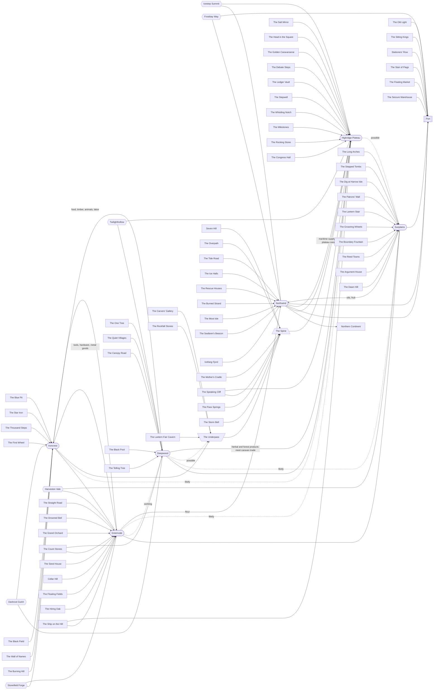

# Atlas Part 1: Regions and Geography

## Status

**Derived view, not canon. Generated; don't edit by hand.** Edit [`regions.json`](regions.json), then run `python3 atlas/tools/atlas_part.py` from the repository root. That rebuilds this page, the [image](regions.png) of this part, and the [combined board](../board/README.md) (interactive: https://claude.ai/artifact/XG2oKvVRes6f7su2dyMaWs). Every thing links to the wiki page it comes from; the wiki wins any disagreement. Part of the [Atlas](../README.md); plan in [PLAN.md](../PLAN.md).

The backbone of the Atlas: the six regions, Port, the Spine and the Underpass, the border towns between them, and who trades what with whom.

**A board, not a map.** The wiki says the exact map isn't locked ([Geography and Connections](../../wiki/Geography-and-Connections.md)), so the interactive view sorts things into one column per region instead of placing them. Columns are ordered so regions with a settled border sit next to each other (Northwind, Highridge, Deepwood, Ironcrest, Greenvale, Sunplains); nothing else about position means anything. A real map can be drawn from the same data once the geography is locked.

**Counts:** 3 continents, 6 regions, 1 neutral city, 1 mountain system, 1 underground network, 6 border towns, 7 unplaced names, 1 mountain trail, 1 town, 65 place of interests; 113 connections (102 stated in the wiki, 11 inferred).

## Gaps this part exposes

Things the wiki doesn't settle yet. Listed for the author to decide; nothing here was filled in.

- No named cities inside any of the six regions. Port and the border towns are the only named settlements; every region page describes 'cities' only in general.
- Only one region is placed on a continent (Northwind, Northern Continent). Which regions sit on the Western and Eastern Continents is not stated.
- Port's site and territory are not fixed. The wiki lists conditions its site should meet (convenient to northern and southern sea routes, access to inland rivers or roads) and describes Frostbay Way 'if Port is territorially separate'.
- Five region borders aren't established: Ironcrest–Highridge (likely), Greenvale–Highridge (likely), Deepwood–Sunplains (likely), Highridge–Sunplains (possible), and Greenvale–Deepwood (treated as a direct border unless the map contradicts it). Deepwood–Ironcrest is established as a relationship but only as a 'direct or near-direct' frontier.
- The region pages and Geography and Connections disagree on certainty: the Greenvale and Ironcrest pages state their Highridge borders plainly, while Geography and Connections calls them likely.
- Five region pairs have no border town: Ironcrest–Highridge, Greenvale–Deepwood, Deepwood–Sunplains, Greenvale–Highridge and Highridge–Sunplains.
- The wiki doesn't say which regions the Spine touches (only Highridge is tied to it) or which kingdoms hold Underpass entrances.
- No rivers, passes or Underpass entrances are named (history mentions provisional 'Ridge Pass Toll Wars'). Geography and Connections lists what the finished map should show: rivers, passes, Underpass entrances, caravan roads, seasonal closures, sea routes, old roads, pilgrimage paths, smuggling corridors.
- Directions are thin: Ironcrest west, Northwind north, Sunplains south and east, and Greenvale as 'the eastern agricultural interior' (from Highridge's point of view).
- Border Towns and World Overview carry no status label; the Border Towns page calls its six towns 'established working examples'.
- Seven names sit in the border-town name bank, unplaced.

## Borders

| From | Connection | To | Basis | Supporting text |
| --- | --- | --- | --- | --- |
| Ironcrest | borders | Greenvale | stated, established | “Repeatedly used in border-town discussions. Upland/mineral country grades into productive foothill and lowland agriculture.” [source](../../wiki/Geography-and-Connections.md#ironcrest--greenvale) |
| Greenvale | borders | Sunplains | stated, established | “Repeatedly used. Temperate mixed farmland transitions toward warmer, drier agriculture with orchards, vineyards, irrigation systems, and southern trade.” [source](../../wiki/Geography-and-Connections.md#greenvale--sunplains) |
| Deepwood | borders | Highridge Plateau | stated, established | “Repeatedly used. Forested uplands thin toward exposed plateau routes.” [source](../../wiki/Geography-and-Connections.md#deepwood--highridge) |
| Deepwood | borders (direct or near-direct) | Ironcrest | stated, established | “This implies at least one direct or near-direct frontier, probably where Ironcrest's eastern or southeastern uplands meet a western arm of the forest.” [source](../../wiki/Geography-and-Connections.md#deepwood--ironcrest) |
| Northwind | borders | Highridge Plateau | stated, established | “The cold northern interior/coast transitions toward elevated routes leading into Highridge.” [source](../../wiki/Geography-and-Connections.md#northwind--highridge) Also: “Used repeatedly through Icestep Summit and trade-pass discussions.” [source](../../wiki/Geography-and-Connections.md#northwind--highridge) Also: “inland routes toward Highridge.” [source](../../wiki/Regions/Northwind.md#geography) |
| Ironcrest | borders or corridor | Highridge Plateau | stated, likely | “Likely a meaningful direct border or a very short mountain corridor.” [source](../../wiki/Geography-and-Connections.md#ironcrest--highridge) Also: “The eastern and southeastern edges grade toward Greenvale, Highridge, and parts of Deepwood through foothills, old roads, and forest margins.” [source](../../wiki/Regions/Ironcrest.md#geography) *The Ironcrest page states this plainly; Geography and Connections calls it likely.* |
| Greenvale | borders | Deepwood | stated, working | “Strong ecological logic and repeatedly discussed as field-to-forest transition, including historical encroachment. Treat as a direct border unless the final map contradicts it.” [source](../../wiki/Geography-and-Connections.md#greenvale--deepwood) Also: “Deepwood forest margins” [source](../../wiki/Regions/Greenvale.md#geography) |
| Deepwood | borders | Sunplains | stated, likely | “Likely a southern forest transition into drier woodland and cultivated Sunplains.” [source](../../wiki/Geography-and-Connections.md#deepwood--sunplains) |
| Greenvale | borders | Highridge Plateau | stated, likely | “Likely. Highridge trade must reach the eastern agricultural interior somewhere. The exact length of border is not settled.” [source](../../wiki/Geography-and-Connections.md#greenvale--highridge) Also: “Its boundaries grade into: Ironcrest foothills; Highridge routes (likely a direct border; … keeps it open); Deepwood forest margins; warmer Sunplains country.” [source](../../wiki/Regions/Greenvale.md#geography) *The Greenvale page now marks it likely, matching Geography and Connections (2026-11 review).* |
| Highridge Plateau | borders or corridor | Sunplains | stated, possible | “Possible through southern caravan routes. Could be a direct boundary, a narrow corridor, or mediated through Greenvale/Deepwood. Do not assume until the map is locked.” [source](../../wiki/Geography-and-Connections.md#highridge--sunplains) |

## Border towns

| From | Connection | To | Basis | Supporting text |
| --- | --- | --- | --- | --- |
| Stonefield Forge | border town of | Ironcrest | stated | “Stonefield Forge — Ironcrest / Greenvale” [source](../../wiki/Places/Border-Towns.md#stonefield-forge--ironcrest--greenvale) |
| Stonefield Forge | border town of | Greenvale | stated | “Stonefield Forge — Ironcrest / Greenvale” [source](../../wiki/Places/Border-Towns.md#stonefield-forge--ironcrest--greenvale) |
| Harveston Vale | border town of | Greenvale | stated | “Harveston Vale — Greenvale / Sunplains” [source](../../wiki/Places/Border-Towns.md#harveston-vale--greenvale--sunplains) |
| Harveston Vale | border town of | Sunplains | stated | “Harveston Vale — Greenvale / Sunplains” [source](../../wiki/Places/Border-Towns.md#harveston-vale--greenvale--sunplains) |
| Twilighthollow | border town of | Deepwood | stated | “Twilighthollow — Deepwood / Highridge” [source](../../wiki/Places/Border-Towns.md#twilighthollow--deepwood--highridge) |
| Twilighthollow | border town of | Highridge Plateau | stated | “Twilighthollow — Deepwood / Highridge” [source](../../wiki/Places/Border-Towns.md#twilighthollow--deepwood--highridge) |
| Icestep Summit | border town of | Northwind | stated | “Icestep Summit — Northwind / Highridge” [source](../../wiki/Places/Border-Towns.md#icestep-summit--northwind--highridge) |
| Icestep Summit | border town of | Highridge Plateau | stated | “Icestep Summit — Northwind / Highridge” [source](../../wiki/Places/Border-Towns.md#icestep-summit--northwind--highridge) |
| Darkroot Gulch | border town of | Deepwood | stated | “Darkroot Gulch — Deepwood / Ironcrest” [source](../../wiki/Places/Border-Towns.md#darkroot-gulch--deepwood--ironcrest) |
| Darkroot Gulch | border town of | Ironcrest | stated | “Darkroot Gulch — Deepwood / Ironcrest” [source](../../wiki/Places/Border-Towns.md#darkroot-gulch--deepwood--ironcrest) |
| Frostbay Way | corridor town of | Northwind | stated | “Best treated as a coastal corridor or secondary port rather than a literal kingdom border if Port is territorially separate.” [source](../../wiki/Places/Border-Towns.md#frostbay-way--northwind--port-influence-zone) |
| Frostbay Way | in the influence zone of | Port | stated | “Frostbay Way — Northwind / Port influence zone” [source](../../wiki/Places/Border-Towns.md#frostbay-way--northwind--port-influence-zone) |

## Sea and Port

| From | Connection | To | Basis | Supporting text |
| --- | --- | --- | --- | --- |
| Northwind | major maritime partner of | Port | stated | “Northwind and Sunplains are major maritime partners, but Port belongs to neither.” [source](../../wiki/Geography-and-Connections.md#port) |
| Sunplains | major maritime partner of | Port | stated | “Northwind and Sunplains are major maritime partners, but Port belongs to neither.” [source](../../wiki/Geography-and-Connections.md#port) |
| Northwind | debates convoy agreements with | Port | stated | “debate over convoy agreements with Port.” [source](../../wiki/Regions/Northwind.md#current-pressures) |

## Spine and Underpass

| From | Connection | To | Basis | Supporting text |
| --- | --- | --- | --- | --- |
| The Underpass | runs beneath | The Spine | stated | “Beneath parts of The Spine runs The Underpass.” [source](../../wiki/World-Overview.md#the-world) |
| The Spine | funnels routes into | Highridge Plateau | stated | “Its importance comes from geography: routes that avoid or cross parts of The Spine naturally converge here.” [source](../../wiki/Regions/Highridge-Plateau.md) |
| Ironcrest | presses for access to | The Underpass | stated | “Current pressures: … pressure to expand access to Underpass routes.” [source](../../wiki/Regions/Ironcrest.md#current-pressures) |
| Deepwood | may have entrances to | The Underpass | stated, possible | “routes into foothills and possibly Underpass entrances.” [source](../../wiki/Regions/Deepwood.md#geography) |
| Seven Hill | stands on a pass of | The Spine | stated | “Seven Hill was a fortress on one of the” [source](../../wiki/Places/Seven-Hill.md#what-it-is) |
| The Overpath | runs over | The Spine | stated | “Where the Underpass runs through the range, the Overpath runs over it.” [source](../../wiki/Places/The-Spine.md#the-overpath) |

## Trade (stated)

| From | Connection | To | Basis | Supporting text |
| --- | --- | --- | --- | --- |
| Greenvale | supplies (food, timber, animals, labor) | Ironcrest | stated | “Industrial settlements in Ironcrest buy food, timber, animals and labor.” [source](../../wiki/Economy/Trade-and-Dependencies.md#ironcrest--greenvale) Also: “Their economic relationship is old: metal, tools, timber, food, animals, fuel, labor, and investment move both ways.” [source](../../wiki/Geography-and-Connections.md#ironcrest--greenvale) |
| Ironcrest | supplies (tools, hardware, metal goods) | Greenvale | stated | “Greenvale farms and workshops buy Ironcrest tools, hardware and metal goods.” [source](../../wiki/Economy/Trade-and-Dependencies.md#ironcrest--greenvale) Also: “Their economic relationship is old: metal, tools, timber, food, animals, fuel, labor, and investment move both ways.” [source](../../wiki/Geography-and-Connections.md#ironcrest--greenvale) |
| Greenvale | supplies (flour) | Northwind | stated | “imported Greenvale flour and Sunplains oils or fruit in wealthier ports.” [source](../../wiki/Regions/Northwind.md#food) |
| Sunplains | supplies (oils, fruit) | Northwind | stated | “imported Greenvale flour and Sunplains oils or fruit in wealthier ports.” [source](../../wiki/Regions/Northwind.md#food) |
| Deepwood | trades with (herbal and forest products meet caravan trade) | Highridge Plateau | stated | “herbal/forest products meeting caravan trade” [source](../../wiki/Places/Border-Towns.md#twilighthollow--deepwood--highridge) |
| Northwind | trades with (maritime supply meets plateau caravans) | Highridge Plateau | stated | “A cold pass town where maritime supply routes meet plateau caravans.” [source](../../wiki/Places/Border-Towns.md#icestep-summit--northwind--highridge) |

## Trade (inferred)

| From | Connection | To | Basis | Supporting text |
| --- | --- | --- | --- | --- |
| Deepwood | likely supplies (timber, fuel) | Ironcrest | inferred | “Ironcrest imports 'timber/fuel'; logging and charcoal are discussed at the Deepwood–Ironcrest frontier. The wiki doesn't name the pair.” [source](../../wiki/Economy/Trade-and-Dependencies.md#core-model) |
| Northwind | likely supplies (preservation salt) | Greenvale | inferred | “Northwind exports 'salt and preserved foods'; Greenvale imports 'preservation salt'. The wiki doesn't name the pair.” [source](../../wiki/Economy/Trade-and-Dependencies.md#core-model) |
| Ironcrest | likely supplies (metal goods) | Northwind | inferred | “Ironcrest exports metalwork and tools; Northwind imports 'metal goods'. The wiki doesn't name the pair.” [source](../../wiki/Economy/Trade-and-Dependencies.md#core-model) |
| Deepwood | likely supplies (medicines) | Northwind | inferred | “Deepwood exports 'herbs/medicinals'; Northwind imports 'medicines'. The wiki doesn't name the pair.” [source](../../wiki/Economy/Trade-and-Dependencies.md#core-model) |
| Ironcrest | likely supplies (metal tools) | Deepwood | inferred | “Deepwood imports 'selected metal tools'; tools are discussed at the Deepwood–Ironcrest frontier.” [source](../../wiki/Economy/Trade-and-Dependencies.md#core-model) |
| Greenvale | likely supplies (grain) | Deepwood | inferred | “Deepwood imports grain; Greenvale exports it. The wiki doesn't name the pair.” [source](../../wiki/Economy/Trade-and-Dependencies.md#core-model) |
| Ironcrest | likely supplies (metal) | Sunplains | inferred | “Sunplains imports 'selected timber, metal, furs and northern goods'. The wiki doesn't name the suppliers.” [source](../../wiki/Economy/Trade-and-Dependencies.md#core-model) |
| Northwind | likely supplies (furs, northern goods) | Sunplains | inferred | “Sunplains imports furs and 'northern goods'; Northwind exports furs. The wiki doesn't name the pair.” [source](../../wiki/Economy/Trade-and-Dependencies.md#core-model) |
| Deepwood | likely supplies (timber) | Sunplains | inferred | “Sunplains imports 'selected timber'; Deepwood exports timber and borders it (likely).” [source](../../wiki/Economy/Trade-and-Dependencies.md#core-model) |
| Northwind | likely supplies (salt) | Deepwood | inferred | “Deepwood imports salt; Northwind exports 'salt and preserved foods'. The wiki doesn't name the pair.” [source](../../wiki/Economy/Trade-and-Dependencies.md#core-model) |
| Highridge Plateau | likely provides (caravan access) | Greenvale | inferred | “Greenvale imports 'shipping and caravan access'; 'Highridge trade must reach the eastern agricultural interior somewhere.'” [source](../../wiki/Geography-and-Connections.md#greenvale--highridge) |

## Continents

| From | Connection | To | Basis | Supporting text |
| --- | --- | --- | --- | --- |
| Northwind | lies on | Northern Continent | stated | “Northwind occupies much of the Northern Continent and associated coasts and islands.” [source](../../wiki/Regions/Northwind.md#geography) |

## Places of interest

| From | Connection | To | Basis | Supporting text |
| --- | --- | --- | --- | --- |
| The Tide Road | lies in | Northwind | stated | “A causeway of stones runs a mile out across the sand to a rock island with a house of the [Silent Whisper](../Politics/Religions.md#6-the-silent-whisper) on it: archives, a garden, a bell” [source](../../wiki/Places/Places-of-Interest.md#the-tide-road) |
| The Ice Halls | lies in | Northwind | stated | “Sea caves on a cold stretch of coast freeze in deep winter into halls of blue ice” [source](../../wiki/Places/Places-of-Interest.md#the-ice-halls) |
| The Rescue Houses | lies in | Northwind | stated | “A chain of lifeboat sheds runs along the worst of the coast, each with a boat, a bell and a door covered in names: everyone that shed's boat has brought back” [source](../../wiki/Places/Places-of-Interest.md#the-rescue-houses) |
| The Burned Strand | lies in | Northwind | stated | “A long beach where the ribs of old boats stick out of the sand, black with fire” [source](../../wiki/Places/Places-of-Interest.md#the-burned-strand) |
| The Moot Isle | lies in | Northwind | stated | “A bare island where no one may live, with a ring of stone seats facing the sea” [source](../../wiki/Places/Places-of-Interest.md#the-moot-isle) |
| The Seafarer's Beacon | lies in | Northwind | stated | “A fire tower on a headland, kept by one family for so long that the family's name and the tower's are the same word” [source](../../wiki/Places/Places-of-Interest.md#the-seafarers-beacon) |
| Icefang Fjord | lies in | Northwind | stated | “A fjord whose mouth is a row of black rocks like teeth” [source](../../wiki/Places/Places-of-Interest.md#icefang-fjord) |
| The Burning Hill | lies in | Ironcrest | stated | “A coal seam caught fire under a hill a hundred years ago and has never gone out” [source](../../wiki/Places/Places-of-Interest.md#the-burning-hill) |
| The Wall of Names | lies in | Ironcrest | stated | “A long wall of dressed stone with the names of every worker the town's furnaces and mines have killed, cut one under another for two hundred years” [source](../../wiki/Places/Places-of-Interest.md#the-wall-of-names) |
| The Black Field | lies in | Ironcrest | stated | “A wide meadow on a valley floor where nothing has been built since a great burning in the old wars over resources, which Ironcrest remembers "as both achievement and warning"” [source](../../wiki/Places/Places-of-Interest.md#the-black-field) |
| The First Wheel | lies in | Ironcrest | stated | “The oldest water wheel in the region still turns in a gorge, driving a hammer that no longer hits anything” [source](../../wiki/Places/Places-of-Interest.md#the-first-wheel) |
| The Thousand Steps | lies in | Ironcrest | stated | “A stair cut into the rock up to an old mine mouth, climbed by miners every shift for a century” [source](../../wiki/Places/Places-of-Interest.md#the-thousand-steps) |
| The Star Iron | lies in | Ironcrest | stated | “A lump of iron the size of a calf sits in a village square” [source](../../wiki/Places/Places-of-Interest.md#the-star-iron) |
| The Blue Pit | lies in | Ironcrest | stated | “An old open pit that filled with water when the workings closed” [source](../../wiki/Places/Places-of-Interest.md#the-blue-pit) |
| The Straight Road | lies in | Greenvale | stated | “Forty miles of fitted stone road run dead straight across hills, fields and one river, and stop in a meadow” [source](../../wiki/Places/Places-of-Interest.md#the-straight-road) |
| The Drowned Bell | lies in | Greenvale | stated | “A village lies under a millpond, flooded when the dam was raised in someone's great-grandmother's time” [source](../../wiki/Places/Places-of-Interest.md#the-drowned-bell) |
| The Grand Orchard | lies in | Greenvale | stated | “The oldest orchard in Greenvale” [source](../../wiki/Places/Places-of-Interest.md#the-grand-orchard) |
| The Count Stones | lies in | Greenvale | stated | “A ring of standing stones in a field” [source](../../wiki/Places/Places-of-Interest.md#the-count-stones) |
| The Count Stones | lies in | Deepwood | stated | “A ring of standing stones in a field” [source](../../wiki/Places/Places-of-Interest.md#the-count-stones) |
| The Seed House | lies in | Greenvale | stated | “A cool stone house where every farming family in the district keeps a handful of its own seed in a jar with its name on, so that whatever the year does, nobody starts from nothing” [source](../../wiki/Places/Places-of-Interest.md#the-seed-house) |
| Cellar Hill | lies in | Greenvale | stated | “A village dug into a south-facing hillside: every house has its root cellar going back into the hill, and some cellars join up” [source](../../wiki/Places/Places-of-Interest.md#cellar-hill) |
| The Floating Fields | lies in | Greenvale | stated | “Gardens built on rafts of reed and mud in a wide marsh, tethered with poles and poled about by the families who farm them” [source](../../wiki/Places/Places-of-Interest.md#the-floating-fields) |
| The Hiring Oak | lies in | Greenvale | stated | “A great oak where seasonal workers stand to be hired at harvest” [source](../../wiki/Places/Places-of-Interest.md#the-hiring-oak) |
| The Ship on the Hill | lies in | Greenvale | stated | “A seagoing ship, keel and ribs and most of its planking, sits on a hilltop forty miles from the sea” [source](../../wiki/Places/Places-of-Interest.md#the-ship-on-the-hill) |
| The Ship on the Hill | lies in | Highridge Plateau | stated | “A seagoing ship, keel and ribs and most of its planking, sits on a hilltop forty miles from the sea” [source](../../wiki/Places/Places-of-Interest.md#the-ship-on-the-hill) |
| The Salt Mirror | lies in | Highridge Plateau | stated | “A salt flat so wide you can't see across it” [source](../../wiki/Places/Places-of-Interest.md#the-salt-mirror) |
| The Head in the Square | lies in | Highridge Plateau | stated | “In the middle of a market square lies a stone head as tall as a house, on its side” [source](../../wiki/Places/Places-of-Interest.md#the-head-in-the-square) |
| The Golden Caravanserai | lies in | Highridge Plateau | stated | “A caravanserai that has never closed, through wars, winters and the Convergence” [source](../../wiki/Places/Places-of-Interest.md#the-golden-caravanserai) |
| The Debate Steps | lies in | Highridge Plateau | stated | “A great semicircle of stone steps where the [Midsummer Debates](../Culture/Festivals-and-Seasonal-Life.md#highridge) are held” [source](../../wiki/Places/Places-of-Interest.md#the-debate-steps) |
| The Ledger Vault | lies in | Highridge Plateau | stated | “A house of the [market and records guilds](../Politics/Guilds.md#market-and-records-guilds) that holds the oldest account books on the plateau” [source](../../wiki/Places/Places-of-Interest.md#the-ledger-vault) |
| The Stepwell | lies in | Highridge Plateau | stated | “A well dug as a deep square funnel of stone steps, flight after flight, down to water that's always cool” [source](../../wiki/Places/Places-of-Interest.md#the-stepwell) |
| The Whistling Notch | lies in | Highridge Plateau | stated | “A cleft in a ridge where the wind never stops and the rocks whistle” [source](../../wiki/Places/Places-of-Interest.md#the-whistling-notch) |
| The Milestones | lies in | Highridge Plateau | stated | “Old carved milestones give distances to everywhere, including towns nobody can find any more” [source](../../wiki/Places/Places-of-Interest.md#the-milestones) |
| The Rocking Stone | lies in | Highridge Plateau | stated | “A boulder the size of a house balanced on a ledge, so finely that a child can rock it with one hand, and a crowd can't push it over” [source](../../wiki/Places/Places-of-Interest.md#the-rocking-stone) |
| The Congress Hall | lies in | Highridge Plateau | stated | “A long hall in a plateau town, said to be where the Convergence was negotiated” [source](../../wiki/Places/Places-of-Interest.md#the-congress-hall) |
| The One Tree | lies in | Deepwood | stated | “From the edge it looks like any old forest” [source](../../wiki/Places/Places-of-Interest.md#the-one-tree) |
| The Quiet Villages | lies in | Deepwood | stated | “Villages left during the [Ages of Silence](../Regions/Deepwood.md#historical-identity), grown over with moss and trees until only the shapes of doorways show” [source](../../wiki/Places/Places-of-Interest.md#the-quiet-villages) |
| The Canopy Road | lies in | Deepwood | stated | “Rope bridges and platforms in the high branches let people cross the forest when the rivers are up” [source](../../wiki/Places/Places-of-Interest.md#the-canopy-road) |
| The Black Pool | lies in | Deepwood | stated | “A still forest pool so dark with leaf-water that it doesn't seem to reflect anything” [source](../../wiki/Places/Places-of-Interest.md#the-black-pool) |
| The Telling Tree | lies in | Deepwood | stated | “A great tree under which the village's history is told aloud once a year, from the beginning, by whoever knows it best” [source](../../wiki/Places/Places-of-Interest.md#the-telling-tree) |
| The Long Arches | lies in | Sunplains | stated | “An aqueduct of tall stone arches crosses a valley and still carries water to the orchards on the far side” [source](../../wiki/Places/Places-of-Interest.md#the-long-arches) |
| The Stepped Tombs | lies in | Sunplains | stated | “Stepped stone tombs, five of them, rise out of the scrub where the irrigated country gives out” [source](../../wiki/Places/Places-of-Interest.md#the-stepped-tombs) |
| The Dig at Harrow Isle | lies in | Sunplains | stated | “Two hundred years ago, a boy found a dip in the ground under an old oak, and a pulley block hanging from a branch” [source](../../wiki/Places/Places-of-Interest.md#the-dig-at-harrow-isle) |
| The Patrons' Wall | lies in | Sunplains | stated | “A wall of carved names: every patron who has paid for a fountain, a school, a road or a feast” [source](../../wiki/Places/Places-of-Interest.md#the-patrons-wall) |
| The Lantern Stair | lies in | Sunplains | stated | “A long public stair climbs the city's hill, with a niche for a lamp beside every step, and each niche belongs to a family” [source](../../wiki/Places/Places-of-Interest.md#the-lantern-stair) |
| The Groaning Wheels | lies in | Sunplains | stated | “Enormous wooden waterwheels lift river water into the city's channels, and groan as they turn, day and night” [source](../../wiki/Places/Places-of-Interest.md#the-groaning-wheels) |
| The Boundary Fountain | lies in | Sunplains | stated | “A fountain with three spouts, one for each city, on the exact spot where their lands meet” [source](../../wiki/Places/Places-of-Interest.md#the-boundary-fountain) |
| The Reed Towns | lies in | Sunplains | stated | “Towns on stilts above a delta's channels, where people go to market by boat and children swim before they walk” [source](../../wiki/Places/Places-of-Interest.md#the-reed-towns) |
| The Argument House | lies in | Sunplains | stated | “A library of the [Illuminated Circle](../Politics/Religions.md#5-the-illuminated-circle) where any question may be asked aloud in the reading room, and any reader may answer it” [source](../../wiki/Places/Places-of-Interest.md#the-argument-house) |
| The Dawn Hill | lies in | Sunplains | stated | “A bare hill where the [Radiant Path](../Politics/Religions.md#3-the-radiant-path), whose moral life is a struggle toward courage, keeps a vigil fire” [source](../../wiki/Places/Places-of-Interest.md#the-dawn-hill) |
| The Old Light | lies in | Port | stated | “The empire's lighthouse stands at the harbor mouth, fallen to half its height” [source](../../wiki/Places/Places-of-Interest.md#the-old-light) |
| The Sitting Kings | lies in | Port | stated | “Where the river cuts through the last hills before the coast, colossal seated kings are carved out of the gorge walls, facing the water” [source](../../wiki/Places/Places-of-Interest.md#the-sitting-kings) |
| Stationers' Row | lies in | Port | stated | “A street of paper sellers, each house's mark carved over its door” [source](../../wiki/Places/Places-of-Interest.md#stationers-row) |
| The Stair of Flags | lies in | Port | stated | “A long stair climbs through the [foreign enclaves](Port.md#neutrality), and every landing has a different flag, a different kitchen smell and a different idea of what's polite” [source](../../wiki/Places/Places-of-Interest.md#the-stair-of-flags) |
| The Floating Market | lies in | Port | stated | “Boats tie up gunwale to gunwale at dawn and sell to each other and to the quays until the tide turns” [source](../../wiki/Places/Places-of-Interest.md#the-floating-market) |
| The Seizure Warehouse | lies in | Port | stated | “An old warehouse that families on both sides remember as the place where the [Port Seizure](../History/Contested-Memory.md#the-port-seizure) began or ended” [source](../../wiki/Places/Places-of-Interest.md#the-seizure-warehouse) |
| The Mother's Cradle | lies in | The Spine | stated | “A natural amphitheater high among the central peaks, where a whisper at the bottom carries to the top” [source](../../wiki/Places/Places-of-Interest.md#the-mothers-cradle) |
| The Speaking Cliff | lies in | The Spine | stated | “A cliff face above a pass road is carved with one long proclamation, three times over, in three languages” [source](../../wiki/Places/Places-of-Interest.md#the-speaking-cliff) |
| The Speaking Cliff | lies in | Highridge Plateau | stated | “A cliff face above a pass road is carved with one long proclamation, three times over, in three languages” [source](../../wiki/Places/Places-of-Interest.md#the-speaking-cliff) |
| The Pass Springs | lies in | The Spine | stated | “Hot springs where travelers soak before the descent” [source](../../wiki/Places/Places-of-Interest.md#the-pass-springs) |
| The Storm Bell | lies in | The Spine | stated | “A tiny shrine in the worst saddle on the [Overpath](The-Spine.md#the-overpath), with a bell that whoever's sheltering rings every few minutes through a storm, so travelers lost in the cloud can find it” [source](../../wiki/Places/Places-of-Interest.md#the-storm-bell) |
| The Carvers' Gallery | lies in | The Underpass | stated | “A long stretch of [Underpass](The-Underpass.md) tunnel is carved from floor to ceiling by travelers: names, boats, a goat, prayers, a whole wedding party in one panel” [source](../../wiki/Places/Places-of-Interest.md#the-carvers-gallery) |
| The Rockfall Stones | lies in | The Underpass | stated | “A side cavern where a stone is set up for every collapse the tunnels have had, each with the names of those it took” [source](../../wiki/Places/Places-of-Interest.md#the-rockfall-stones) |
| The Lantern Fair Cavern | lies in | The Underpass | stated | “A cavern so big a whole fair fits in it” [source](../../wiki/Places/Places-of-Interest.md#the-lantern-fair-cavern) |

## Diagram

Stated connections only; positions are automatic. The [interactive board](../board/README.md) is easier to read.

## Every thing in this part

Grouped by board column.

### Northwind

| Thing | Kind | Status | Summary |
| --- | --- | --- | --- |
| [Northwind](../../wiki/Regions/Northwind.md) | Region | Working canon | Cold northern coasts, islands, sheltered inland valleys and old clan territories. Settlements cluster at harbors, bays, rivers, fisheries and routes south. |
| [The Tide Road](../../wiki/Places/Places-of-Interest.md#the-tide-road) | Place of interest | Provisional | A causeway to an island house of the Silent Whisper, dry only at low tide. |
| [The Ice Halls](../../wiki/Places/Places-of-Interest.md#the-ice-halls) | Place of interest | Provisional | Sea caves that freeze into blue halls in winter. |
| [The Rescue Houses](../../wiki/Places/Places-of-Interest.md#the-rescue-houses) | Place of interest | Provisional | Lifeboat sheds whose doors carry the names of everyone brought back. |
| [The Burned Strand](../../wiki/Places/Places-of-Interest.md#the-burned-strand) | Place of interest | Provisional | A beach of burned boat ribs, remembered two ways. |
| [The Moot Isle](../../wiki/Places/Places-of-Interest.md#the-moot-isle) | Place of interest | Provisional | A bare island where the clans settle fishing rights. |
| [The Seafarer's Beacon](../../wiki/Places/Places-of-Interest.md#the-seafarers-beacon) | Place of interest | Provisional | A fire tower kept by one family. |
| [Icefang Fjord](../../wiki/Places/Places-of-Interest.md#icefang-fjord) | Place of interest | Provisional | A fjord whose mouth is a row of teeth. |

**Northwind**

- *Terrain:* cold seas, seasonal storms, rocky coasts, sheltered coves, some partially freezing waters, inland routes toward Highridge
- *Exports:* fish, salt and preserved foods, furs and animal products, ships and maritime capacity
- *Imports:* grain, metal goods, medicines, warmer-climate produce
- *Trade role:* Leverage, not an automatic shipping monopoly: its shipbuilding, sailors, ports and knowledge of difficult northern waters make it unusually important to some routes, so storms, fishery disputes, convoy policy or piracy can propagate beyond Northwind without every coastal shipment belonging to it. ([source](../../wiki/Economy/Trade-and-Dependencies.md#northwind-and-maritime-access))
- *Pressures:* shifting fish stocks, rising piracy, convoy agreements with Port, accusations that clans cooperate with raiders
- *Seasons:* In winter, northern routes become unreliable. ([source](../../wiki/Economy/Trade-and-Dependencies.md#seasonal-stress))

**The Tide Road**

- *Kind:* holy site
- *Where:* the Northwind coast

**The Ice Halls**

- *Kind:* natural wonder
- *Where:* the Northwind coast

**The Rescue Houses**

- *Kind:* landmark
- *Where:* the Northwind cliffs

**The Burned Strand**

- *Kind:* memorial
- *Where:* the Northwind coast

**The Moot Isle**

- *Kind:* meeting place
- *Where:* off the Northwind coast

**The Seafarer's Beacon**

- *Kind:* landmark
- *Where:* a Northwind headland

**Icefang Fjord**

- *Kind:* natural wonder
- *Where:* Northwind

### Highridge Plateau

| Thing | Kind | Status | Summary |
| --- | --- | --- | --- |
| [Highridge Plateau](../../wiki/Regions/Highridge-Plateau.md) | Region | Working canon | A highland crossroads: routes that avoid or cross parts of the Spine converge here. Exposed uplands, sheltered valleys, steep passes and towns at water and route junctions. |
| [The Salt Mirror](../../wiki/Places/Places-of-Interest.md#the-salt-mirror) | Place of interest | Provisional | A salt flat that floods into a mirror after rain. |
| [The Head in the Square](../../wiki/Places/Places-of-Interest.md#the-head-in-the-square) | Place of interest | Provisional | One of the Sitting Kings' heads, carried off after the war. |
| [The Golden Caravanserai](../../wiki/Places/Places-of-Interest.md#the-golden-caravanserai) | Place of interest | Provisional | An inn that has never closed. |
| [The Debate Steps](../../wiki/Places/Places-of-Interest.md#the-debate-steps) | Place of interest | Provisional | The stone steps of the Midsummer Debates. |
| [The Ledger Vault](../../wiki/Places/Places-of-Interest.md#the-ledger-vault) | Place of interest | Provisional | The oldest account books on the plateau. |
| [The Stepwell](../../wiki/Places/Places-of-Interest.md#the-stepwell) | Place of interest | Provisional | Flight after flight of stone steps down to cool water. |
| [The Whistling Notch](../../wiki/Places/Places-of-Interest.md#the-whistling-notch) | Place of interest | Provisional | A cleft where the wind never stops. |
| [The Milestones](../../wiki/Places/Places-of-Interest.md#the-milestones) | Place of interest | Provisional | Distances to everywhere, including places that are gone. |
| [The Rocking Stone](../../wiki/Places/Places-of-Interest.md#the-rocking-stone) | Place of interest | Provisional | A boulder a child can rock and a crowd can't topple. |
| [The Congress Hall](../../wiki/Places/Places-of-Interest.md#the-congress-hall) | Place of interest | Provisional | Where one town says the Convergence was agreed. |

**Highridge Plateau**

- *Terrain:* exposed uplands, sheltered valleys, steep passes, seasonal streams, grazing country, caravan corridors
- *Exports:* route access, caravan services, brokerage, arbitration, credit, records and specialist knowledge
- *Imports:* many lowland and coastal goods
- *Trade role:* Intermediary: its route position supports tolls, banking, arbitration, caravan services and information exchange. Its leverage comes from making movement easier or harder, not from "producing nothing"; it still has farms, herds, workshops and ordinary local production. ([source](../../wiki/Economy/Trade-and-Dependencies.md#highridge-as-intermediary))
- *Pressures:* caravan attacks, manipulated route closures, accusations of corrupt militia or toll officials, contested infrastructure
- *Seasons:* Nothing specific to this region. The wiki gives only a general pattern: passes reopen unevenly in spring, heat and water pressure rise in warmer regions in summer, harvest and storms collide in autumn, and northern routes become unreliable in winter. ([source](../../wiki/Economy/Trade-and-Dependencies.md#seasonal-stress))

**The Salt Mirror**

- *Kind:* natural wonder, holy site
- *Where:* the high Highridge plateau

**The Head in the Square**

- *Kind:* monument
- *Where:* a Highridge market town

**The Golden Caravanserai**

- *Kind:* landmark
- *Where:* the Highridge caravan corridors

**The Debate Steps**

- *Kind:* landmark
- *Where:* a Highridge city

**The Ledger Vault**

- *Kind:* landmark
- *Where:* a Highridge trading town

**The Stepwell**

- *Kind:* landmark
- *Where:* a dry Highridge plateau town

**The Whistling Notch**

- *Kind:* natural wonder
- *Where:* a pass on the Highridge plateau

**The Milestones**

- *Kind:* ruin
- *Where:* the Highridge caravan corridors

**The Rocking Stone**

- *Kind:* natural wonder, holy site
- *Where:* a Highridge hillside

**The Congress Hall**

- *Kind:* landmark
- *Where:* a Highridge plateau town

### Deepwood

| Thing | Kind | Status | Summary |
| --- | --- | --- | --- |
| [Deepwood](../../wiki/Regions/Deepwood.md) | Region | Working canon | A major forest region: old-growth and managed woodland, river valleys, wetlands, clearings, forest-edge towns, timber districts and restricted areas. |
| [The One Tree](../../wiki/Places/Places-of-Interest.md#the-one-tree) | Place of interest | Provisional | A whole forest grown from one root, and the people who live in it. |
| [The Quiet Villages](../../wiki/Places/Places-of-Interest.md#the-quiet-villages) | Place of interest | Provisional | Villages left in the Ages of Silence. |
| [The Canopy Road](../../wiki/Places/Places-of-Interest.md#the-canopy-road) | Place of interest | Provisional | Rope bridges in the high branches. |
| [The Black Pool](../../wiki/Places/Places-of-Interest.md#the-black-pool) | Place of interest | Provisional | A pool that seems to reflect nothing. |
| [The Telling Tree](../../wiki/Places/Places-of-Interest.md#the-telling-tree) | Place of interest | Provisional | Where a village's history is told aloud once a year. |

**Deepwood**

- *Terrain:* old-growth and managed forest, river valleys, wetlands, clearings; routes into foothills and possibly Underpass entrances
- *Exports:* timber, herbs and medicinals, dyes, forest products, specialist ecological knowledge
- *Imports:* selected metal tools, salt, grain and urban goods
- *Trade role:* Controlled extraction: it can matter disproportionately because some forest products are hard to replace quickly. Export restrictions may be ecological, religious, political, local or commercial, and other regions may misread those motives. Bargaining friction, not a single-minded "resource faction". ([source](../../wiki/Economy/Trade-and-Dependencies.md#deepwood-and-controlled-extraction))
- *Pressures:* logging beyond accepted limits, fungal disease, isolationists against reformers, hidden-route crime
- *Seasons:* Nothing specific to this region. The wiki gives only a general pattern: passes reopen unevenly in spring, heat and water pressure rise in warmer regions in summer, harvest and storms collide in autumn, and northern routes become unreliable in winter. ([source](../../wiki/Economy/Trade-and-Dependencies.md#seasonal-stress))

**The One Tree**

- *Kind:* holy site
- *Where:* Deepwood

**The Quiet Villages**

- *Kind:* ruin
- *Where:* deep in Deepwood

**The Canopy Road**

- *Kind:* landmark
- *Where:* Deepwood's flood country

**The Black Pool**

- *Kind:* natural wonder
- *Where:* a Deepwood clearing

**The Telling Tree**

- *Kind:* landmark
- *Where:* a Deepwood village

### Ironcrest

| Thing | Kind | Status | Summary |
| --- | --- | --- | --- |
| [Ironcrest](../../wiki/Regions/Ironcrest.md) | Region | Working canon | Much of the western upland country: mineral-rich hills, stream valleys, wooded slopes, pasture and farmland around old mining and metalworking centers. |
| [The Burning Hill](../../wiki/Places/Places-of-Interest.md#the-burning-hill) | Place of interest | Provisional | A coal seam that has burned under a hill for a century. |
| [The Wall of Names](../../wiki/Places/Places-of-Interest.md#the-wall-of-names) | Place of interest | Provisional | The names of every worker the furnaces and mines have killed. |
| [The Black Field](../../wiki/Places/Places-of-Interest.md#the-black-field) | Place of interest | Provisional | A meadow where nothing is built, after an old burning. |
| [The First Wheel](../../wiki/Places/Places-of-Interest.md#the-first-wheel) | Place of interest | Provisional | The oldest water wheel, rebuilt until nothing original is left. |
| [The Thousand Steps](../../wiki/Places/Places-of-Interest.md#the-thousand-steps) | Place of interest | Provisional | A miners' stair nobody can count the same way twice. |
| [The Star Iron](../../wiki/Places/Places-of-Interest.md#the-star-iron) | Place of interest | Provisional | A lump of iron said to have fallen from the sky. |
| [The Blue Pit](../../wiki/Places/Places-of-Interest.md#the-blue-pit) | Place of interest | Provisional | A flooded mine pit of impossible blue. |

**Ironcrest**

- *Terrain:* mineral hills, stream valleys, wooded slopes, pasture; eastern and southeastern edges grade into Greenvale, Highridge and parts of Deepwood
- *Exports:* ores, metalwork, tools, weapons, industrial craft capacity
- *Imports:* substantial food in industrial districts, timber and fuel, seasonal labor, some luxuries
- *Trade role:* One side of one of the strongest recurring dependency pairs, Ironcrest ↔ Greenvale: industrial settlements buy food, timber, animals and labor; Greenvale farms and workshops buy Ironcrest tools, hardware and metal goods. Price movements on either side can become political disputes. "A long marriage of necessity: useful, intimate and periodically resentful." ([source](../../wiki/Economy/Trade-and-Dependencies.md#ironcrest--greenvale))
- *Pressures:* labor unrest, covert metal shipments, pressure to expand Underpass access, fears of weapon stockpiling
- *Seasons:* Nothing specific to this region. The wiki gives only a general pattern: passes reopen unevenly in spring, heat and water pressure rise in warmer regions in summer, harvest and storms collide in autumn, and northern routes become unreliable in winter. ([source](../../wiki/Economy/Trade-and-Dependencies.md#seasonal-stress))

**The Burning Hill**

- *Kind:* natural wonder
- *Where:* Ironcrest

**The Wall of Names**

- *Kind:* memorial
- *Where:* an Ironcrest foundry town

**The Black Field**

- *Kind:* memorial
- *Where:* an Ironcrest valley

**The First Wheel**

- *Kind:* landmark
- *Where:* an Ironcrest gorge

**The Thousand Steps**

- *Kind:* landmark
- *Where:* an Ironcrest mountainside

**The Star Iron**

- *Kind:* relic
- *Where:* an Ironcrest village square

**The Blue Pit**

- *Kind:* natural wonder
- *Where:* Ironcrest

### Greenvale

| Thing | Kind | Status | Summary |
| --- | --- | --- | --- |
| [Greenvale](../../wiki/Regions/Greenvale.md) | Region | Working canon | The largest major agricultural heartland: broad temperate lowlands with comparatively reliable rainfall and productive soils, market towns, rivers, orchards, wetlands, mills and estates. |
| [The Straight Road](../../wiki/Places/Places-of-Interest.md#the-straight-road) | Place of interest | Provisional | Forty miles of fitted stone that end in a meadow. |
| [The Drowned Bell](../../wiki/Places/Places-of-Interest.md#the-drowned-bell) | Place of interest | Provisional | A village under a millpond; some say you can hear its bell. |
| [The Grand Orchard](../../wiki/Places/Places-of-Interest.md#the-grand-orchard) | Place of interest | Provisional | The oldest orchard, said to be the mother of all the rest. |
| [The Count Stones](../../wiki/Places/Places-of-Interest.md#the-count-stones) | Place of interest | Provisional | A ring of stones whose shadows count the year. |
| [The Seed House](../../wiki/Places/Places-of-Interest.md#the-seed-house) | Place of interest | Provisional | Every family's seed, a jar each. |
| [Cellar Hill](../../wiki/Places/Places-of-Interest.md#cellar-hill) | Place of interest | Provisional | A village dug into a hill of root cellars. |
| [The Floating Fields](../../wiki/Places/Places-of-Interest.md#the-floating-fields) | Place of interest | Provisional | Gardens on rafts of reed. |
| [The Hiring Oak](../../wiki/Places/Places-of-Interest.md#the-hiring-oak) | Place of interest | Provisional | An oak carved with a tally for every returning worker. |
| [The Ship on the Hill](../../wiki/Places/Places-of-Interest.md#the-ship-on-the-hill) | Place of interest | Provisional | A seagoing ship forty miles from the sea. |

**Greenvale**

- *Terrain:* temperate lowlands and rolling country; grades into Ironcrest foothills, Highridge routes, Deepwood margins and warmer Sunplains country
- *Exports:* grain, produce, livestock products, textiles and other agricultural goods
- *Imports:* metal tools, preservation salt, shipping and caravan access
- *Trade role:* One side of one of the strongest recurring dependency pairs, Ironcrest ↔ Greenvale: Greenvale farms and workshops buy Ironcrest tools, hardware and metal goods, and Ironcrest's industrial settlements buy its food, timber, animals and labor. Border communities can contain mixed families, shared workshops and competing memories. "A long marriage of necessity: useful, intimate and periodically resentful." ([source](../../wiki/Economy/Trade-and-Dependencies.md#ironcrest--greenvale))
- *Pressures:* an unusually abundant harvest or new high-yield seed strain, collapsing prices, land consolidation, co-ops against estates
- *Seasons:* Nothing specific to this region. The wiki gives only a general pattern: passes reopen unevenly in spring, heat and water pressure rise in warmer regions in summer, harvest and storms collide in autumn, and northern routes become unreliable in winter. ([source](../../wiki/Economy/Trade-and-Dependencies.md#seasonal-stress))

**The Straight Road**

- *Kind:* ruin
- *Where:* across Greenvale

**The Drowned Bell**

- *Kind:* mystery
- *Where:* a Greenvale mill valley

**The Grand Orchard**

- *Kind:* landmark
- *Where:* Greenvale

**The Count Stones**

- *Kind:* holy site
- *Where:* the Greenvale–Deepwood border

**The Seed House**

- *Kind:* landmark
- *Where:* a Greenvale market town

**Cellar Hill**

- *Kind:* landmark
- *Where:* Greenvale

**The Floating Fields**

- *Kind:* landmark
- *Where:* the Greenvale wetlands

**The Hiring Oak**

- *Kind:* landmark
- *Where:* a Greenvale crossroads

**The Ship on the Hill**

- *Kind:* mystery
- *Where:* between Greenvale and the Highridge foothills

### Sunplains

| Thing | Kind | Status | Summary |
| --- | --- | --- | --- |
| [Sunplains](../../wiki/Regions/Sunplains.md) | Region | Working canon | Warmer, drier southern and eastern country of city-states, irrigated basins, orchard belts, grazing country and coast. Water law is politically important. |
| [The Long Arches](../../wiki/Places/Places-of-Interest.md#the-long-arches) | Place of interest | Provisional | An aqueduct still carrying water to orchards. |
| [The Stepped Tombs](../../wiki/Places/Places-of-Interest.md#the-stepped-tombs) | Place of interest | Provisional | Stepped stone tombs nobody claims. |
| [The Dig at Harrow Isle](../../wiki/Places/Places-of-Interest.md#the-dig-at-harrow-isle) | Place of interest | Provisional | A shaft people have dug for two hundred years. |
| [The Patrons' Wall](../../wiki/Places/Places-of-Interest.md#the-patrons-wall) | Place of interest | Provisional | The carved names of every patron. |
| [The Lantern Stair](../../wiki/Places/Places-of-Interest.md#the-lantern-stair) | Place of interest | Provisional | A stair with a family's lamp beside every step. |
| [The Groaning Wheels](../../wiki/Places/Places-of-Interest.md#the-groaning-wheels) | Place of interest | Provisional | Waterwheels that groan day and night. |
| [The Boundary Fountain](../../wiki/Places/Places-of-Interest.md#the-boundary-fountain) | Place of interest | Provisional | Three spouts, three cities, one argument. |
| [The Reed Towns](../../wiki/Places/Places-of-Interest.md#the-reed-towns) | Place of interest | Provisional | Towns on stilts above the channels. |
| [The Argument House](../../wiki/Places/Places-of-Interest.md#the-argument-house) | Place of interest | Provisional | The loudest library in the world. |
| [The Dawn Hill](../../wiki/Places/Places-of-Interest.md#the-dawn-hill) | Place of interest | Provisional | A vigil fire of the Radiant Path. |

**Sunplains**

- *Terrain:* dry plains, river valleys, irrigated basins, orchard belts, grazing country, coast, scrub, some fertile deltas
- *Exports:* orchard and irrigated crops, oils and wines where appropriate, craft and luxury goods, southern maritime access
- *Imports:* selected timber, metal, furs and northern goods
- *Trade role:* A competitive market: city-states can concentrate wealth, patronage and demand for imported goods while competing fiercely with one another over water, ports, prestige and trade. There's no single Sunplains market actor. ([source](../../wiki/Economy/Trade-and-Dependencies.md#sunplains-as-a-competitive-market))
- *Pressures:* drought fears, private control of canals, city-state blocs forming and breaking
- *Seasons:* Nothing specific to this region. The wiki gives only a general pattern: passes reopen unevenly in spring, heat and water pressure rise in warmer regions in summer, harvest and storms collide in autumn, and northern routes become unreliable in winter. ([source](../../wiki/Economy/Trade-and-Dependencies.md#seasonal-stress))

**The Long Arches**

- *Kind:* ruin, still working
- *Where:* a Sunplains valley

**The Stepped Tombs**

- *Kind:* monument
- *Where:* the dry edge of the Sunplains

**The Dig at Harrow Isle**

- *Kind:* mystery
- *Where:* a small island off the Sunplains coast

**The Patrons' Wall**

- *Kind:* monument
- *Where:* a Sunplains city square

**The Lantern Stair**

- *Kind:* landmark
- *Where:* a Sunplains hill city

**The Groaning Wheels**

- *Kind:* landmark
- *Where:* a Sunplains river city

**The Boundary Fountain**

- *Kind:* landmark
- *Where:* where three Sunplains city-states meet

**The Reed Towns**

- *Kind:* landmark
- *Where:* a Sunplains delta

**The Argument House**

- *Kind:* holy site
- *Where:* a Sunplains city

**The Dawn Hill**

- *Kind:* holy site
- *Where:* a hill above a Sunplains–Highridge road

### Port

| Thing | Kind | Status | Summary |
| --- | --- | --- | --- |
| [Port](../../wiki/Places/Port.md) | Neutral city | Working canon | The major neutral commercial city. It matters for its network position and institutions, not as the only harbor. Its exact site isn't fixed; it belongs to no kingdom. |
| [The Old Light](../../wiki/Places/Places-of-Interest.md#the-old-light) | Place of interest | Provisional | The empire's lighthouse, half fallen and still lit. |
| [The Sitting Kings](../../wiki/Places/Places-of-Interest.md#the-sitting-kings) | Place of interest | Provisional | Colossal seated statues of forgotten kings. |
| [Stationers' Row](../../wiki/Places/Places-of-Interest.md#stationers-row) | Place of interest | Provisional | A street of paper sellers. |
| [The Stair of Flags](../../wiki/Places/Places-of-Interest.md#the-stair-of-flags) | Place of interest | Provisional | A stair through the foreign enclaves. |
| [The Floating Market](../../wiki/Places/Places-of-Interest.md#the-floating-market) | Place of interest | Provisional | A market of boats that's gone by noon. |
| [The Seizure Warehouse](../../wiki/Places/Places-of-Interest.md#the-seizure-warehouse) | Place of interest | Provisional | Where the Port Seizure began or ended. |

**Port**

- *Position:* not fixed; its site should give 'a position convenient to both northern and southern sea routes' and 'access to inland rivers or roads'
- *Territory:* unsettled: Frostbay Way is described 'if Port is territorially separate'
- *Exports:* shipping access, repair, warehousing, processing, finance, arbitration, information, neutral exchange
- *Imports:* significant food and raw-material inflows
- *Why it stays central:* network effects: agents, credit, warehouses, courts and translators are already there
- *Trade role:* Network hub: its dependence on inflows is real but not helplessness. Its power comes from accumulated institutions and network effects (ships, warehouses, credit, repair, translators, courts, guilds and information all meet there), so a disruption in Port can become a continental event even when the original problem is local. ([source](../../wiki/Economy/Trade-and-Dependencies.md#port-as-network-hub))

**The Old Light**

- *Kind:* ruin
- *Where:* Port's harbor mouth

**The Sitting Kings**

- *Kind:* monument
- *Where:* the river gorge on the road down to Port

**Stationers' Row**

- *Kind:* landmark
- *Where:* Port

**The Stair of Flags**

- *Kind:* landmark
- *Where:* Port's enclave quarter

**The Floating Market**

- *Kind:* landmark
- *Where:* Port's inner harbor

**The Seizure Warehouse**

- *Kind:* memorial
- *Where:* Port

### Spine & Underpass

| Thing | Kind | Status | Summary |
| --- | --- | --- | --- |
| [The Spine](../../wiki/Places/The-Spine.md) | Mountain system | Working canon | The central mountain system the world's geography and transport are organized around. Passes, saddles, inhabited valleys, mining districts, old fortifications and hidden routes. Geologically active. |
| [The Underpass](../../wiki/Places/The-Underpass.md) | Underground network | Working canon | Caves, fault passages, tunnels, settlements and trade routes beneath parts of the Spine. Not one road, not wholly mapped; authority is fragmented. |
| [The Overpath](../../wiki/Places/The-Spine.md#the-overpath) | Mountain trail | Provisional | The trail along the length of the Spine, over the mountains, which the pass roads cross: the legacy notes' Overpass under bt 7274's name (D24). Slower and more dangerous than the tunnels; pilgrims, herders, adventurers and caravans use it. |
| [Seven Hill](../../wiki/Places/Seven-Hill.md) | Town | Provisional | A former fortress on one of the Spine's passes, on the Highridge side, emptied when toll warfare gave way to negotiated passage; a town for generations (D24). Which pass is open. |
| [The Mother's Cradle](../../wiki/Places/Places-of-Interest.md#the-mothers-cradle) | Place of interest | Provisional | A natural amphitheater where a whisper carries. |
| [The Speaking Cliff](../../wiki/Places/Places-of-Interest.md#the-speaking-cliff) | Place of interest | Provisional | One proclamation carved three times, in three languages. |
| [The Pass Springs](../../wiki/Places/Places-of-Interest.md#the-pass-springs) | Place of interest | Provisional | Hot springs where nobody brings a weapon. |
| [The Storm Bell](../../wiki/Places/Places-of-Interest.md#the-storm-bell) | Place of interest | Provisional | A bell rung through storms for lost travelers. |
| [The Carvers' Gallery](../../wiki/Places/Places-of-Interest.md#the-carvers-gallery) | Place of interest | Provisional | A stretch of tunnel where travelers carve once in their lives. |
| [The Rockfall Stones](../../wiki/Places/Places-of-Interest.md#the-rockfall-stones) | Place of interest | Provisional | A stone for every collapse. |
| [The Lantern Fair Cavern](../../wiki/Places/Places-of-Interest.md#the-lantern-fair-cavern) | Place of interest | Provisional | A cavern big enough for a fair. |

**The Spine**

- *Physical role:* High enough to redirect weather; difficult enough to concentrate travel into passes; geologically active enough for earthquakes and collapses to matter; old and complex enough to hold caves, faults, mineral belts, valleys and isolated communities. It should not be one continuous impassable wall; it contains high peaks, lower saddles, inhabited valleys, pilgrimage routes, mining districts, seasonal passes, old fortifications, hidden routes. ([source](../../wiki/Places/The-Spine.md#physical-role))
- *Human role:* The range creates political choke points: a pass can matter more than a hundred miles of open border. It explains Highridge's importance, Underpass development, ancient toll states, strategic fortresses, migration corridors, bandit economies and religious pilgrimage traditions. ([source](../../wiki/Places/The-Spine.md#human-role))
- *Touches:* Highridge is the only region the wiki ties to it by name
- *Seasons:* in spring, roads and passes reopen unevenly (Trade and Dependencies)

**The Underpass**

- *Functional adjacency:* two places not close on the surface may trade intensely because a reliable tunnel branch connects them
- *Claims:* surface kingdoms claim some entrances and sections but rarely control the entire network
- *Named entrances:* none yet

**The Mother's Cradle**

- *Kind:* holy site
- *Where:* the central Spine

**The Speaking Cliff**

- *Kind:* carving
- *Where:* a pass on the Highridge side of the Spine

**The Pass Springs**

- *Kind:* landmark
- *Where:* a high pass on the Spine

**The Storm Bell**

- *Kind:* holy site
- *Where:* the Overpath

**The Carvers' Gallery**

- *Kind:* carving
- *Where:* the Underpass

**The Rockfall Stones**

- *Kind:* memorial
- *Where:* the Underpass

**The Lantern Fair Cavern**

- *Kind:* landmark
- *Where:* the Underpass

### Border towns

| Thing | Kind | Status | Summary |
| --- | --- | --- | --- |
| [Stonefield Forge](../../wiki/Places/Border-Towns.md#stonefield-forge--ironcrest--greenvale) | Border town | Established working example | Where mineral foothills grade into farmland: mixed farming and craft households, metal repair for farms, labor migration both ways, disputes over water, smoke, timber and land. |
| [Harveston Vale](../../wiki/Places/Border-Towns.md#harveston-vale--greenvale--sunplains) | Border town | Established working example | Where mixed farmland meets orchard and irrigation country: grain plus fruit, mixed water law, festivals built around several harvest calendars. |
| [Twilighthollow](../../wiki/Places/Border-Towns.md#twilighthollow--deepwood--highridge) | Border town | Established working example | Where forest uplands meet plateau routes: herbs meet caravan trade; rangers, traders, herders and guides; disputes over timber, roads and conservation. |
| [Icestep Summit](../../wiki/Places/Border-Towns.md#icestep-summit--northwind--highridge) | Border town | Established working example | A cold pass town where maritime supply routes meet plateau caravans. |
| [Darkroot Gulch](../../wiki/Places/Border-Towns.md#darkroot-gulch--deepwood--ironcrest) | Border town | Established working example | A forested mineral frontier shaped by logging, charcoal, ore, repair and conflict over extraction. |
| [Frostbay Way](../../wiki/Places/Border-Towns.md#frostbay-way--northwind--port-influence-zone) | Border town | Established working example | Best treated as a coastal corridor or secondary port in Port's sphere: Northwind seafaring, Port credit and trade law, ship repair, immigrant merchants, seasonal labor. |
| [The Treaty Stones](../../wiki/Places/Places-of-Interest.md#the-treaty-stones) | Place of interest | Provisional | Boundary stones cut with clauses. |
| [The Reconciliation Bridge](../../wiki/Places/Places-of-Interest.md#the-reconciliation-bridge) | Place of interest | Provisional | A footbridge where feuds end in the middle. |
| [The Letter Tree](../../wiki/Places/Places-of-Interest.md#the-letter-tree) | Place of interest | Provisional | Letters for travelers, and for the dead. |
| [The Fiddlers' Hollow](../../wiki/Places/Places-of-Interest.md#the-fiddlers-hollow) | Place of interest | Provisional | The meadow where the Ridge-Roamers winter. |

**The Treaty Stones**

- *Kind:* landmark
- *Where:* along Convergence lines

**The Reconciliation Bridge**

- *Kind:* holy site
- *Where:* between two border towns

**The Letter Tree**

- *Kind:* landmark
- *Where:* a crossroads on a carriers' road

**The Fiddlers' Hollow**

- *Kind:* meeting place
- *Where:* the Ridge-Roamers' circuit

### World & unplaced

| Thing | Kind | Status | Summary |
| --- | --- | --- | --- |
| [Western Continent](../../wiki/Geography-and-Connections.md#macro-geography) | Continent | Working canon | One of three broad landmasses. The wiki does not say which regions sit on it; Ironcrest is described as 'western upland country'. |
| [Northern Continent](../../wiki/Geography-and-Connections.md#macro-geography) | Continent | Working canon | One of three broad landmasses. Northwind 'occupies much of the Northern Continent and associated coasts and islands'. |
| [Eastern Continent](../../wiki/Geography-and-Connections.md#macro-geography) | Continent | Working canon | One of three broad landmasses. The wiki does not say which regions sit on it; Sunplains is 'southern/eastern country'. |
| [Coalglen Meadows](../../wiki/Places/Border-Towns.md#other-provisional-names) | Unplaced name | Provisional name | A name from earlier brainstorming, kept in a name bank until the map and naming systems are finalized. Not placed. |
| [Helios Orchard](../../wiki/Places/Border-Towns.md#other-provisional-names) | Unplaced name | Provisional name | Name bank; not placed. |
| [Snowbreaker Quay](../../wiki/Places/Border-Towns.md#other-provisional-names) | Unplaced name | Provisional name | Name bank; not placed. |
| [Mosspeak Rise](../../wiki/Places/Border-Towns.md#other-provisional-names) | Unplaced name | Provisional name | Name bank; not placed. |
| [Emberhaven Cross](../../wiki/Places/Border-Towns.md#other-provisional-names) | Unplaced name | Provisional name | Name bank; not placed. |
| [Golden Dunes Shore](../../wiki/Places/Border-Towns.md#other-provisional-names) | Unplaced name | Provisional name | Name bank; not placed. |
| [Reedveil Bend](../../wiki/Places/Border-Towns.md#other-provisional-names) | Unplaced name | Provisional name | Name bank; not placed. |

