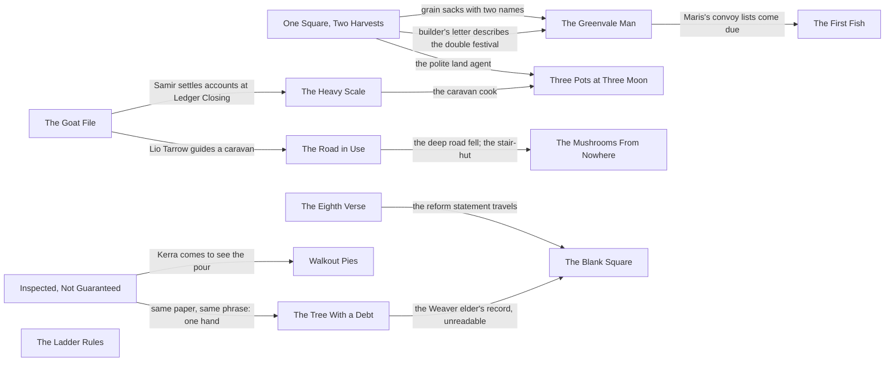

# Collection

## Status

**Provisional collection design and a derived view of the domino web. Writing reference, not setting canon.** This page owns how the fourteen Sunday Morning stories work *as a set*: reading order and calendar, what the reader knows after each story, the cross-story promises, and how the set sits on the domino web. Each story page still owns its own story and its own Larger-world thread; this page shows how they connect.

The calendar and every attribution below are **provisional**. The Villain's identity and plan remain [open questions](../../Open-Questions.md#villain), and [Current Events](../../Story/Current-Events.md) hasn't been audited against a final map. Rules for the world tie are on [Rules](Rules.md#the-world-tie-rule-connected-not-driven).

**Development level: L2 Outlined** at collection level (the THINK and PLAN pass below, 2026-09-27, extended to fourteen stories on 2026-11-02). The first seven stories are drafted to L3. The seven added at bt 7274's request ([D16](Decisions.md#the-authors-decisions)) are planned to L2; see the [story index](../README.md#read-the-stories).

## The collection in one sentence

Fourteen small communities, one bad year: a domino lands in each, and each holds for its own small reasons, while the reader alone watches the pattern gather.

Working title, provisional: *Sunday Mornings in a Bad Year*.

## Reading order

Read in calendar order. Each story stands alone; read in order, they add up to a year. The order follows the ripple chain: grain fails in the autumn of year 1, the effects reach the forges and passes the next spring, and displaced families reach Port by the following autumn.

| # | Story | When | Festival clock | What the reader gains |
| --- | --- | --- | --- | --- |
| 1 | [One Square, Two Harvests](../Stories/One-Square-Two-Harvests.md) | Year 1, early autumn | Harvest Home + Wine Crush | A rumor dies and a polite land agent leaves. It reads as purely local. |
| 2 | [The Greenvale Man](../Stories/The-Greenvale-Man.md) | Year 1, late autumn | Last Sail | A second rumor, on another coast, dies the same way. A sack of Harveston grain turns up in the cove's stores. Maris Bleakshore asks every cove whom it will sail with next season. |
| 3 | [The Goat File](../Stories/The-Goat-File.md) | Year 1, late autumn | Ledger Closing | Credit is tightening somewhere far away. Samir Tareh is in the gallery. |
| 4 | [The Eighth Verse](../Stories/The-Eighth-Verse.md) | Year 1, midwinter | Root Cellar Night | The farms that sold have neighbors. Anger at the buyers becomes a notice that travels village to village; one village won't sing it. |
| 5 | [The Ladder Rules](../Stories/The-Ladder-Rules.md) | Year 1, midwinter | Solstice Lanterns | Far from Greenvale, cities agree on things together, and nobody says who pays. Bahriyya Nazar's name is only a grumble. |
| 6 | [Inspected, Not Guaranteed](../Stories/Inspected-Not-Guaranteed.md) | Year 2, early spring | Forge Reawakening | The tool orders have fallen, and an unsigned offer arrives at exactly the wrong moment. People gossip about someone who took one. |
| 7 | [The Heavy Scale at Icestep Summit](../Stories/The-Heavy-Scale.md) | Year 2, early spring | Pass Opening + Ice Breaking | Samir's survey decides which passes live. The caravan cook complains about mushroom prices. |
| 8 | [The First Fish at Snowbreaker Quay](../Stories/The-First-Fish.md) | Year 2, late spring | First Catch | Maris's convoy lists come due. A buyer's coin for sole access could split two towns; they share instead. |
| 9 | [The Road in Use](../Stories/The-Road-in-Use.md) | Year 2, late spring | Caravan Blessing | The Spine shakes, and a clerk's sentence turns a rockfall into a quarrel. The deep road under the saddle falls too. |
| 10 | [The Tree With a Debt](../Stories/The-Tree-With-a-Debt.md) | Year 2, midsummer | Canopy Vigil + Midsummer Debates | A second unsigned offer, on the same Port paper, in the same turn of phrase. The attentive reader now knows one hand wrote both; nobody in the story does. |
| 11 | [Walkout Pies](../Stories/Walkout-Pies.md) | Year 2, midsummer | Foundry Week | Inspected's short hours have become strike talk, and a rumor nearly picks the worst possible moment. Orin's name comes up again in gossip. |
| 12 | [The Mushrooms From Nowhere](../Stories/The-Mushrooms-From-Nowhere.md) | Year 2, late summer | the late-summer fair | The stair-hut opens. Forest mushrooms are short, and trade without a record goes to people who don't ask questions. |
| 13 | [The Blank Square](../Stories/The-Blank-Square.md) | Year 2, early autumn | Gathering Quiet | The midwinter statement reaches Deepwood with a row of marks on it. Three faiths compare the year and miss what the reader can see. |
| 14 | [Three Pots at Three Moon](../Stories/Three-Pots-at-Three-Moon.md) | Year 2, early autumn | Three Moon Festival | The polite land agent is mentioned by a family who didn't escape him. One street holds. The reader knows more than anyone in it. |

The last column is the **expected reader state**, PLAN's expected-evidence idea applied to the reader. JUDGE checks drafts against it.

## How the stories connect

Every connection rides a real flow in the world (grain, credit, caravans, letters, displaced people), never coincidence. Each story links to at most two others, so none depends on another to be understood. (One Square carries three details, but they reach only two stories.)



The Ladder Rules has no link on purpose: it tests that a story can stand on the world thread alone.

### Cross-story promise ledger

Every line is a promise the reader can check. The links are provisional: a draft that doesn't want one can drop it back to nothing (except C6, which is [D3](Decisions.md)). While a link stands, the setup end is authoritative, and the other end must match it.

| Promise | Set up in (authoritative) | Pays off in | Flow it rides | Must match | Recognition needed? |
| --- | --- | --- | --- | --- | --- |
| **C1** grain sacks stamped *Commons / Press Yard* | One Square, s8 (the grain handed out) | The Greenvale Man, winter stores | Northwind imports grain in winter ([Trade](../../Economy/Trade-and-Dependencies.md#core-model)) | the stamp wording (COMMONS / PRESS YARD and PRESS YARD / COMMONS) | No: a pleasant detail for those who notice |
| **C2** the old builder's letter | One Square, s8 (old Scarth at the joint table) | The Greenvale Man, s1 letter: "they held two festivals at once and ate everything" | Scarth retired to Greenvale; his letter names Harveston Vale | the festival details | No |
| **C3** the polite land agent | One Square, s2 and s8 | Three Pots, Mrs. Arden: "a very polite man bought our notes" | Consolidation continues elsewhere in Greenvale; the Ardens' farm is one that *did* sell, a year after the Vale avoided it | the agent's manner (polite, lunch) | Optional: the line works without it |
| **C4** Samir Tareh | The Goat File, s8 (settling caravan accounts at Ledger Closing; he hears the goat ruling) | The Heavy Scale, s9 (his route book already lists "Seven Wells: water and guides, one roof") | Caravan negotiators settle debts at Ledger Closing | his reason for being at Ledger Closing | No |
| **C5** the Deepwood caravan cook, Garro Sedgewater | The Heavy Scale, s9 (the first caravan's cook, grumbling that mushrooms cost more than meat) | Three Pots, s5 (his verdict on the stews) | He has cooked for caravans since the blight took his village's mushroom harvest; he came over Icestep | his name and grievance | No |
| **C6** the connected offers | Inspected, s4 (Col's patron) | The Tree With a Debt, s5 (Hollis's buyer) | Offers by letter are ordinary; both come through the same Port stationer | unsigned, heavy cream paper, ship's-lantern watermark, "should … fail to recognize" | Yes, for the collection's payoff: the watermark and phrase must be salient in s4 |
| **C7** the reform statement | The Eighth Verse, s2 (Yorick's notice and the circles' joint statement that the buying-up of distressed farms is coordinated theft) | The Blank Square, s3 (on the table, with a row of marks) | Circle and faith letters travel slowly from village to village ([Couriers #10](../../Couriers-Posts-and-Message-Networks.md#10-faith-networks-can-carry-messages-beyond-commercial-corridors)) | the claim ("coordinated theft"); Reedveil Bend's mark isn't on it | No |
| **C8** Maris's convoy lists | The Greenvale Man (her letter: name the coves you'll sail with in convoy next season, "coves whose waters were clean") | The First Fish, s4 and s8 | The convoy season opens in spring | the letter's terms | No |
| **C9** Lio Tarrow | The Goat File (Ebbe's grandson, from Seven Wells, courting Nessa Kesh) | The Road in Use, s4 (guiding the first outbound caravan) | Seven Wells is "water and guides, one roof"; guides hire out to caravans | his family and town; the wedding is mentioned without saying who hosts it | No |
| **C10** Kerra Dunnock | Inspected, s8 (she passes with her blade at Forge Reawakening) | Walkout Pies, s4 (come to watch the great pour) | Smiths travel to see a big casting | a young bladesmith from Stonefield who has just passed | No |
| **C11** the Twilighthollow community record | The Tree With a Debt (the Weaver-path elder writes everything into the community record, Hollis burning the letter included) | The Blank Square, s2 (it arrives soaked and half unreadable) | Weaver houses exchange their year's records | it arrives unreadable; nothing about the letter travels ([D3](Decisions.md#the-authors-decisions)) | No |
| **C12** the lost corridor | The Road in Use, s5 (the stair-hut is shut; the broker didn't come up; the deep road fell in the same shake) | The Mushrooms From Nowhere, s1 (Xenna opens the stair-hut herself) | Underpass trade comes up the stair to the pass town | the stair-hut by the east gate; the broker lost his corridor, not his life | No |

C6 is the collection's only link to the hidden hand ([D3](Decisions.md)), and C11 exists partly to show that it stays that way: the one record that described the second letter reaches another house unreadable. No character connects the two letters; the reader who has read both can. Readers keep gist, not wording, so the phrase gets salience where it first appears (Col reads it aloud to Wurdren in s5), and the watermark gets one concrete sentence in each story.

**Saga link, not a cross-story link:** in Inspected, Wurdren meets the anonymous-patron pattern for the first time. It is the first of the recurring "strange orders, inexplicable resources" his [middle arc](../../Story/Wurdren.md#middle) turns on.

## The web

Each story lands on a different link of the ripple chain that [Current Events](../../Story/Current-Events.md#example-ripple-chain) already describes: piracy raises shipping risk, credit tightens, Greenvale grain stops selling, farms fail, tool orders fall, and so on outward.

The whole web, with every story and seed placed on it and the open dominoes marked, is the [Domino Map](../../../atlas/domino-map/Domino-Map.md) ([interactive version](https://claude.ai/artifact/PAf2C4bDk7bfjVunex17Ps)).


### The threads

A summary of each story page's Larger-world thread; the story page owns the detail. "Behind it" is an out-of-story, provisional attribution that nobody inside a story knows.

| Story | Current event | Domino figure | The nail | Behind it | Local outcome | Outward effect |
| --- | --- | --- | --- | --- | --- | --- |
| [One Square, Two Harvests](../Stories/One-Square-Two-Harvests.md) | Greenvale abundance crisis; unsafe-grain rumors; land consolidation | [Rosana Meadowcroft](../../Story/Villains-Dominoes.md#rosana-meadowcroft--greenvale) (her seed strain) | A rumor that Meadowcroft-seed grain is unsafe, and a land agent circling the Vale's indebted farms | Rumor: Villain-amplified. Land agent: `UNKNOWN` (Council-linked finance or ordinary speculators) | The joint festival eats the grain in public; the Salve house buys and distributes it; no farm sells to the agent | A Greenvale co-op and a Sunplains patron house now trade grain together, a precedent rivals could later read as a bloc forming ([Bahriyya's domino](../../Story/Villains-Dominoes.md#bahriyya-nazar--sunplains)) |
| [The Greenvale Man](../Stories/The-Greenvale-Man.md) | Northwind piracy; accusations that clans shelter raiders; convoy politics | [Maris Bleakshore](../../Story/Villains-Dominoes.md#maris-bleakshore--northwind) (her call for convoy patrols) | "It is said" Narrow Sound shelters raiders; some want the regatta cancelled | Villain-amplified rumor | Old Rask asks who *saw* it; nobody did; the coves race anyway | Two coves still sailing together is one less "credible" report feeding the patrol push |
| [The Goat File](../Stories/The-Goat-File.md) | Port credit tightening; Highridge caravan attacks cutting trade | none | Lenders will renew Seven Wells' credit only if deferred claims are cleared | Council finance stabilizing lenders (ordinary pressure, not a scheme) | The file closes with no house losing face; a caravan house and a cistern house will join | A joined house can offer caravans water and guides together, just as routes are being redrawn |
| [Inspected, Not Guaranteed](../Stories/Inspected-Not-Guaranteed.md) | Tool orders fall; forges on short hours; strike talk; good steel vanishing into private contracts | [Orin Slatehallow](../../Story/Villains-Dominoes.md#orin-slatehallow--ironcrest) (the pattern Col nearly follows) | An anonymous patron offers Col funding "should the guild fail to recognize" his work | Villain (provisional): the same approach that took Orin | Col passes his judgment, so the letter goes unanswered; Wurdren notices it | One skilled repairer stays independent; Wurdren has seen his first "convenient offer" |
| [The Heavy Scale at Icestep Summit](../Stories/The-Heavy-Scale.md) | Caravan attacks; route redirection | [Samir Tareh](../../Story/Villains-Dominoes.md#samir-tareh--highridge) (travels with the first caravan) | Samir is judging which passes are reliable this season; a crooked scale would strike Icestep from his list | The scale fault is weather; the concentration pressure is the Villain's pattern | A public correction; Samir lists Icestep as honest | Traffic stays spread across more than one pass, blunting the concentration the domino needs |
| [The Tree With a Debt](../Stories/The-Tree-With-a-Debt.md) | Deepwood road and logging conflict; Council infrastructure interest | [Naruin Mossglade](../../Story/Villains-Dominoes.md#naruin-mossglade--deepwood) (Sessa's senior warden) | An unnamed buyer offers to purchase old pledges along a proposed road; whoever holds a "for as long as it stands" pledge profits if the tree falls | The Villain, through a Port intermediary: the same hand as Col's patron. The pledges are meant to become leaked evidence for Naruin | Hollis renews the pledge as guardianship instead of selling | Sessa brings Naruin a working counterexample: a negotiated path and a Highridge family sworn to a tree |
| [The Eighth Verse](../Stories/The-Eighth-Verse.md) | Land and seed politics: reformers call the buying-up coordinated theft (ripple step 8) | none | A reform circle's notice: an eighth verse about "cellar rats", and a signature | The buyers' guilt `UNKNOWN`; reformers sincere, their funding `UNKNOWN` | The Bend sings the seventh verse at the Kembles' door and signs nothing | The statement travels on; villages that sign refuse tools from the buyers' suppliers, adding to the fall in Ironcrest orders |
| [The Ladder Rules](../Stories/The-Ladder-Rules.md) | Drought anxiety and oil hoarding; city-state coordination | [Bahriyya Nazar](../../Story/Villains-Dominoes.md#bahriyya-nazar--sunplains), offstage ("the Nazar rule") | A joint lamp standard, "two to a ladder", with nothing said about who pays the second | Coordination sincere; who timed the standard `UNKNOWN` | The footers are counted and paid in lamp-oil; the lamps are lit | A rival city reads Vasselin's lit night as joining Bahriyya's bloc |
| [The First Fish at Snowbreaker Quay](../Stories/The-First-Fish.md) | Fish stocks shift; convoy politics | [Maris Bleakshore](../../Story/Villains-Dominoes.md#maris-bleakshore--northwind), offstage (her lists) | A Frostbay buyer's coin for sole access to Skerrimouth's water | Why the fish moved `UNKNOWN`; the buyer's backer `UNKNOWN` | Fish for fires; each town on the other's convoy list | Another town took the offer, and the convoy hears of Frostbay boats on Northwind water |
| [The Road in Use](../Stories/The-Road-in-Use.md) | Spine earthquake; Underpass route wars | none | The route authority's letter: tolls "reckoned on the road in use at the blessing" | The quake is nature; the letter's intent `UNKNOWN` | The pony won't take the bypass; the town clears the old road; the tower claim goes to arbitration | The deep road is gone, and the growers below have to find another way up |
| [Walkout Pies](../Stories/Walkout-Pies.md) | Labor unrest (ripple steps 10 and 11) | [Orin Slatehallow](../../Story/Villains-Dominoes.md#orin-slatehallow--ironcrest), as gossip | A rumor that the owners hired outside carters to replace the crews, pushing the walkout to the great pour | The rumor's source `UNKNOWN`; strike timing is a lever the hidden powers can use | The carters are fed; the rumor dies at the long table; the walkout comes after the Week, with notice | In another valley the walkout hit the pour; owners and crews blame each other there |
| [The Mushrooms From Nowhere](../Stories/The-Mushrooms-From-Nowhere.md) | Underpass route wars; fungal disruption | none | The fair's blight-year mark rule, and a dealer's offer to pass cellar mushrooms off as forest ones | The blight's cause and reach `UNKNOWN`; the dealer's buyers `UNKNOWN` | A named stall and a new line in the fair book | Other enclaves sell through dealers, and their goods go off the record |
| [The Blank Square](../Stories/The-Blank-Square.md) | Religious networks; logging and road conflict | [Naruin Mossglade](../../Story/Villains-Dominoes.md#naruin-mossglade--deepwood), offstage, first name on the road statement | Two joint statements asking a house to mark what it didn't see | Who steers the statements `UNKNOWN`; the faiths see only disagreeing numbers | A blank square; neither statement signed | Other houses sign both, and the plateau reads a row of Weaver marks as Deepwood lining up against roads |
| [Three Pots at Three Moon](../Stories/Three-Pots-at-Three-Moon.md) | Refugee and worker pressure; smuggling surge; Deepwood fungal disruption | none | A street rumor that the newcomers next door are smugglers, while inspectors are fining unpermitted stalls | Ordinary prejudice | The first bowl goes to the newcomers; Jory files their permit | Three Moon does its civic job on one street: incompatible people share one space |

### Where the nail still fell

Every story holds its own ground, but the same nail succeeds somewhere just offstage. A web where every domino misses would be too tidy, and the Villain's plan too weak to matter. Each of these appears in its story as one line at most, never as the story's subject ([tone guardrails](Rules.md#tone-guardrails)).

| Story | Holds here | Still falls elsewhere |
| --- | --- | --- |
| One Square, Two Harvests | No Vale farm sells to the land agent | Farms elsewhere in Greenvale do; the Ardens in Three Pots are one of them |
| The Greenvale Man | Kettle Cove races Narrow Sound | Other coves take the rumor and leave Narrow Sound out of their convoy |
| The Goat File | Seven Wells closes its file without ruin | In other towns, forced closures ruin families; the tea seller has heard of two |
| The Eighth Verse | Reedveil Bend won't sing the verse | Other villages sing it, and sign |
| The Ladder Rules | Vasselin's lamps are lit | In another city they went dark that night |
| Inspected, Not Guaranteed | Col never answers the letter | Orin Slatehallow already answered his |
| The Heavy Scale | Icestep stays on Samir's list | Another pass town, with a genuinely bad scale, comes off it |
| The First Fish | Skerrimouth turns down the Frostbay coin | A town further up the coast takes it |
| The Road in Use | The toll stays with the town gate | The deep road under the saddle is gone for good |
| The Tree With a Debt | Hollis won't sell | The buyer has already bought other pledges along the planned road |
| Walkout Pies | Coalglen's pour goes | Another valley's pour is lost to a walkout |
| The Mushrooms From Nowhere | Underwell sells under its own name | Other enclaves sell through dealers, off the record |
| The Blank Square | Larchmere signs neither statement | Other Weaver houses sign both |
| Three Pots at Three Moon | One street shares its space | The smuggling rumors keep running on the next street over |

### The view from the desks

Out of story: what each hidden power could conclude from the seven events, following [World Rules §12](../../World-Rules.md#12-every-major-event-should-have-second--and-third-order-effects). Written for the saga's use, and provisional because the Villain's plan is [open](../../Open-Questions.md#villain).

| Story | The Villain's desk sees | The Council's desk sees |
| --- | --- | --- |
| One Square, Two Harvests | A rumor that didn't take in one valley. Noise. | A Sunplains patron house buying Greenvale grain directly. It looks like the start of cross-border consolidation, and the Council might quietly tighten the Salve house's credit. The Villain could then point to that squeeze as proof that the Council punishes Sunplains cooperation. |
| The Greenvale Man | One cove refused the Narrow Sound story. Noise. | Nothing. Northwind convoy patrols are growing, and one regatta changes no ledger. |
| The Goat File | Nothing. | A town cleaned its books under credit pressure without a scandal: the system working as intended. |
| The Eighth Verse | One village didn't sign. The statement has plenty of marks without it. Noise. | A reform statement calling the buyers thieves is circulating. Some Council families might want the buyers seen to slow down; others might want the circles watched. |
| The Ladder Rules | A coordinated standard caused a stand-down in one city and not another. Useful either way, since a rival city now reads Vasselin as Bahriyya's. | Joint standards spreading across the Sunplains talks. It's worth watching how fast cities adopt them. |
| Inspected, Not Guaranteed | One talent declined the patron. Noise, unless it repeats. | Nothing. |
| The Heavy Scale | A pass he expected to lose traffic kept it. Mildly inconvenient. | A route stayed open. Welcome, and unexamined. |
| The First Fish | Two towns that might have split now sail together. Noise, but it's the second Northwind refusal. | A sole-access contract turned down. Nothing. |
| The Road in Use | Nothing. A quake is a quake. | A toll quarrel settled locally and sent to arbitration. Nothing. |
| The Tree With a Debt | One pledge refused, and Naruin now holds something that argues against the escalation the leaks were meant to provoke. Worth watching. | Pledges changing hands along its planned right of way. The Council assumes ordinary speculators and may pay more to clear them, a misreading the Villain can use. |
| Walkout Pies | A walkout that could have been sharp came with notice instead. Mildly inconvenient. | Strike talk in two valleys, one costly. The Council's desk may read the costly one as the pattern. |
| The Mushrooms From Nowhere | Nothing. | A fair book with a new line for goods grown below. Nothing yet. |
| The Blank Square | One house didn't sign. The row of marks is long anyway. | A long row of Weaver marks against the road arrives on the plateau. The Council's desk may read it as Deepwood organizing. |
| Three Pots at Three Moon | Nothing. | Nothing. |

Individually, every entry is noise. Together they are the kind of pattern the [Villain's page](../../Story/Villain.md#relationship-to-wurdren) says he eventually notices: people repairing connections without being paid or coerced. That realization belongs to the saga, not to any Sunday Morning story.

### What the web adds

Taken together, the fourteen stories are places where a domino should have fallen and, mostly, didn't, because people acted for small local reasons. That is the setting's claim about ordinary decency ([Villain's Dominoes](../../Story/Villains-Dominoes.md#wurdrens-effect): changing relationships, not knocking dominoes backward). Several show the other side. Harveston Vale's good outcome may feed a later suspicion, and Icestep's honest scale is only one pass among many. Vasselin's lit night is read abroad as joining a bloc. The statements Reedveil and Larchmere wouldn't sign travel on with other villages' marks, and Coalglen's walkout is postponed, not prevented.

## Development record

### Stage 1 — THINK (collection level)

**Reasoning allocation:** structured single path plus reserve methods. THINK's tests didn't earn extra methods by default. Here they were used at the author's request, each tied to a specific failure signal found in the collection, which is THINK's rule for bringing reserve methods in.

| Method | Failure signal it answers | Finding |
| --- | --- | --- |
| **Frame challenge** | Are these seven separate stories, or one work? | A linked cycle, read in calendar order, each story standalone. The collection's arc is the reader's growing knowledge, not any character's. |
| **Systems thinking** | The stories touched the domino chain but not each other: seven spokes, no rim. | Links must follow real flows (grain, credit, caravans, letters, displaced people). Six links meet that test; see the ledger. |
| **Inversion / premortem** | Every nail fails. The web is too tidy, and the Villain would never be that unlucky. | Local holds, the system still moves. In every story the same nail succeeds just offstage; see [Where the nail still fell](#where-the-nail-still-fell). |
| **Perspective shift** | Nobody had looked at these events from the Villain's or the Council's side. | Recorded as [the view from the desks](#the-view-from-the-desks). Individually each story is noise; together they are the kind of noise the Villain's canon arc says he eventually notices. |
| **Abduction** | What should an attentive reader be able to infer, and when? | By The Tree With a Debt (story 10 since the 2026-11-02 extension), "someone is behind the offers" is the best explanation available; nothing in the stories confirms it. See the reading order. |
| **Counterexample search** | Do the links become coincidence? | Rejected: Wurdren appearing in a second story (no flow puts him there); the land agent appearing in person in Port (he'd have no reason to be there). Kept only links a trade or travel route explains. |

**PLAN handoff**

```text
frame             a linked cycle: seven communities, one year, one domino web the characters never see
selected strategy calendar reading order; each story linked to ≤2 others, each link on a real flow; local holds, system moves
alternatives      A a shared protagonist (Wurdren) across stories — set aside: breaks rule 20 and his canon arc
                  B no links at all — set aside: the collection would not add up to a year
                  C every link explicit — set aside: stories would stop standing alone
assumptions       calendar and all attributions provisional
decided           the two offers are connected (the author, 2026-09-27; D3)
reconsider if     any story needs another to be understood; a link feels like coincidence in draft;
                  the reader's inference arrives before The Tree With a Debt or never
```

### Stage 2 — PLAN (collection level)

**Decomposition:** one drafting task per story. No finer breakdown is needed: cross-links are cameos and details, not plot dependencies. Any story can be drafted independently; the ledger's authoritative end settles any mismatch.

**Reconsideration triggers**

- A draft needs another story's events to make sense → cut the link back to a detail (PLAN).
- Readers of story 1 alone sense a conspiracy → the rumor reads too pointed; soften it (THINK on that story).
- The collection reads as seven identical "the town holds" endings → vary the endings' cost (THINK). The [Registry's story shapes](Registry.md#story-shapes) track this now.

### Extension to fourteen stories (2026-11-02)

bt 7274 asked for more stories, "inside the same year", and for seven of them, one in each of the gaps the [Domino Map](../../../atlas/domino-map/Domino-Map.md) showed ([D16](Decisions.md#the-authors-decisions)). Each went through the pipeline to L2 on its own page. This is the collection-level check.

**Calendar.** The year had no stories in midwinter, late spring or late summer. The seven fill them: two in midwinter, two in late spring, one each in midsummer, late summer and early autumn. Every season from Year 1 early autumn to Year 2 early autumn now has a story, most have two in different regions, and no festival is used twice.

**Shape check** ([Pipeline](Pipeline.md#collection-shape-check-for-a-set-of-stories)): each new story differs from both neighbors in reading order on at least three of the [shape columns](Registry.md#story-shapes). The seven add five new ways of resolving a story (a performance, a count, a swap, an animal, an absence), plus a meal as the engine rather than the landing, and a choice. None uses a language habit as its running element. None has a clerk or records person as protagonist, and none repeats the polite antagonist.

**Links.** Six new ledger rows (C7–C12), each on a real flow. Each story still links to at most two others. Garro Sedgewater was considered for The Mushrooms From Nowhere and set aside, because it would have linked The Heavy Scale and Three Pots to three stories each.

**Hidden hand.** No new story touches C6. A third letter on the ship's-lantern paper was considered for Walkout Pies and set aside; it would turn D3's pair into a pattern, which is bt 7274's call.

**Reconsideration triggers added**

- A reader of the fourteen in order senses the hidden hand before The Tree With a Debt → find which new story leaks it and soften that story's nail (THINK on that story).
- Two midwinter stories in a row feel like one winter story told twice → make the two winters look different on the page: Reedveil's cellars and frozen reeds, Vasselin's dry cold and long dusk (DO).
- The new links read as a cast reunion (Lio, Kerra, Zan) → cut one cameo back to a mention (PLAN).
